# Dossier informatiu Boicot ICL — versió actualitzada (novembre–desembre 2025)

> **Notes de conversió**
> - Transcripció del PDF de 27 pàgines (capa de text neta). Els marcadors `<!-- pdf p.N · imprès p.M -->` indiquen la pàgina del PDF i la numeració impresa (PDF − 3).
> - La portada diu «Novembre 2025» però el text inclou fets de **desembre de 2025** (abandonament del projecte de bateries a Sallent; premi «Defense Minister's Shield»). És, doncs, una versió actualitzada del dossier de novembre.
> - Respecte a la versió anterior del KB (`dossier-general`, 24 pp.): xifra de **110 habitants** del barri de l'Estació i fórmula «**diversos accidents mortals en les últimes dècades**» (sense xifra de morts); veure `auditoria-web-vs-fonts.md`.
> - Els errors tipogràfics de l'original es mantenen tal com són (p. ex. «Barri de l'estació», «Mart Mort», «col·lecor»), llevat dels peus de foto, on s'han corregit mínimament.
> - Les imatges són les incrustades al PDF, comprimides; les captures de pantalla d'altres webs (Highergov, HispanTV, ICL) es mostren només com a evidència documental.

<!-- pdf p.1 · portada -->

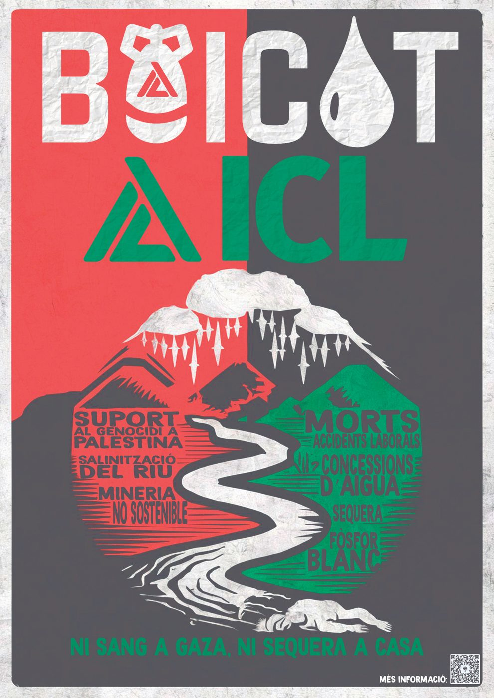

**Dossier informatiu Boicot ICL · Novembre 2025**

<!-- pdf p.2 · imprès p.— (índex) -->

## Índex

- Introducció — p. 1
- Què és ICL — p. 3
- ICL als Països Catalans i a l'Estat espanyol — p. 3
  - ICL Iberia Súria — p. 3
  - ICL Iberia Barcelona Port — p. 3
  - ICL Specialty Fertilizers — p. 4
  - Fomento y Desarrollo Agrícola, S.L. (FOMDESA) — p. 4
  - Projecció d'una nova fàbrica de components de bateries elèctriques a Sallent — p. 4
- Vincle entre ICL i l'ocupació militar de Palestina — p. 5
  - Identificació amb el projecte sionista i suport econòmic d'Israel — p. 5
  - Accionariat — p. 5
  - Extracció recursos naturals palestins i contaminació del territori — p. 6
  - Contribució en l'economia de les colònies a Cisjordània — p. 8
  - Bombes de fòsfor blanc — p. 9
  - Suport a l'exèrcit d'Israel — p. 11
  - Un president provinent de la indústria militar — p. 13
- Danys medioambientals i al territori — p. 14
  - Salinització del riu i aqüífers — p. 14
  - Runams salins — p. 14
  - El col·lector de salmorres — p. 15
  - Ús de l'aigua — p. 15
  - Potabilitzadores que han de dessalar el Llobregat — p. 16
  - Barri de l'estació — p. 16
  - Contaminació amb metalls pesants — p. 16
  - Agroindústria — p. 16
  - Greenwashing i cotxes elèctrics — p. 17
- La campanya de Boicot a ICL s'emmarca en la campanya internacional de BDS — p. 18
- Demandes de la campanya — p. 19
- Referències — p. 20

<!-- pdf p.3 · agraïments -->

> Gràcies a totes les persones i col·lectius que han participat en la creació d’aquest dossier i que segueixen sostenint la lluita contra ICL.

<!-- pdf p.4 · imprès p.1 -->

## INTRODUCCIÓ

Vivim temps convulsos, on la fase imperialista del capitalisme provoca guerres, augment de l'explotació, l'espoli i el malbaratament dels recursos naturals.

A Palestina hem presenciat un genocidi televisat, en forma de bombardejos massius, múltiples massacres, fam planificada, detencions i tortures. Malgrat les protestes globals i les advertències d'organismes de les Nacions Unides i les ordres de detenció de la Cort Penal Internacional, l'Estat d'Israel gaudeix d'una impunitat gairebé absoluta per cometre tal barbàrie. Això és degut al fet que compta amb el suport i la complicitat diplomàtica, militar i econòmica dels governs dels Estats Units, dels estats de la Unió Europea, i de retruc de molts altres estats, incloent Egipte, Jordània, Aràbia Saudita i altres. Així com de grans empreses multinacionals que es lucren de la seva economia de l'ocupació militar.

Conscients de la importància de tal impunitat i complicitat, des de l'any 2005 un ampli consens de les organitzacions de la societat palestina fa una crida a una campanya internacional de Boicot, Desinversions i Sancions (BDS) contra l'Estat d'Israel, per tal d'exercir pressió sobre Israel per posar fi a l'ocupació militar i actualment el genocidi.

És en el marc d'aquesta campanya que es crea la campanya de Boicot a ICL. Israel Chemicals Ltd (ICL) és una multinacional israeliana que té presència als Països Catalans i a l'Estat espanyol a través de l'explotació de les mines de potassa de Súria (Bages) i la presència al Port de Barcelona, de la producció i comercialització de fertilitzants des de Múrcia, i d'un projecte de producció de components de bateries elèctriques a Sallent (Bages).

ICL és un dels principals motors de l'economia de l'Estat d'Israel, sobretot a la zona del Nègueb, al voltant de la Franja de Gaza, amb l'explotació de mines de potassa i fosfats. A part d'explotar els territoris ocupats de la Palestina del 48 (l'actual Estat d'Israel), també té un impacte directe en els territoris ocupats de Cisjordània, sobretot pel que fa a l'explotació del Mar Mort i al desenvolupament agrícola de les colònies de la Vall del Jordà. Manté diversos programes de suport als soldats de l'exèrcit israelià que han comès el genocidi a Gaza, la seva filial dels Estats Units comercialitza el fòsfor blanc que acaba sent utilitzat per les bombes de l'exèrcit israelià, i diversos accionistes i directius tenen un vincle directe amb la indústria militar israeliana.

És per aquests motius que impulsem el boicot a ICL, tal com s'ha impulsat a altres països on té presència com els EUA o el Brasil. Per contribuir a la pressió de la campanya del BDS i per impedir que els guanys que ICL extreu del nostre territori serveixin per finançar el genocidi.

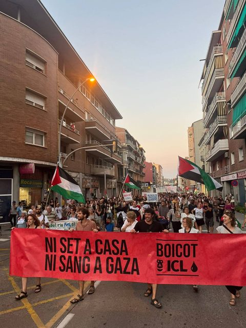
*Manifestació a Manresa, setembre 2025.*

<!-- pdf p.5 · imprès p.2 -->

Paral·lelament, ICL ha estat denunciada i condemnada judicialment per contaminar les aigües de diferents rius i aqüífers del nostre territori, incloent-hi el Llobregat, amb els seus residus salins miners. Tot i les sentències condemnatòries, el seu poder corporatiu i la complicitat amb els governs, sobretot amb els diferents que han passat per la Generalitat de Catalunya, ha fet que avui dia encara no hagi restaurat les muntanyes de residus i que la seva producció en continuï generant. Fet que contribueix a expandir l'ecocidi que vivim, en aquest cas vinculat a la contaminació i malbaratament de l'aigua dolça.

Aquest poder corporatiu li ha permès utilitzar la compra de mà d'obra com a element de xantatge per seguir les seves males pràctiques mediambientals, així com per introduir diferents elements de precarietat laboral que han provocat un alt índex de sinistralitat inclús mortal.

La campanya de Boicot a ICL pretén denunciar i impedir que aquesta multinacional israeliana mantingui les seves activitats econòmiques al nostre territori mentre segueixi el seu vincle amb l'ocupació militar i el genocidi a Palestina, i mentre contamini el territori i vulneri els drets laborals.

Per això demanem a tots els agents econòmics, polítics i socials que mantinguin vincles amb aquesta empresa, que els aturin. I a tothom que pugui difondre la campanya de denúncia que ho faci. Perquè contribuir a aturar la font d'alimentació del genocidi a Palestina hauria de ser un deure d'imperatiu moral. I perquè no podem permetre que les multinacionals ens contaminin el territori i ens facin xantatge amb els llocs de treball.

La campanya BDS és efectiva. El mateix informe financer anual d'ICL de 2022 admet que en ser una empresa israeliana es pot veure afectada "pel boicot econòmic o altres sancions sobre els seus productes".

En l'últim any (2024-2025) hem aconseguit que entitats culturals com el Teatre Kursaal de Manresa i educatives com la UManresa (vinculada a la Universitat de Vic) tallin els seus vincles pels motius exposats. És una tasca difícil perquè sovint es perceben beneficis en mantenir els vincles. Però el nivell de barbàrie és tal que cap d'aquests beneficis ho hauria de compensar.

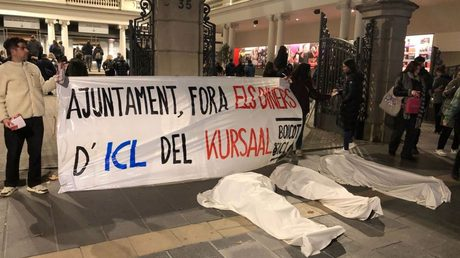
*Concentració davant el teatre Kursaal de Manresa el març del 2025.*

<!-- pdf p.6 · imprès p.3 -->

## QUI ÉS ICL?

Israel Chemicals Ltd. (ICL Group) és una empresa multinacional israeliana que desenvolupa, produeix i comercialitza fertilitzants, metalls i altres productes químics d'ús especial. Destaca per la producció de potassa. El seu origen parteix de l'establiment d'un projecte miner a la zona del Mar Mort abans de la creació de l'Estat d'Israel. Un dels seus fundadors, Moshe Novomeysky, sionista convençut, va ser tresorer de l'Haganah (grup paramilitar sionista) el 1921–1922. L'any 1951, ja creat l’Estat d’Israel, l’empresa minera és nacionalitzada i rebatejada com a Dead Sea Works. El 1968 es crea ICL com a empresa governamental que uneix diferents empreses mineres i químiques, entre elles Dead Sea Works. A partir dels anys 90 del segle XX ICL és privatitzada, i el 1999 la família Ofer (una de les més riques d'Israel) obté la majoria de les accions del grup inversor Israel Corporation, qui posseeix la majoria d'accions de ICL. Idan Ofer, qui actualment dirigeix Israel Corporation, és una de les persones més riques d’Israel (fortuna valorada en 20.000 milions de dòlars).

ICL va entrar a Catalunya l'any 1998. A partir de la privatització de l’empresa pública minera, adquireix els drets d’explotació de les mines de potassa de Súria i Sallent (Bages), sota el nom de Iberpotash. Posteriorment, adopta el nom de ICL Iberia i adquireix diverses empreses de l'agroindústria a la Regió de Múrcia.

Amb data de 2023 ICL factura un total de 332 milions d'euros a l'Estat espanyol. Situant-la en l'empresa que més factura del Bages. D’aquesta quantitat, 162 milions d'euros van ser de vendes reportades per Fuentes Fertilizantes, convertint-la en la segona companyia amb volum més alt de facturació en la zona de la regió murciana en què s'assenteixi. En total, l’any 2024 ICL Iberia va tenir 879 treballadors, segons fa constar al seu informe de responsabilitat corporativa.

## ICL ALS PAÏSOS CATALANS I A L'ESTAT ESPANYOL

### ICL Iberia Súria

L'any 1998 ICL (amb el nom d'Iberpotash) compra les empreses i els drets d'explotació de les mines de potassa de Súria i Sallent/Balsareny. Després de tancar la seva activitat a Balsareny i Sallent l'any 2020, a causa de les sentències judicials per la mala gestió dels residus, l'acumulació d'accidents laborals, alguns mortals, i l'objectiu productivista de centrar-se en altres pous, ICL concentra tota la seva extracció minera de potassa a la mina de Cabanasses de Súria. Segons les seves pròpies fonts, produeix aproximadament un milió anual de tones de potassa, el 80% per a l'exportació.

### ICL Iberia Barcelona Port

El 2020 inaugura la terminal portuària ICL Iberia Barcelona Port (Tramer), situada al Port de Barcelona, amb una superfície de 7 hectàrees i 14 metres de calatge. Fet que li permet ampliar la seva capacitat exportadora de la potassa extreta a la mina de Súria, passant d'una capacitat de càrrega de vaixells de 800.000 tones a 4 milions.

ICL manté un contracte amb l'empresa Ferrocarrils de la Generalitat de Catalunya (FGC) pel transport de la potassa des de la mina de Súria fins al port de Barcelona. Compta amb una línia pròpia des de la mina fins a Manresa, on s'incorpora a la infraestructura viària de passatgers i mercaderies de FGC. El 2019 va ser renovat per un període de 30 anys i li permet l'ús de 4 trens diaris de 21 vagons amb circulació els 7 dies de la setmana.

<!-- pdf p.7 · imprès p.4 -->

### ICL Specialty Fertilizers

El 2011 ICL adquireix el grup empresarial Agromediterráneo (Fuentes Fertilizantes) amb fàbriques a Totana i Cartagena (Múrcia), considerat el major productor de l'Estat espanyol en fertilitzants especialitzats sòlids i líquids. I passa a treballar amb distribuïdores dels nous productes de la marca ICL arreu de l'Estat espanyol. Mitjançant aquesta empresa, ICL rep, transforma i comercialitza les matèries primeres que importa des de territoris palestins ocupats. L’empresa té al voltant de 300 treballadors a Totana, segons fonts locals, si bé d’altres informen d’un número entre 44-50 (any 2024).

### Fomento y Desarrollo Agrícola, S.L. (FOMDESA) i Logística de Fertilizantes Fuentes , S.A.

Per articular la recepció de materials com àcid fosfòric i potassa des d’Israel, ICL, compta amb aquesta empresa per dur a terme operacions portuàries de descàrrega i col·labora activament amb d’altres per la consigna dels enviaments, tals com el grup Pèrez y cía. o Ership S.A.U. A Cartagena, FOMDESA té una seu dins del port (dàrsena d’Escombreras) i d’altra dins de la ciutat, al barri de San José Obrero (Los Patojos). L’empresa consta com ocupadora d’entre 20 i 100 treballadors (any 2024).

D’altra banda, Logística de Fertilizantes Fuentes s’encarrega de l’explotació de serveis de transport per carretera nacionals i internacionals. Aquesta empresa consta com ocupadora de 31 treballadores. Les tres empreses podrien fer el total de 300 treballadors esmentats abans.

### Projecció d'una nova fàbrica de components de bateries elèctriques a Sallent

El gener de 2025 ICL anuncia el seu nou projecte d'instal·lar una fàbrica de components de bateries elèctriques (càtodes) a Sallent, en els terrenys on actualment es troben les instal·lacions mineres tancades. El projecte compta amb la col·laboració de l'empresa xinesa Dynanonic, i ja ha rebut 18 milions d'euros de subvenció pública a través del PERTE del Vehicle elèctric del Ministeri d'Indústria i Turisme.

El desembre de 2025, ICL va anunciar que s’havia abandonat el projecte.

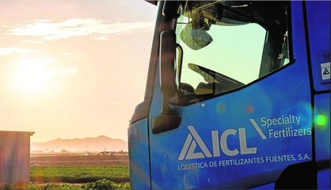
*Camió ICL Specialty Fertilizers.*

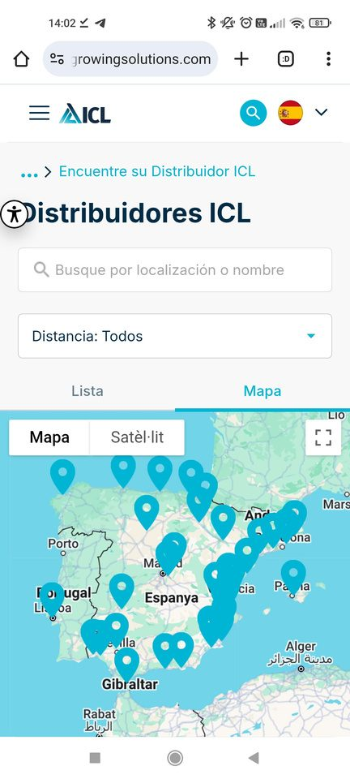
*Mapa de les diferents distribuïdores a la Península Ibèrica.*

<!-- pdf p.8 · imprès p.5 -->

## VINCLE ENTRE ICL I L’OCUPACIÓ MILITAR DE PALESTINA

### Identificació amb el projecte sionista i suport econòmic d'Israel

L'activitat principal d'ICL a Israel és la mineria de potassa al Mar Mort i de fosfats al Nègueb, així com la comercialització de fertilitzants. Segons declaracions de la mateixa empresa, aporta una gran quantitat de recursos econòmics a l’Estat d’Israel, sobretot a la zona desèrtica del Nègueb, considerada un referent històric del colonialisme sionista.

En un article de desembre de 2023 en el seu blog de la matriu israeliana s’exposa: «La història d'ICL està entrellaçada amb la història d'Israel i l'empresa està profundament compromesa amb l'estat i els seus principis d'unitat i solidaritat».

El 2020 ICL va publicar un informe sobre el seu impacte a l’Estat d’Israel, destacant la seva aportació a l’1,2% del PIB israelià i erigint-se la «columna vertebral econòmica del Nègueb». I posant en valor que el 95% dels ingressos d’ICL, que provenen de les exportacions, contribueixen a la balança de pagaments d’Israel.

L’any 2024, va reportar que també contribueix al desenvolupament del turisme en la regió del Mar Mort creant milers de llocs d’ocupació. En aquest mateix informe, es diu que “la majoria dels ciutadans israelians tenen una participació directa o indirecta en ICL a través dels seus plans d'estalvi per a pensions i fons de previsió, sent les accions de ICL una pedra angular de la Borsa de Valors de Tel-Aviv.

### Accionariat

Des de la privatització de ICL a partir de l'any 1992, el seu control accionarial l'ha mantingut el conglomerat empresarial Israel Corporation, actualment en mans del magnat israelià Idan Ofer. Entre els accionistes minoritaris s'hi troben empreses financeres com Altshuler Shaham Investment House i The pohoenix holdings Ltd., les quals també tenen inversions en la indústria armamentística israeliana a través d'accions a l'empresa Elbit Systems.

L’Estat d’Israel manté una clàusula especial per evitar que un grup no israelià prengui control accionarial de l’empresa. El seu principal accionista, Idan Ofer, un dels hereus de la fortuna familiar de Sammy Ofer, és una de les persones més riques d’Israel (té una fortuna valorada en 20.000 milions de dòlars), qui actualment posseeix accions d’un seguit de conglomerats empresarials, incloent-hi Israel Corporation i Kenon Holdings, així com les navilieres Eastern Pacific Shipping, XT Shipping i Ace Tankers.

L’octubre de 2023, en plena operació de genocidi a Gaza, juntament amb la seva parella, va dimitir de la Junta executiva de la Kennedy School of Government de la Universitat Harvard per pressionar la universitat per no haver reprimit una associació estudiantil que en una carta va denunciar l’ocupació israeliana com a causa del conflicte. Seguidament, van renunciar al donatiu que tenien previst fer a la universitat i van fer un donatiu a l’associació israeliana «Brothers in arms», qui després dels atacs del 7 d’octubre va posar tota la seva infraestructura a recolzar les víctimes de l’atac i els soldats enviats a Gaza.

<!-- pdf p.9 · imprès p.6 -->

Els estudiants de Harvard firmants de la carta foren pressionats i perseguits per un grup de magnats que va amenaçar-los en excloure’ls de tot lloc de treball, i les seves imatges foren difoses en un camió publicitari pel campus de la universitat.

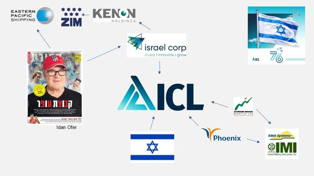
*Accionariat d’ICL.*

### Extracció recursos naturals palestins i contaminació del territori

Com a empresa extractivista israeliana, podem considerar que totes les explotacions d’ICL a la Palestina històrica són explotació de recursos de territoris ocupats. ICL, amb la seva filial ICL Dead Sea, explota els recursos minerals potàssics del Mar Mort, a través de les salines situades a la bassa sud, a causa de la pèrdua d’aigua del Mart Mort ha quedat separada de la bassa més gran del nord. Amb la seva filial ICL Rotem extrau minerals de roques de fosfats de les mines de Rotem, Oron i Zin, situades prop del Mar Mort dins del desert del Nègueb.

Tota la zona de la part del Mar Mort que quedaria dins de Cisjordània, on se suposa que s’hi ha de constituir l’Estat palestí juntament amb la Franja de Gaza, es troba en l’anomenada «àrea C». Aquesta àrea es troba sota ocupació militar i és administrada únicament per autoritats israelianes, fet que impedeix qualsevol activitat o accés al Mart Mort per part de la població i administracions palestines.

Tal com denuncia Who Profits, ICL desvia aigua a través d’un canal des de la bassa del nord cap a la del sud, contribuint a l’extracció d’aigua i recursos de la part que hauria de quedar en territori administrat per l’Autoritat Palestina.

Segons un informe del Banc Mundial de 2013, si Palestina pogués explotar els recursos del Mar Mort, podria obtenir uns 918 milions de dòlars l’any, gairebé l’equivalent a tot el sector manufacturer palestí. Això sense comptar els beneficis derivats del turisme a la zona del Mar Mort.

Tots aquests materials extrets de territoris palestins ocupats són comercialitzats i arriben, entre d’altres, a destins com l’estat espanyol, i més en concret a l’àrea del sud-est del Llevant (Regió de Múrcia), fent així còmplice al sector de l’agroindústria i als governs que permeten aquest comerç.

<!-- pdf p.10 · imprès p.7 -->

L’aigua és un bé escàs i l’ocupació israeliana l’utilitza per al seu projecte colonialista en detriment de la població palestina. Ha construït l’Aqüeducte Nacional d’Israel, que transvasa aigua dolça del Mar de Galilea per abastir les ciutats i assentaments del Nègueb, on també hi ha les mines d’ICL. Privant d’aigua el Riu Jordà, qui alimenta el Mar Mort. Així, Israel priva la població palestina de l’accés als recursos hídrics del riu Jordà, tant pel regadiu dels cultius com pel consum humà.

Les diferents explotacions mineres d’ICL al Mar Mort i al desert del Nègueb han rebut nombroses denúncies mediambientals. Fet que suposa que a part d’explotar recursos de la Palestina històrica, n’està contaminant el territori. A inicis de 2023 ICL Rotem fou situada al primer lloc de la llista de delinqüents mediambientals emesa pel Ministeri de Protecció Ambiental d’Israel, per les repetides violacions de la llei i les regulacions cada any, del 2019 al 2021. Referint-se a l'abocament d'aigües residuals, la infraestructura i les emissions excessives a l'aire. El desembre de 2023 es va descobrir una filtració d’aigües residuals de la mina que contenien un subproducte radioactiu.

Pel que fa a ICL Dead Sea, entitats ambientalistes han denunciat l’empresa per vessaments salins que contaminen l’entorn, per contribuir a dessecar el Mar Mort pel fet que només retornen la meitat de l’aigua que bombegen per als processos d’extracció minera, i per la provocació d’esfondraments de terres.

En el procés d’extracció de la potassa genera residus salins que aboca al fons dels estanys artificials, provocant inundacions. L’any 2012 es va comprometre a elaborar un pla per transportar la sal a la part nord del Mar Mort, però tal com han denunciat entitats com la Societat per la protecció de la Natura, ICL pretén amuntegar els centenars de milions de tones de residus salins sobre terra seca i instal·lar-hi plaques solars al damunt.

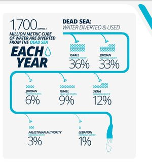
*Infografia sobre l’ús de l’aigua del Mar Mort.*

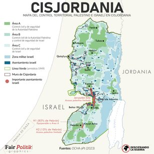
*Mapa del control territorial de Cisjordània.*

<!-- pdf p.11 · imprès p.8 -->

### Contribució en l'economia de les colònies a Cisjordània

L’Estat d’Israel no ha parat mai d’expandir-se, ja sigui en la conquesta i ocupació militar de territoris en les diferents guerres, o a través de la creació de colònies. Actualment, es calcula que hi ha uns 700.000 colons israelians en assentaments dins de Cisjordània i Jerusalem Est, fet que impossibilita aplicar els Acords d’Oslo en el sentit de dotar d’un territori estable a la població palestina sota la seva pròpia administració.

Els tribunals de l’ONU han sentenciat que aquests assentaments són il·legals i que violen el dret internacional. Per la qual cosa, les empreses que exploten o proporcionen béns i infraestructura a aquests assentaments estarien cometent delictes vinculats a l’ocupació militar.

ICL té diferents vincles amb les colònies de Cisjordània i del Golan sirià.
- L’entitat Who Profits ha documentat el proveïment de diversos productes d’ICL en diverses colònies agrícoles a la Vall del Jordà a Cisjordània el juny de 2019, com les de Naama, Mehola i Na’aran.
- ICL anuncia els serveis dels seus agrònoms regionals als territoris ocupats de la Vall del Jordà (Cisjordània), i del Golan (territori ocupat de Síria).
- El 2014 ICL va participar en un experiment agrícola sobre l’ús de pesticides a la colònia de Tomer a la Vall del Jordà (Cisjordània).
- Els anys 2016-2017 ICL va participar en un experiment agrícola en ametllers d’un hort de la colònia de Ram at Magshimim, al Golan.
- ICL apareix com a client destacat al web de l’empresa metal·lúrgica Krashin-Shalev, qui té la fàbrica principal a l’assentament de Barkan, al nord de Cisjordània.
- També apareix com a client d’Amir Marketing, qui treballa en assentaments de Cisjordània i al Golan sirià.
- L'any 2014, després de l’operació «Marge protector», on l’exèrcit israelià va causar més de 2.000 morts a Gaza, ICL va oferir a uns 2.000 ciutadans israelians dels pobles propers a Gaza, el transport i un dia gratuït de descans amb una agència turística situada a l'assentament Kfar Etzion de Cisjordània.
- ICL patrocina i participa en la 52a trobada de l’Institut israelià d’enginyers químics de l’any 2017, on participen ponents de la Universitat d’Ariel, situada en una colònia de Cisjordània.

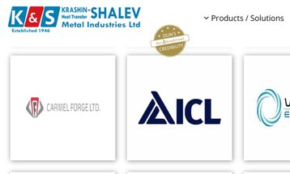
*Clients de Krashin-Shalev.*

<!-- pdf p.12 · imprès p.9 -->

### Bombes de fòsfor blanc

La filial d’ICL dels Estats Units (ICL-IP America) ha comercialitzat fòsfor blanc per al departament de municions de l’exèrcit dels Estats Units. A través de fragments de bombes de fòsfor blanc llançades per l’exèrcit d’Israel sobre el Líban s’ha pogut demostrar que aquestes provenien de l’exèrcit dels Estats Units.

En el web de Highergov, una entitat privada que es dedica a «proporcionar les dades més completes disponibles sobre els mercats de contractes i subvencions governamentals», s’hi pot visualitzar el contracte de ICL-IP America amb el Joint Munitions Command de l’Army Contracting Command Rock Island, de l’exèrcit dels Estats Units, amb els epígrafs de fabricació d’explosius i municions, en relació amb el fòsfor blanc de l’any 2020 a 2025. Relacionat també amb Pine Bluff Arsenal.

Segons el web de Corruption Tracker, dedicat a documentar la corrupció en el comerç d’armes, ICL proporciona a Monsanto (ara Bayer) fosfats per a la producció química del fòsfor blanc, que després són comercialitzats a l’empresa estatal Pine Bluff Arsenal, on diu ser l’únic lloc de l’hemisferi occidental on s’omplen municions de fòsfor blanc.

Segons l’informe de l’Observatori de Drets Humans i Empreses a la Mediterrània de 2017, ICL també va proporcionar fòsfor blanc a l’exèrcit dels Estats Units des de 2008 a 2013.

L’octubre de 2023, després que periodistes locals testimoniessin un atac de l’exèrcit israelià amb bombes de fòsfor blanc sobre el poble libanès de Dheira, un periodista del Washington Post va certificar per les restes dels projectils, que aquestes provenien del Pine Bluff Arsenal. Tot i que les restes provenen de projectils fabricats amb anterioritat als contractes de ICL amb Pine Bluff Arsenal, es pressuposa que sense les noves produccions no haguessin venut les velles.

Una notícia de desembre de 2023 d’Arkansas Times també fa referència, a partir d’informes d’Amnistia Internacional, al vincle entre les bombes de fòsfor blanc llançades per l’exèrcit israelià a la Franja de Gaza en diferents ocasions, i l’arsenal de Pine Bluff situat a Arkansas, EUA. Hispan TV recull la denúncia de l’atac amb fòsfor blanc a l’hospital Al-Shifa el novembre de 2023.

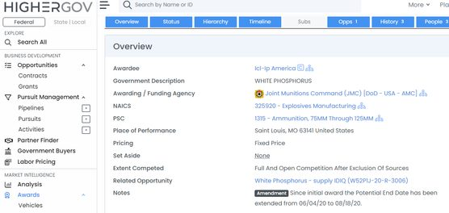
*Captura de pantalla de la web de Highergov.*

<!-- pdf p.13 · imprès p.10 -->

El fòsfor blanc és una substància química que s'inflama en exposar-se a l'oxigen i crema fins que es priva d'oxigen, produint incendis intensius i duradors i provocant ferides insuportables quan entra en contacte amb la pell, així com problemes respiratoris i oculars.

Com que és molt inflamable, està subjecte al Protocol III de les Convencions de Ginebra, que prohibeix l'ús d'armes incendiàries contra objectius civils i l'ús per aire en zones civils densament poblades.

El 2010, després de diverses denúncies, el govern israelià va admetre haver llançat bombes de fòsfor blanc contra espais habitats de la Franja de Gaza durant l’operació Plom Fos de 2008-2009. Entre els objectius d’aquests atacs hi va haver un magatzem i una escola de l’ONU.

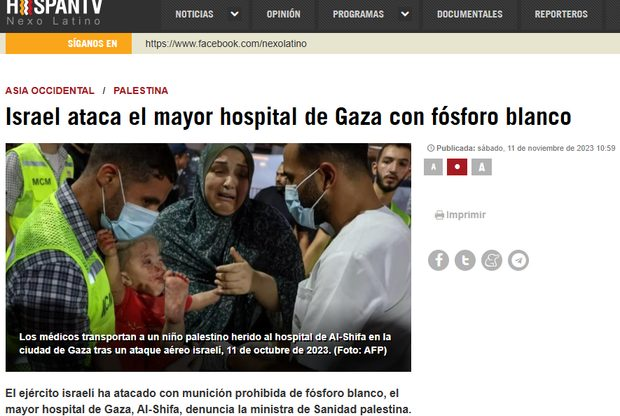
*Notícia sobre un dels atacs produits amb fòsfor blanc a un hospital de Gaza.*

<!-- pdf p.14 · imprès p.11 -->

### Suport a l'exèrcit d'Israel

ICL ha expressat de múltiples formes el seu suport a l'exèrcit d'Israel i les seves activitats. Des de comunicacions a les xarxes socials fins al finançament de diferents programes i projectes destinats al benestar dels soldats.

Entre aquests en destaca el programa anomenat «Adopta un soldat». Segons indiquen a la seva pròpia web es tracta d’un programa «gestionat per l'Associació en benefici dels soldats de l’exèrcit israelià, connecta empreses comercials i donants amb unitats militars, proporcionant suport moral i físic. El projecte té com a objectiu proporcionar assistència als soldats de l’exèrcit israelià que tenen una gran càrrega de la rutina del dia a dia, el que provoca esgotament i situacions d'alt risc».

En el seu informe de filantropia de 2018 exposava que ICL adopta dos regiments: El «Desert Patrol Regiment (585)», compost sobretot per beduins, i el «Rimon Regiment» de la «Brigada Givati».

A la seva web actual anuncia que adopta el «Desert Recon Battalion», regiment compost sobretot per beduins destinat al patrullatge a les fronteres de la Franja de Gaza.

Un altre programa destacat en el qual contribueix econòmicament és el de l'associació «Big brother organization for lone soldiers», que es dedica a donar suport econòmic i acompanyament mitjançant soldats voluntaris a aquells soldats que no tenen familiars, molts d’ells pel fet que viuen en altres països i van a Israel a fer el servei militar i a participar de les operacions de l’ocupació militar de Palestina i altres territoris.

Es calcula que cada any unes 1.300 persones migren a Israel per a servir a l’exèrcit i participar en operacions d’incursió en territoris ocupats.

En plena ofensiva de l'exèrcit israelià contra la Franja de Gaza, el desembre de 2023 ICL va celebrar la festivitat jueva de la Hanukka visitant diverses bases militars de la zona sota l'eslògan "Llum per a la victòria".

La primera base militar que van visitar va ser la de Tse’elim, amb el 14è regiment del cos de blindats «Machatz/Bison». Aquesta base fou construïda l’any 2005 i s’hi va reproduir l’escenari d’una ciutat palestina per entrenar els soldats en les incursions a la Franja de Gaza.

A la visita de la base militar d’Urim (utilitzada també per a tasques d’espionatge internacional) amb soldats paracaigudistes, la comunicació d'ICL va expressar: «Ens va fer il·lusió veure'ls un moment després de tornar de l'activitat operativa, i viure moments d'alegria i llum amb ells durant aquest moment difícil».

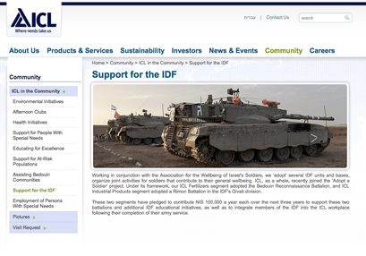
*Captura de pantalla de la web de ICL on parlen del suport a l’exèrcit israelià.*

<!-- pdf p.15 · imprès p.12 -->

El gener de 2024 amb l'eslògan "Una dutxa calenta per a cada soldat", ICL presenta el suport que ha donat a la iniciativa d’un dels seus treballadors jubilats corresponent en la fabricació de dipòsits d’aigua portàtils amb un mecanisme d’escalfament de l’aigua per a què els soldats israelians es puguin dutxar amb aigua calenta a la mateixa zona de combats de la Franja de Gaza, on estan cometent el genocidi.

Segons declaracions de l’artífex del projecte «Coses senzilles com una dutxa. Aquesta acció diària que no és possible al camp durant el combat pren un gran significat. Ens trobem amb soldats que reben una dutxa calenta després de diverses setmanes, i és emocionant veure el bé que els fa».

El maig de 2025 ICL anuncia la seva participació en un programa de beques d’estudis en ciberseguretat destinat especialment als soldats que han participat en el genocidi a Gaza. Segons el seu vocabulari: «graduats en servei de combat i reserva activa durant la Guerra de les Espases de Ferro». Camió d’ICL amb subministraments per l’IDF.

El desembre de 2025 ICL va ser una de les empreses premiades pel Ministeri de Defensa israelià pel seu suport als soldats reservistes. “On behalf of hundreds of thousands of reservists—thank you,” Katz said. “You are the vanguard of the State of Israel.”

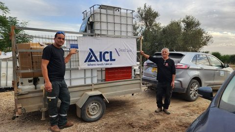
*Camió d’ICL amb subministraments per l’IDF.*

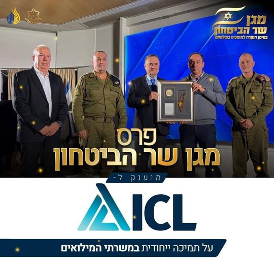
*El ministre de Defensa d’Israel, Katz, al «Defense Minister’s Shield» award, premiant ICL.*

<!-- pdf p.16 · imprès p.13 -->

### Un president provinent de la indústria militar

Diferents directius d'ICL tenen o han tingut vincles directes tant amb el Ministeri de Defensa d'Israel com en el sector de la indústria militar. En destaca l’actual president Elad Aharonson. És president del Grup ICL des de març de 2025. De març de 2021 a març de 2025 havia estat president del departament Growing Solutions de ICL.

De 2015 a 2021 fou vicepresident i mànager general de la secció ISTAR de l’empresa armamentística Elbit Systems, dedicada als sensors làsers. De 2011 a 2015 fou vicepresident i mànager general de la secció UAS d’Elbit Systems, dedicada als drons amb capacitat explosiva.

El dron Hermes 900, comercialitzat durant l’estada d’Aharonson a Elbit Systems, fou utilitzat en diverses operacions d’espionatge i bombardeig a Palestina, sobretot en les operacions militars de 2014, causant centenars de víctimes, inclosos 164 nens.

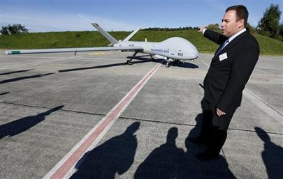
*Elad Aharonson amb un dels drons.*

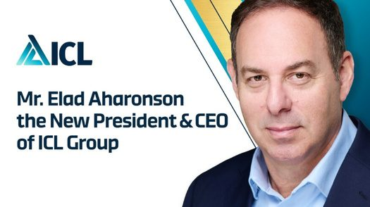
*Imatge del CEO d’ICL de la pàgina web.*

<!-- pdf p.17 · imprès p.14 -->

## DANYS MEDIOAMBIENTALS AL TERRITORI

ICL té un ampli impacte negatiu, mediambiental i social, a Catalunya. Ja sigui per la contaminació de l'aigua i en conseqüència del sòl, pels diners públics i recursos hídrics invertits en la gestió d'aquests passius ambientals, per l'impacte paisatgístic i fins a l'esfondrament d'un barri.

### Salinització del riu i aqüífers

ICL contamina l'aigua de la zona minera i del Llobregat, que abeura fins a Barcelona. Degut principalment a la gestió dels residus de l'extracció de la potassa, ICL és una empresa que ha contaminat i contamina l'aigua de la conca del Llobregat que abeura fins a Barcelona, el cardener (afluent del Llobregat) i de rius, rieres i aqüífers de la zona. Això que comporta? Com més augmenta la sal a l'aigua, menys usos pels humans té i menys espècies hi poden viure, i en les que hi viuen, empitjora el seu desenvolupament. La salinització de l'aigua per sobre d'una determinada xifra fa que no sigui potabilitzable per mitjans convencionals, i a causa de l'aigua per la zona minera, aquesta puja tant de salinitat que sobrepassa aquest nivell. També afecta la pagesia, quan troba contaminades les fonts que abeuren les seves terres o animals, registrant-se més de 30 denúncies per aquest motiu. Les vies de contaminació són diverses i també els seus impactes, els detallem a continuació:​

### Runams salins

Els runams salins de la conca potàssica del Bages són muntanyes de sal formades principalment per sal comuna, descartada en el procés d'obtenció de la potassa. A part de la transformació del paisatge natural que suposen, aquestes muntanyes "suen" aigua salada per la humitat, i quan plou l'aigua salinitzada cau muntanya avall. ICL és la responsable de 4 runams, dels quals el Fusteret de Súria, encara en creixement, segueix rebent permisos d'ampliació tot i l'ordre penal de ser neutralitzat. La suma de massa exposada a l'aire i l'aigua supera els 80 milions de tones.

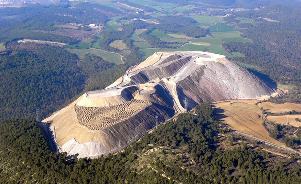
*Vista aèria del runam salí.*

<!-- pdf p.18 · imprès p.15 -->

Una sentència penal de l'any 2014 condemnava a presó a tres dirigents d'ICL per l'incompliment de lleis ambientals, ordenava l'aturada de l'abocament de residus al runam del Cogulló de Sallent i restablir-lo al llarg del 2008. També reclamava la recuperació ambiental dels runams de Sallent i el Fusteret de Súria fins que no contaminin les aigües, cosa que en el pla proposat actualment suposa la retirada dels runams d'ICL en 75 anys. Però al ritme actual del procés de restauració d'un dels runams, el de la Botjosa, es calcula que tardaria 180 anys a retirar-los. Realment es controlarà a ICL perquè els retiri a un ritme correcte? O marxarà d'aquí a unes dècades amb les butxaques plenes i els runams dempeus? Això sí, la fiança de 6,9 milions d'euros que hauria de pagar si no els restaura no és més que una petitíssima part del que costaria després retirar-ho a les institucions públiques.

Tot i que a causa de les denúncies de grups ecologistes ICL ha estat obligada recentment a fer una rasa que col·lecti part de l'aigua salada dels runams, aquesta rasa es desborda quan plou molt. A més a més, el manteniment de la rasa i la gestió de la salmorra (aigua amb sal) és d'uns 30-40 milions d'euros anuals.

Per tant, les muntanyes salades són un problema actual per l'aigua dels nostres territoris, però en perill d'incrementar-se de cara al futur si les rases es deixen de mantenir o es deixa de poder enviar aigua pel col·lector de salmorres per manca de recursos.

### El col·lector de salmorres

El col·lector de salmorres és una infraestructura finalitzada el 1988 consistent en una canonada de 120km que porta part de l'aigua salada que contenen les mines fins al mar. La seva construcció va suposar una disminució de la contaminació de les mines, però les seves filtracions i averies han ocasionat en moltes ocasions la contaminació absoluta de terrenys agrícoles i boscosos. Actualment hi ha un nou col·lector de salmorres en construcció per augmentar la capacitat de transport de salmorres, que està finançat en part amb diners públics i que el 2027 està previst que sigui funcional des del runam del Cogulló.

### Ús de l'aigua

ICL té concedides per part de l'ACA (Agència Catalana de l'Aigua) un total de 12,8 M de metres cúbics d'aigua, més del que gasta anualment una ciutat de 233.000 habitants com és Terrassa. Part d'aquesta aigua concedida prové d'una recent concessió de 6,8 milions de metres cúbics d'aigua ja tractada de la depuradora de Manresa, i que en comptes de reintegrar-se al riu aniria en mans d'ICL. Estem parlant d'un volum total similar al de 10 piscines olímpiques al dia.

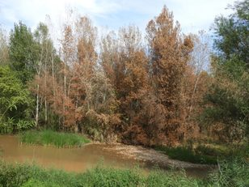
*Imatges de les conseqüències del vessament del col·lector de salmorres al seu pas per Sant Joan de Vilatorrada el 2023 (imatge de «El medi natural del Bages i el Moianés»).*

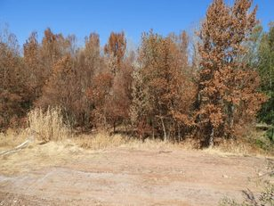
*(segona imatge de la mateixa sèrie).*

<!-- pdf p.19 · imprès p.16 -->

Part d'aquesta aigua concedida hauria de servir per la restauració dels runams, consistent a desfer-los i transportar-los a través del col·lector fins al mar. De totes maneres, actualment, la major part de l'aigua s'usa per mantenir l'extracció i la producció de la potassa. L'aigua requerida per a restaurar tots els runams amb aquest mètode seria equivalent a 3 pantans sencers de la Baells o 4 de la Llosa del Cavall. Mentrestant, el runam de Súria creix i l'aigua es torna un bé cada vegada més fràgil a causa de la crisi climàtica.

### Potabilitzadores que han de dessalar el Llobregat

Com dèiem, l'aigua contaminada del Llobregat fa sobrepassar la capacitat de ser potabilitzada per mitjans convencionals. És per això que l'Agència Catalana de l'Aigua va haver de millorar el 2009 les potabilitzadores d'Abrera i de Sant Joan d'Espí, gastant-se 122,7M € per incorporar el procés d'osmosi inversa, un costós mecanisme de separació de la sal de l'aigua que encareix la factura d'aigua de la conca del Llobregat, fent-se notar a les butxaques de bona part de Catalunya. Es calcula que la salinització del Llobregat ha provocat un deute de més de 300 milions d’euros a l’administració pública catalana.

### Barri de l'estació

A causa dels forats que queden sota terra per l'activitat minera, el 2009 es va haver d'abandonar el barri de l'Estació de Sallent per perill d'esfondrament, amb l'impacte que això va tenir a les vides dels seus 110 habitants. Mentre que, si ICL retornés els excedents sota terra, s'evitaria augmentar la mida dels runams i s'esquivarien perills com el de l'esfondrament del barri de l'estació.

### Contaminació amb metalls pesants

A més de la sal, segons l'ODHE també s'han trobat metalls pesants d'alta toxicitat a l'aigua contaminada per part d'ICL.

### Agroindústria

També és rellevant que ICL utilitza aquesta potassa per fabricar més de 100 fertilitzants agraris, la gran majoria dels quals no aptes per l'agricultura ecològica, que contribueixen al model agrari de l'agroindústria, que empobreix el sòl agrícola fins al perill de desertització, fent-lo cada vegada més i més dependent de fertilitzants de síntesi química i reduint la seva matèria orgànica.

La mort del sòl agrícola a causa d'aquest model és una conseqüència que cal revertir. L'extracció de potassa hauria d'estar limitada i destinada de manera a un nou model agrícola ecològic i regeneratiu, en comptes d'estar en mans d'empreses capitalistes com ICL que les venen al millor postor, siguin quines siguin les conseqüències socials i ambientals.

<!-- pdf p.20 · imprès p.17 -->

### Greenwashing i cotxes elèctrics

Un dels casos de rentada de cara verd d'ICL és el pla, junt amb els Ajuntaments de Súria i Sallent, de fer un parc de plaques fotovoltaiques als runams salins del Cogulló i el Fusteret. És flagrant que es vulguin disfressar de fonts de transició ecològica unes muntanyes contaminants les quals s'han de restaurar segons ordres penals, cosa que temem que pugui ser excusa per endarrerir més la seva retirada.

Durant el 2025, ICL va declarar que faria un nou projecte de bateries elèctriques a Sallent. Això ens confirma la seva voluntat de continuar al nostre territori, amb el tracte de favor i subvencions del govern, mentre no ha resolt els comptes pendents amb els nostres ecosistemes restaurant els runams salins.

La transició energètica no pot estar en mans de grans empreses com ICL que només busquen el benefici privat, explotant i acaparant els recursos del sud global com el liti i vulnerant greument els drets humans i ambientals. A més, destinen la producció a projectes insostenibles d'occident, com l'electrificació de cotxes privats per a una elit, quan els materials necessaris per a aquesta transició són limitats i haurien de prioritzar-se per a una mobilitat pública per a tothom i no depenent de combustibles fòssils.

Lluny de contribuir a la transició ecològica com ens volen fer creure, hi van en contra, impossibilitant la creació d'estructures resilients i perdurables al conjunt del planeta.

<!-- pdf p.21 · imprès p.18 -->

## La campanya de Boicot a ICL s’emmarca en la campanya internacional de Boicot, Desinversions i Sancions contra l’Estat d’Israel (BDS)

Presentats els efectes nocius que té ICL al territori i el seu rol en el genocidi a palestina, és evident la urgència de revertir o canviar la situació perquè aquestes atrocitats no es duguin a terme. Però, per què és necessari fer boicot? D'on surt aquesta estratègia? És realment efectiva?

La campanya de Boicot, Desinversions i Sancions (BDS) contra l'estat d'Israel va sorgir el 2005 arran d'una declaració de més de 170 organitzacions de la societat civil palestina a la comunitat internacional. En aquesta declaració es demana que s'apliquin mesures coercitives "fins que l'estat d'Israel compleixi amb el dret internacional i els principis universals dels drets humans". El moviment BDS s'inspira en les campanyes que es van dur a terme en contra de l'apartheid racista de Sud-àfrica, que van ser liderades per l'Anti-Apartheid Movement (AAM), que va arribar a les Nacions Unides, on es va crear un comitè específicament per a imposar sancions econòmiques a Sud-àfrica.

Hi ha múltiples maneres de fer boicot, però en general es poden agrupar en les següents categories: econòmic (boicot empresarial i de consum als productes israelians o d'empreses vinculades a l'ocupació israeliana); acadèmic (trencant relacions amb universitats o centres educatius israelians vinculats a l'ocupació); cultural (artistes que es neguin a actuar a Israel sota l'ampra de les administracions israelianes, o boicotejant a artistes israelianes que actuïn amb el suport de l'Estat israelià i/o que en justifiquin les seves accions contra Palestina); esportiu (rebutjar la participació d'equips israelians sota l'empara de les administracions israelianes a competicions internacionals); i institucional (ruptura total de relacions institucionals amb l'estat d'Israel). Les desinversions fan referència als diners que empreses internacionals retiren d'aquelles empreses israelianes o internacionals que es beneficien de la violació dels drets del poble palestí. Finalment, les sancions són el càstig que la comunitat internacional aplica a estats que amenacen a la pau i la seguretat al món, una mesura que, com s'ha comentat abans, es va imposar amb èxit i va ser clau en acabar amb el règim d'apartheid de Sud-àfrica.

Les victòries de les campanyes de BDS a Israel són múltiples i han sigut molt decisives per a forçar a estats i organitzacions a trencar relacions amb l'estat genocida d'Israel. Aquí, entre altres, s'ha aconseguit el tancament de les oficines del Departament de la Generalitat de Catalunya "Acció" que tenia a Israel, i el trencament de l'agermanament de la ciutat de Barcelona amb Tel-Aviv. S'ha aconseguit que la UManresa (vinculada a la Universitat de Vic), i el teatre Kursaal de Manresa trenquessin vincles amb ICL.

Tot i que requereixen un treball més sostingut en el temps, les campanyes de BDS generen canvis profunds que a la llarga van aïllant l'estat genocida d'Israel. És una de les maneres més efectives per a la ciutadania d'actuar i trencar amb les complicitats que sostenen i legitimen el genocidi que el poble palestí esta vivint.

<!-- pdf p.22 · imprès p.19 -->

## LES DEMANDES DE LA CAMPANYA

### Fer fora ICL: que marxi ICL de forma immediata i permanent

1. **Per solidaritat amb Palestina:** per la implicació d'ICL en el genocidi del poble palestí, seguim la premissa del moviment de Boicot, Desinversions i Sancions (BDS) contra l'Estat d'Israel.
2. **Perquè estan destruint el territori:** per les reincidents pràctiques ecocides i l'acaparament de recursos.
3. **Per l'explotació de la classe treballadora:** per finalitzar amb el xantatge permanent cap als treballadors i treballadores, per la precarietat i inseguretat laboral que genera el sistema de primes i les subcontractacions, amb un alt nivell de sinistralitat laboral, amb diversos accidents mortals en les últimes dècades.

### Després d'ICL, què?

1. **Procés participatiu** sobre quin ha de ser el futur de la mina i que garanteixi:
   - **Justícia laboral**
     - *Preservació del treball:* garantir el benestar econòmic i social dels treballadors i treballadores de la mina a curt, mitjà i llarg termini (tant de la plantilla de l'empresa com de totes les persones subcontractades i precaritzades per ICL).
     - *Sindicalisme:* supervisió sindical de tot el procés per assegurar els drets dels treballadors i treballadores.
   - **Justícia ecosocial**
     - *Restauració:* reparar els danys mediambientals i socials històrics, principalment el perill que suposen les muntanyes de sal (a pagar completament per ICL).
     - *Futur de l'ús de l'aigua:* priorització de l'aigua del riu i de les seves reserves per sectors bàsics com la pagesia; no malbaratar ni privatitzar les reserves d'aigua (aqüífers, pantans...) i garantir un cabal adequat del Llobregat o decidir popularment per a quins sectors prioritzem l'aigua del riu i les reserves acumulades.
     - *Preservació dels ecosistemes:* posar fi a la salinització i la contaminació amb metalls pesants de rius i aqüífers de la zona.
     - *Transició ecosocial:* tot el procés s'ha de fer en coherència amb un context de crisi climàtica i crisi de recursos; hem de decréixer en l'activitat dels sectors que no són essencials per sostenir la vida i garantir un futur digne per a les generacions futures.

<!-- pdf p.23–27 · imprès p.20–24 -->

## REFERÈNCIES

### ICL IBERIA SÚRIA
- <https://naciodigital.cat/manresa/economia-i-empresa/icl-iberia-defensa-el-tancament-del-cogullo-com-una-oportunitat-cap-a-la-mineria-sostenible.html>
- <https://directa.cat/la-mina-diberpotash-de-sallent-tanca-tenyida-de-dol-i-inseguretat/>
- <https://www.icliberia.com/productos/potasa/?lang=es#:~:text=ICL%20Iberia%20S%C3%BAria%20%26%20Sallent%20produce,exportan%20en%20todo%20el%20mundo.>

### ICL IBERIA BARCELONA PORT
- <https://www.icliberia.com/about-icl-iberia/instalaciones-y-procesos/?lang=es>
- <https://www.icliberia.com/sala-premsa/noticies/noticies-2019-2/?lang=ca>

### ICL SPECIALTY FERTILIZERS I FOMDESA
- <https://cincodias.elpais.com/cincodias/2011/04/13/empresas/1302701996_850215.html>
- <https://icl-growingsolutions.com/es-es/ornamental-horticulture/find-a-dealer/>
- <https://icl-growingsolutions.com/es-es/turf-landscape/find-a-dealer/>
- <https://www.einforma.com/informacion-empresa/grupo-empresarial-agromediterraneo>
- <https://www.einforma.com/informacion-empresa/fomento-desarrollo-agricola>
- <https://www.einforma.com/informacion-empresa/logistica-fertilizantes-fuentes>

### PROJECCIÓ D'UNA NOVA FÀBRICA DE COMPONENTS DE BATERIES ELÈCTRIQUES A SALLENT
- <https://www.regio7.cat/economia/2025/01/17/icl-dynanonic-volen-obrir-sallent-113457471.html>
- <https://www.regio7.cat/economia/2025/01/30/iberpotash-rep-18-milions-deuros-113842026.html>

### IDENTIFICACIÓ AMB EL PROJECTE SIONISTA I SUPORT ECONÒMIC D'ISRAEL
- <https://www.icl-group.com/wp-content/uploads/2024/06/ICL-Corporate-responsibility-ESG-Report-2023.pdf (pàg 200)>
- <https://www.icl-group.com/wp-content/uploads/2024/06/ICL-Corporate-responsibility-ESG-Report-2023.pdf (pàg 13)>
- <https://he.icl-group.com/blog/israel-strong-together-icl-joining-forces/>
- <https://2021.icl-group-sustainability.com/reports/israel/>
- <https://www.icl-group.com/wp-content/uploads/2025/06/ICL-2024-ESG-FINAL.pdf>

### ACCIONARIAT
- <https://maya.tase.co.il/en/company/281?view=details>
- <https://fintel.io/so/us/icl>
- <https://es.marketscreener.com/cotizacion/accion/ELBIT-SYSTEMS-LTD-56536814/empresa-accionistas/>
- <https://fintel.io/es/so/us/eslt>
- <https://s27.q4cdn.com/112109382/files/doc_downloads/immediate_reports/2023/03/2023-Proxy-Statement-Final.pdf>
- <https://www.ambito.com/negocios/quien-es-idan-ofer-el-multimillonario-israeli-que-desafio-harvard-n5983279>
- <https://forbes.co.il/eyal-idan-ofer-billionaires/>
- <https://www.tradewindsnews.com/containers/idan-ofer-inks-2-45bn-container-ship-series-as-eastern-pacific-newbuilding-tally-tops-100/2-1-1671680>
- <https://www.timesofisrael.com/pandora-papers-teddy-sagi-idan-and-eyal-ofer-named-in-latest-documents/>
- <https://www.ynet.co.il/sport/article/5511884>
- <https://www.independent.co.uk/news/world/middle-east/israel-s-wealthiest-man-idan-ofer-set-to-move-to-london-amid-tax-row-8566269.html>
- <https://www.themarker.com/news/2023-10-12/ty-article/.premium/0000018b-24dd-d010-a59f-bdfd59cf0000>
- <https://en.wikipedia.org/wiki/Brothers_and_Sisters_in_Arms>
- <https://www.thecrimson.com/article/2023/10/12/doxxing-truck-students-israel-statement/>

### EXTRACCIÓ RECURSOS NATURALS PALESTINS I CONTAMINACIÓ DEL TERRITORI
- <https://s27.q4cdn.com/112109382/files/doc_financials/2022/ar/updated/Full-20F-Final.pdf (pàg 146)>
- <https://icl-group-sustainability.com/reports/icl-dead-sea-israel/>
- <https://icl-group-sustainability.com/reports/icl-rotem-israel/>
- <https://hlrn.org/img/violation/Area+C+Report+Oct-13.pdf>
- <https://www.whoprofits.org/companies/company/6592?israel-chemicals-icl-group>
- <https://atmos.earth/palestines-jordan-river-drained-of-water-and-livelihood/>
- <https://www.icl-group.com/wp-content/uploads/2024/06/ICL-Corporate-responsibility-ESG-Report-2023.pdf (pàg 81)>
- <https://www.timesofisrael.com/phosphate-mining-company-icl-rotem-tops-latest-list-of-worst-environmental-offenders/>
- <https://www.timesofisrael.com/toxic-liquids-flow-yet-again-from-phosphate-mining-company-in-negev/>
- <https://www.globes.co.il/news/article.aspx?did=1001416596>
- <https://www.timesofisrael.com/israel-has-a-chance-to-slow-the-dead-seas-demise-will-big-business-get-in-the-way/>
- <https://shakuf.co.il/34660>
- <https://www.timesofisrael.com/state-allows-dead-sea-works-to-pump-more-water-as-iconic-lake-recedes/>

### CONTRIBUCIÓ EN L'ECONOMIA DE LES COLÒNIES A CISJORDÀNIA
- <https://www.whoprofits.org/companies/company/6592?israel-chemicals-icl-group>
- <https://www.whoprofits.org/writable/uploads/publications/1668633368_b1cc7601fe5ac87a92b9.pdf (Pàg 28)>
- <https://krashin-shalev.co.il/en/references/>
- <https://krashin-shalev.co.il/en/about/>
- <https://www.google.es/maps/place/%D7%A7%D7%A8%D7%A9%D7%99%D7%9F-%D7%A9%D7%9C%D7%95+%D7%91%D7%A2%22%D7%9E%E2%80%AD/@32.1094023,34.456839,9z/data=!4m6!3m5!1s0x1502b5f6e8ce732f:0xdaf5691d8ba70137!8m2!3d32.1093978!4d35.1180572!16s%2Fg%2F11flg2076f?entry=ttu>
- <https://kenes-media.com/%d7%9b%d7%a0%d7%a1-%d7%9c%d7%a7%d7%95%d7%97%d7%95%d7%aa-%d7%a2%d7%9e%d7%99%d7%a8-%d7%a9%d7%99%d7%95%d7%95%d7%a7/>
- <https://www.whoprofits.org/companies/company/4045?amir-marketing-and-investment-in-agriculture>
- <https://www.israelhayom.co.il/article/202999>
- <https://etziontour.org.il/en/item/kfar-etzion-field-school/>
- <https://bioforumconf.com/iiche2017-scientific-program>

### BOMBES DE FÒSFOR BLANC
- <https://www.gao.gov/products/b-418687>
- <https://www.highergov.com/contract/W52P1J20D3006-W52P1J20F3059/>
- <https://www.highergov.com/idv/W52P1J20D3006/>
- <https://corruption-tracker.org/blog/behind-the-smoke-the-unlawful-use-of-white-phosphorus>
- <https://www.odhe.cat/wp-content/uploads/Emp_ICLdef_CAST.pdf>
- <https://www.washingtonpost.com/investigations/2023/12/11/israel-us-white-phosphorus-lebanon/>
- <https://arktimes.com/arkansas-blog/2023/12/02/report-suggests-israel-used-arkansas-made-white-phosphorus-shells-in-gaza>
- <https://www.hispantv.com/noticias/palestina/574891/israel-fosforo-blanco-hospital-alshifa-gaza>
- <https://www.diariosur.es/20100202/mundo/israel-utilizo-armas-ilegales-20100202.html?ref=https%3A%2F%2Fwww.diariosur.es%2F20100202%2Fmundo%2Fisrael-utilizo-armas-ilegales-20100202.html>
- <https://www.aljazeera.com/news/2009/7/30/israel-admits-white-phosphorus-use>
- <https://warrickpage.photoshelter.com/image/I0000rvi71XPojXk>

### SUPORT A L'EXÈRCIT D'ISRAEL
- <https://2018.icl-group-sustainability.com/reports/philanthropy-and-welfare/>
- <https://icl-group-sustainability.com/reports/community-engagement-in-israel/safety-israeli-bedouin-sector/>
- <https://www.kan.org.il/content/kan-news/defense/live-761458/liveid-761681/>
- <https://www.ice.co.il/career/news/article/1006192>
- <https://achgadol.org/en/%D7%A2%D7%9E%D7%95%D7%93-%D7%94%D7%91%D7%99%D7%AA-english/>
- <https://www.facebook.com/ICLcommunity/posts/pfbid02XZjF7uTd8SQMNTD3gCFXUch867z4hef781QXMsnPzRh6sJQQ6ynMzqq2hBFhkzWJl>
- <https://www.facebook.com/ICLcommunity/posts/pfbid0V67sdrXFbY5hFmqz4DuvKELbjWVbfRH8V4EW4UUkJXziDHNo73hwc33LTD56oWpcl>
- <https://www.facebook.com/watch/?v=378161437914975>
- <https://www.news08.net/%D7%9E%D7%99%D7%9C%D7%94-%D7%98%D7%95%D7%91%D7%94-%D7%A2%D7%95%D7%91%D7%93%D7%99-icl-%D7%91%D7%90%D7%99%D7%A8%D7%95%D7%A2%D7%99->
- <https://www.newsweek.com/israel-fake-city-mini-gaza-baladia-invasion-1835003>
- <https://www.facebook.com/ICLcommunity/posts/pfbid0fQ2gGEJp2yW1xUWoTK7tQj2nKfUbYodtdnidXmSDwMeqmBz6BLKskGAYJCorutSSl>
- <https://www.mitgaisim.idf.il/%D7%9B%D7%AA%D7%91%D7%95%D7%AA/english/bases/the-school-for-air-defense-bisla/#/>
- <https://www.facebook.com/ICLcommunity/posts/pfbid02C1TcphxE4Hszj17Cj4KnJ3ssd3Ub4xA7hBxAWxbaGBxJM5LNRN78TZGKv85fEZzDl>
- <https://mondediplo.com/2010/09/04israelbase>
- <https://www.facebook.com/ICLcommunity/posts/pfbid0m55aesKmDJNER7MnAMvmFBTm816V62XiGwLrFZV25PYax1fpuh7HHTAcbb5CYSohl>
- <https://www.b7net.co.il/%d7%97%d7%93%d7%a9%d7%95%d7%aa/%d7%94%d7%99%d7%95%d7%96%d7%9e%d7%94-%d7%94%d7%99%d7%a4%d7%94-%d7%a9%d7%9c-%d7%a2%d7%95%d7%91%d7%93%d7%99-icl-%d7%9e%d7%92%d7%99%d7%a2%d7%99%d7%9d-%d7%9c%d7%a9%d7%98%d7%97-%d7%a2%d7%9d-%d7%9e%d7%a7%d7%9c%d7%97%d7%aa-%d7%97%d7%9e%d7%94-%d7%9c%d7%9b%d7%9c-%d7%97%d7%99%d7%99%d7%9c-569837>
- <https://www.facebook.com/ICLcommunity/posts/pfbid0gTWhcUtBiBT1qdKsp4gR3xd34MePH7YEwxZJkHgy9Ta4dQX9gRxmdn2vE6QummTHl>
- <https://techidf.co.il/>

### UN PRESIDENT PROVINENT DE LA INDÚSTRIA MILITAR
- <https://www.linkedin.com/in/elad-aharonson/?originalSubdomain=il>
- <https://www.icl-group.com/about-us/governance/>
- <https://www.suasnews.com/2013/01/elbit-systems-wins-35-mln-israel-defense-order-to-develop-advanced-uas-features/aharonson-general-manager-and-ceo-uas-division-at-elbit-systems-ltd-speaks-next-to-the-elbit-hermes-900-uav-during-a-media-presentation-at-the-airbase-in-the-central-swiss-town-of-emmen/>
- <https://www.bdsmovement.net/news/israeli-arms-manufacturers-look-cash-war-gaza>
- <https://visualizingpalestine.org/visual/field-tested-elbit-systems/>
- <https://www.swissinfo.ch/spa/israel-inaugura-nuevo-escuadr%C3%B3n-de-drones-para-atacar-gaza%2C-cisjordania-ocupada-y-l%C3%ADbano/75319907>
- <https://www.calcalistech.com/ctech/articles/0,7340,L-3774577,00.html>
- <https://www.erieri.com/executive/salary/elad-aharonson-7j2j>
- <https://www.calcalist.co.il/market/article/hy33mc1dke>

### GREENWASHING I COTXES ELÈCTRICS
- <https://montsalat.cat/>
- <http://prousal.org/sentencies-judicis-expedients-a-icl/>
- <https://www.odhe.cat/icl-iberia/>
- <https://www.elsetembre.cat/noticia/1282/dotze-claus-mines-sal-sallent-suria>
- <https://www.regio7.cat/bages/2024/08/10/urbanisme-dona-llum-verd-runam-fusteret-suria-106764875.html>
- <https://www.3cat.cat/324/la-polemica-concessio-daigua-a-una-empresa-minera-del-bages/noticia/3278497/>
- Cañedo-Argüelles, M., Brucet, S., Carrasco, S., Flor-Arnau, N., Ordeix, M., Ponsá, S. y Coring, E. (2017). Effects of potash mining on river ecosystems: An experimental study. Environmental Pollution, 224, 759770. doi: 10.1016/j.envpol.2016.12.072.
- <https://www.youtube.com/watch?v=GCZMUZh7QLY&t=2253s>
- <https://xifres.terrassa.cat/A2022/index.php?id=05.01.01>

### LA CAMPANYA DE BOICOT A ICL S’EMMARCA EN LA CAMPANYA INTERNACIONAL DE BOICOT, DESINVERSIONS I SANCIONS CONTRA L’ESTAT D’ISRAEL (BDS)
- <https://rescop.org/bds/que-es-bds-contra-israel-y-por-que-esta-funcionando/>
- <https://bdsmovement.net/bds-guidelines>
