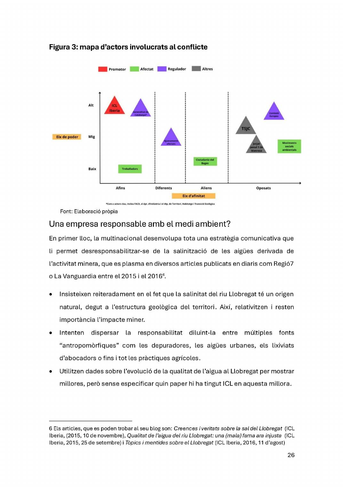

# Extractivisme, percepció dels riscos i mobilització social: una mirada al conflicte ambiental del Bages

**Iona Crusat Reig** · Treball de fi de grau, Universitat Autònoma de Barcelona · Tutor: Josep Espluga Trenc · 23 de maig de 2025

> **Notes de conversió (llegiu-ho abans de citar)**
>
> - Capa de text del PDF corrompuda → text per OCR; xifres crítiques verificades sobre la imatge de pàgina. Regla d'artefactes: «%» surt com «0», «96», «94» o «9» (p. ex. `4309` = 43 %, `1096` = 10 %); «w» surt com «vv»; el punt volat de «l·l» es perd; «?» surt sovint com «2» o «7».
> - **Taules reconstruïdes a mà** a partir de la imatge: figs. 2, 4 i 5; annex 1 (fitxes), annex 5 (suport institucional), annex 6 (cronologia salina, idèntica a la de la tesi 1) i annex 8 (cronologia de mobilitzacions). La **fig. 3** (mapa d'actors) és un diagrama i s'inclou com a imatge (`thesis-2-img/p27-mapa-actors.jpg`).
> - Les **notes al peu** apareixen com `> Nota:` al lloc on el text d'origen les situa. Els marcadors `<!-- pdf p.N · imprès p.M -->` permeten citar la pàgina.
> - Les **fotos i mapes d'impactes** (p. ex. creixement del runam del Fusteret 1980–2001, fig. 3 de l'annex 3) no s'han extret; consulteu el PDF.
> - **Part empírica**: 4 entrevistes semiestructurades (març–abril 2025): activista de Prou Sal!, enginyer mecànic de les mines (Súria), parella pare-filla farmacèutics de Sallent i activista de Boicot ICL. Mostra molt petita: tracteu els resultats de percepció com a indicis qualitatius, no com a dades representatives.
> - **Discrepàncies internes/amb altres fonts** (1998 vs 1999 per a la compra de les mines; naixement de Boicot ICL 2023 vs abril 2024; xifres de treballadors): vegeu `auditoria-web-vs-fonts.md`.

<!-- pdf p.2 -->
Sabía que í(bamos a triunfar. Me lo dijo el río.

Berta Càceres

<!-- pdf p.3 -->
## AGRAIMENTS

Ala Urii al Ror, Si no us hagués conegut, aquest treball no existiria. Gràcies per obrir-me el camí en la lluita per la defensa de la terra del Bages, que és la terra de totes. AlJep, per la teva generositat, tenacitat i convicció.

A totes les persones entrevistades, gràcies per donar-me una estona del vostre temps i per explicar-me les vostres històries. Al meu tutor, per ajudar-me amb la teva perspectiva quan ho he necessitat.

A totes les persones que han format part de Montsalat, Prou Sal!, Boicot ICL, i a totes aquelles que s'enfronten a projectes extractivistes, la vostra determinació i perseverança és inspiradora.

A totes les companyes del grup dels divendres, vosaltres alimenteu la meva fe en una vida més lliure. És una sort poder aprendre i desaprendre al vostre costat.

Ala mami, per estar sempre al meu costat i recolzar-me incondicionalment.

<!-- pdf p.4 · imprès p.3 -->
## ÍNDEX

*(L'índex original s'ha omès: la capa OCR és il·legible; la numeració impresa figura als marcadors de pàgina.)*

<!-- pdf p.5 · imprès p.4 -->
## INTRODUCCIÓ

La Conca Potàssica Catalana ha estat clau pel desenvolupament socioeconòmic i identitari del Bages. L'extracció de sal gemma comença al neolític i esdevé una activitat central durant l'edat mitjana, quan el Comtat de Cardona competia amb la República de Gènova com a principal proveidor de sal de Barcelona (Gorostiza, Honey-Rosés 8: Lloret, 2015). Amb l'inici de l'explotació de sals potàssiques als anys 1920, emergeix un nou model extractiu que genera malestar social i impactes ambientals notables. El primer efecte visible és la salinització dels rius, que provoca les primeres denúncies, com la d'Antònia Burés ("la Buresa") el 1926 contra Minas de Potasa de Súria S.A. per la degradació del riu i la concessió de cabals (Gorostiza et al., 2015). Aquesta denúncia inaugura un llarg conflicte sobre l'origen natural o industrial de la salinitat, que adquireix rellevància política durant la Segona República, però queda relegat durant el franquisme, fins a l'entrada en funcionament del col·lector de salmorres el 1989.

La present investigació pretén entendre quin és l'estat de conflicte social al voltant de la problemàtica ambiental derivada de les mines. En aquest sentit, la pregunta de recerca a resoldre és la seguent: quins són els factors que faciliten que la població del Bages que conviu amb la indústria de la mineria de potassa no es mobilitzi davant dels riscos als quals està exposada7 Aterrant els objectius a què es vol atènyer s'han desplegat tres eixos d'anàlisi. En primer lloc, es vol comprendre en profunditat quin ha estat l'impacte de les mines a nivell ecològic i social des que ICL n'ha pres la propietat. En segon lloc, la recerca aspira determinar, per començar, com la ciutadania valora la indústria de la mineria, i en el cas que hi hagi rebuig, per quins motius i de quina forma l'han expressat. Així, es pretén elaborar un dibuix detallat del possible conflicte social derivat de l'existència de les mines. Finalment, s'espera entendre el paper d'ICL en la dificultat que la ciutadania bagenca hagi pogut trobar a l'hora de mobilitzar-se. Més concretament, es pretén examinar com l'hegemonia d'ICL pot dificultar la mobilització política en contra de l'empresa.

<!-- pdf p.6 · imprès p.5 -->
La investigació present es recolzarà en les teories de la percepció del risc per a comprendre la manera en què la població percep la multinacional i explicar les dinàmiques de convivència que es produeixen entre ambdues. Alhora, prendrà una perspectiva gramsciana de l'hegemonia, que permetrà aprofundir en la manipulació del consentiment i la latència del conflicte social.

Així doncs, les pròximes pàgines pretenen posar en evidència les estratègies que el negoci de la mineria utilitza per a continuar lucrant-se a costa d'un territori i la seva població, cada vegada més vulnerables al destí que els ofereix l'actual capitalisme ferotge. Tanmateix, també es valoraran amb gran respecte totes aquelles iniciatives de lluita que, així com la Buresa, no permeten tolerar un model econòmic que devasta la terra i desprotegeix la seva gent.

<!-- pdf p.7 · imprès p.6 -->
## CLAUS TEÒRIQUES I ESTAT ACTUAL DE LA RECERCA

### Estat de la questió

#### Extractivisme

En les darreres dècades, l'extractivisme s'ha consolidat com un concepte clau per entendre els processos de despossessió i transformació territorial derivats de la mercantilització intensiva de béns comuns naturals. Autors com Gudynas (2009, 2012, 2015), Acosta (2012, 2016), Seoane (2014), o Bebbington (2009), entre d'altres teoritzen al voltant de l'extractivisme' com a element clau per a entendre els fonaments del sistema capitalista actual.

Gudynas defineix el concepte extractivisme com "l'extracció de grans volums de recursos naturals que no són processats, o ho son de forma limitada, per a ser exportats a l'exterior" (Gudynas, 2012). Generalment, el terme s'ha usat fent referència a activitats que exploten béns no renovables, com el petroli, el gas o els minerals, però Seoane apunta que reconèixer el "model extractiu exportador" (2014), ha permès identificar un patró socioeconòmic i polític en diverses activitats. La lògica de saqueig i devastació ambiental és el punt en comú d'activitats tant divergents com la mineria, la indústria turística, o les plantacions extensives d'arbres. La dinàmica d'explotació depredatòria de l'extractivisme és el que les uneix (Seoane, 2014).

Alberto Acosta aprofundeix en la idea que l'extractivisme és una modalitat d'acumulació que comença a sorgir fa 500 anys de la mà del procés europeu colonitzador dels territoris d'Amèrica, Àfrica i Àsia. Així, el considera com un mecanisme de saqueig i apropiació colonial i neocolonial, i que permet que el sistema econòmic capitalista es forgi i s'envigori.

> *Nota:* 1 Utilitzen expressions diferents però amb una base comuna: extractivisme, activitats econòmiques extractives, indústries extractives o model extractiu exportador.

<!-- pdf p.8 · imprès p.7 -->
Seoane (2013) i Gudynas (2012) posen de manifest la capacitat de reinventar-se del model extractiu per garantir el desenvolupament industrial del Nord global, i fan èmfasi la manera en què el model extractiu explotador s'ha adaptat als temps actuals de globalització neoliberal.

Seoane (2014) s'enfoca a explicar els mecanismes a través dels quals l'extractivisme serveix com a forma d'acumulació de capital. Recupera les idees d'acumulació per despossessió" (Harvey, 2004) o per espoli (Roux, 2008, Gilly i Roux, 2009) ressaltant com el neoliberalisme ha intensificat aquests processos. Considera que l'acumulació per despossessió no és únicament la mercantilització de béns naturals, sinó també de béns comuns socials, així com béns intangibles com la cultura, la subjectivitat o els drets laborals. Seaone també insisteix en la dimensió de la violència, apuntant que l'acumulació per espoli (Roux, 2008) no es produeix de forma pacífica, sinó que "la violencia se constituye en una necesidad propia del proceso de acumulación capitalista en curso" (Seoane, 2014), macroprojectes extractivistes basats en aquest tipus de model acumulatiu comporten intrínsecament un alt grau de conflictivitat entre les empreses transnacionals, els estats i les comunitats afectades.

La seva lògica extractivista fonamental es basa a fer que regions locals esdevinguin dependents d'una activitat econòmica implantada externament. Així, es produeix una subordinació de comunitats locals a objectius econòmics d'empreses inversores, condicionant les dimensions polítiques, culturals, socials, psicològiques i jurídiques d'aquell lloc (Machado 8. Rossi, 2017). És més, Porto Gonçalves (2009) assenyala que la colonització no comporta únicament una configuració geopolítica de dependències, sinó que estableix una mentalitat colonial, una colonialitat del poder com apuntaria Quijano (2000), que impregna perspectives cognitives, models de producció, imaginaris subjectius i relacions intersubjectives.

#### Mineria

> *Nota:* 2 Es basa en les idees d'acumulació originària de Marx, i tracta principalment l'expropiació de recursos materials i la privatització de béns comuns.

<!-- pdf p.9 · imprès p.8 -->
La indústria minera és una de les diverses potes del model extractiu explotador. La mineria ha estat especialment rellevant pel desenvolupament del capitalisme (Machado 8: Rossi, 2017), i la seva reproducció al llarg de la història ha contribuit a l'enfortiment de les relacions colonials entre els territoris perifèrics que subministren recursos naturals i les metròpolis que els usen per a enriquir-se. En el capitalisme contemporani, i en un context de transició energètica i innovació de la indústria tecnològica, on el liti, el coure i el níquel son essencials, la mineria continua destacant com un element vertebrador del capitalisme.

L'explotació minera industrial implica l'extracció massiva en un temps reduit de la quantitat més gran possible de recursos minerals, els quals s'han format en processos de llarga duració, a escales tectòniques. L'actualitat evidencia que s'està produint un esgotament de les localitzacions amb altes concentracions de minerals. Tanmateix, els alts preus del mercat fan possible la rendibilitat de l'explotació minera. El que no tenen en compte aquests preus són les profundes externalitats negatives que acaben repercutint els territoris i les seves comunitats (Acosta, 2012).

#### Reterritorialització

Acosta assenyala que la intervenció de la mineria amenaça amb desarticular les formes existents i tradicionals de producció i ocupació de l'espai. Insisteix que es produeix una contraposició entre les visions agropequàries-pageses-familiars amb les visions mineres-empresarials del desenvolupament territorial (Acosta, 2016). En aquesta línia, Anthony Bebbington i Leonith Hinojosa (2007) aprofundeixen en els efectes socials i territorials que la mineria exerceix en espais rurals, usant el terme de reterritorialització.

La reterritorialització es refereix al procés mitjançant el qual les àrees rurals, especialment les vinculades a la mineria i altres activitats extractives, es reconfiguren a consequència de la seva inserció en dinàmiques econòmiques, polítiques i socials globals. Aquesta inserció altera les economies locals, substituint o desplaçant les activitats tradicionals (agricultura, ramaderia, pesca)

per un model extractiu que depèn de corporacions transnacionals. La

<!-- pdf p.10 · imprès p.9 -->
reterritorialització comporta un procés de redefinició de les bases que caracteritzen cada territori: el medi natural, l'estructura institucional reguladora i les relacions socials (Bebbington 8: Hinojosa, 2007).

### Marc teòric

Els impactes ambientals i socials que té el model extractivista explotador sobre el territori i les comunitats són una font de conflictes fervents. Tanmateix, els conflictes derivats d'aquesta reconfiguració territorial no sempre són visibles. Aquest fenomen pot explicar-se a partir de la teoria de la societat del risc de Becle (1998), que destaca la dificultat de percebre i polititzar els riscos ambientals en societats altament tecnificades, on la incertesa es normalitza, i per tant, s'omet. Així, els conflictes mediambientals esdevenen latents: continuen presents però ningú els denuncia.

Els pensadors del risc, amb Ulrich Bech com el seu pioner, apunten que els riscos derivats de la societat moderna industrialitzada són construccions socials que depenen de processos polítics, científics, econòmics i mediàtics. Sovint no són percebuts perquè es produeix una categorització intencionada respecte als riscos que s'han d'entendre com a perillosos i quins s'han d'ometre. La lluita entre diversos actors i grups d'interessos per a definir els riscos socials i mediambientals és el que Bec anomenada heterodeterminació (1998). Aquests actors s'enfronten per aconseguir el monopoli de la visió legítima d'aquests riscos, i ho fan minimitzant, sobredimensionant, ocultant o ressaltant la projecció d'amenaces futures (Montenegro, 2005).

Mary Douglas aprofundeix en la proposta d'Ulrich Becle donant més èmfasi a la relació entre la definició dels riscos i la cultura d'una societat (Montenegro, 2005). Apunta que és el nivell de risc que una societat accepta és inseparable del seu sistema cultural, pel qual es creen els nivells ètics i socials que la caracteritza. Es tracta d'un procés de legitimació d'idees i discursos que condueix al reconeixement cultural de només certs perills, aquells que interessen als actors o institucionals hegemònics.

<!-- pdf p.11 · imprès p.10 -->
LL)

En aquest punt, és imprescindible fer referència al concepte de "maldaptació teoritzat per Giacomo d'Alisa i Giorgos Rallis (2016). La seva aproximació, a través de la teoria de l'Estat de Gramsci, busca comprendre com les dinàmiques polítiques poden conduir a respostes, que lluny de mitigar la vulnerabilitat vers el canvi climàtic o desastres naturals, la incrementen. D'acord amb la perspectiva gramsciana, entenen que l'hegemonia es manté a través de la combinació de consens i coerció. D'Alisa i Rallis argumenten que les forces hegemòniques juguen amb les demandes de la societat per a adaptar-les als seus objectius de circulació de capital i creixement econòmic. L'estudi d'Alisa i Rallis exposa com el capitalisme del desastre (IXlein, 2007) no sempre actua en contra dels desitjos de les persones, sinó que també sap acomodar-se als seus desitjos, emocions i condicions naturals. D'aquesta manera apunten que la "societat civil esdevé una aliada inconscient de projectes polítics que afavoreixen interessos privats" (D'Alisa i Rallis, 2015, p.240, traducció pròpia).

<!-- pdf p.12 · imprès p.11 -->
## MODEL D'ANÀLISI

### Conceptualizació

- Model extractiu explotador (Gudynas, 2012, 2015, Seoane, 2014, Acosta, 2012, 2016): Patró socioeconòmic basat en l'extracció intensiva de recursos naturals per a l'exportació, amb escassa transformació local, que es caracteritza per una dinàmica depredadora, ambientalment devastadora i històricament vinculada a formes colonials i neocolonials d'acumulació i saqueig.

- Risc (Becí, 1998): perill futur, potencial i global generat per la modernització industrial i tecnològica, sovint imprevisible i transversal.

- Heterodeterminació dels riscos (Becí, 1998): lluita entre diversos actors i sabers per imposar una definició legítima del risc i de la seva gestió.

- Percepció social dels riscos (Becle, 1998): forma en què les societats identifiquen i interpreten els riscos globals, influida per coneixements científics, valors socials i les diferències de poder, la qual cosa genera un debat social constant sobre com reconèixer-los, explicar-los i abordar-los.

- Hegemonia (Gramsci a través de d'Allisa 8. Rallis, 2016): dominació cultural, social i política d'un grup o classe sobre la resta de la societat, no només a través de l'ús de la força o la coerció, sinó mitjançant la persuasió i el consentiment.

- Polítiques maladaptatives (D'Allisa 8. Xallis, 2016): estratègies de gestió i resposta als canvis socials o ambientals que, en lloc de reduir els riscos o millorar Lla situació, empitjoren la capacitat de les societats per adaptar-se a les condicions canviants. Aquestes polítiques sovint es basen en solucions a curt termini o en interessos econòmics immediats, ignorant les causes estructurals dels problemes i provocant efectes adversos a llarg termini.

- Inhibició de la mobilització social (Espluga, et al., 2014): mecanismes i condicions que limiten o frenen la capacitat de mobilització col·lectiva dins de les societats o grups socials.

<!-- pdf p.13 · imprès p.12 -->
Hipòtesis de treball H1: Através de l'extracció de sals potàssiques, la multinacional ICL implementa un model extractiu explotador que comporta certs riscos socials i ambientals que repercuteixen en les persones que viuen a prop de les mines.

H2: El fet que ICL Iberia hagi estès la seva hegemonia al Bages, li ha permès tenir el domini de la visió legítima dels riscos derivats de l'extracció minera, i per tant, la mobilització social en la seva contra és escassa.

H3: l'hegemonia econòmica, política i social d'ICL Iberia al Bages, contribueix a acomodar les preferències de la població local amb els interessos del model extractiu miner.

Figura 1: Representació gràfica del model analític ICL Iberia (indústria extractiva) hi (Gudynas, 2012, 2015, Seoane, 2014, Acosta, 2012) Hegemonia (Gramsci a través D'Alisa8:xallis, 2016)

Riscos ambientals i socials (Bech, 1998)

A Maladaptació Resposta social: EES 2016)

- Moviments ecologistes e Ciutadania Inhibició de la mobilització social (Espluga, et al., 2014)

El model d'anàlisi parteix de la suposició que la feble mobilització ciutadana al Bages es podria explicar per la combinació entre els efectes del model extractiu explotador i la construcció hegemònica del risc. Es presumeix que l'hegemonia d'ICLIberia ha permès despolititzar els impactes ambientals i socials de la mineria, consolidar una narrativa legítima del risc i afavorir respostes comunitàries basades en l'acceptació o la negociació, en lloc del conflicte. Aquesta dinàmica podria haver contribuit a inhibir la mobilització social i a reforçar la continuitat del règim extractiu.

<!-- pdf p.14 · imprès p.13 -->
### Dimensionalització

Per operacionalitzar aquests conceptes dins d'una estratègia qualitativa, es proposen les seguents dimensions d'anàlisi:

Model extractiu explotador le)

le)

le)

Intensitat i durada de l'activitat minera Impactes ambientals documentats Dependència econòmica del territori respecte a l'empresa Percepció social dels riscos le)

le)

le)

Danys percebuts per la població (socials, territorials, paisatgístics) Grau d'informació pública sobre els riscos Existència d'impactes documentats o litigis ambientals Hegemonia d'ICL le)

le)

Minimització de la percepció dels riscos en representacions públiques de l'empresa als mitjans i discursos institucionals Xarxa de vincles amb actors socials, culturals i esportius del territori Aliances institucionals i suports polítics Polítiques maladaptatives le)

le)

Projectes de responsabilitat social corporativa Subordinació del malestar social als interessos econòmics de l'empresa Inhibició de la mobilització social le)

le)

le)

Presència d'organitzacions crítiques o moviments socials Repertoris d'acció col·lectiva i resposta institucional Representació dels riscos en el discurs públic

<!-- pdf p.15 · imprès p.14 -->
## METODOLOGIA

### Aproximació metodològica

Aquest treball parteix d'un enfocament qualitatiu per analitzar els efectes socials i ambientals de l'extracció de sals potàssiques al Bages per part d'ICL Iberia, posant especial èmfasi en la construcció social del risc, la consolidació d'un model extractiu i els mecanismes d'hegemonia sociopolítica que l'empresa desplega sobre el territori. L'objectiu no és només descriure fets, sinó comprendre els marcs simbòlics a través dels quals es legitima o es contesta l'activitat extractiva.

El disseny metodològic es basa en l'estudi de cas de la conflictivitat social al voltant de les mines de sal situades Bages, amb una atenció específica als darrers 30 anys, període que coincideix amb la privatització i internacionalització de les mines sota la gestió d'Iberpotash, actualment ICL Iberia. L'ús d'aquest marc temporal es justifica pel canvi d'escala, intensitat i model empresarial que suposa l'entrada de la multinacional, i per la intensificació del conflicte ambiental i social des d'aleshores. En l'àmbit espacial, la investigació se centra en els municipis de Sallent i Súria, en tant que son els territoris que l'empresa ha explotat en els darrers 30 anys.

S'ha optat per una estratègia combinada d'anàlisi documental, entrevistes semiestructurades i anàlisi del discurs. Les dades recollides són de caràcter qualitatiu i tant primàries (entrevistes) com secundàries (documentació històrica, normativa, mediàtica i institucional).

Objectiu 1: Història de les mines i el seu impacte ambiental i social Per contextualitzar el conflicte extractiu, s'ha desenvolupat una revisió documental de caràcter històric, mitjançant fonts secundàries com llibres d'història comarcal, arxius de premsa local i regional, bases de dades tant institucionals com pròpies dels moviments socials, i informes elaborats per entitats públiques i privades. La revisió s'ha centrat en el període comprès entre mitjans dels anys noranta i l'actualitat, i a partir d'aquesta, s'ha construit una cronologia que plasma l'evolució

<!-- pdf p.16 · imprès p.15 -->
de la gestió dels residus salins, així com les principals problemàtiques ambientals associades a l'activitat extractiva (vegeu apartat 6 dels annexos).

#### Objectiu 2: Anàlisi del conflicte social al voltant d'ICL Iberia

Amb l'objectiu de captar la complexitat del conflicte social associat a l'activitat minera, s'ha elaborat, d'una banda, una segona cronologia que testimonia la mobilització social contra els impactes ambientals de les mines (vegeu apartat 8 dels annexos). D'altra banda, s'ha confeccionat un mapa d'actors implicats (institucions públiques, empresa, entitats ecologistes, veinat organitzat, etc.), que serveix com a base per identificar els discursos en disputa i les posicions que ocupen dins l'estructura de poder territorial.

A partir d'aquest mapa s'han realitzat 4 entrevistes semiestructurades a 5 actors clau": un treballador de la mina, dos ciutadans de Sallent (entrevista conjunta), un ex-membre de Prou Sal! i una membre actual de Boicot ICL. Les entrevistes s'han orientat a explorar la seva percepció dels riscos associats a l'activitat minera, així com les estratègies de resistència, contestació o adaptació al model extractiu dominant. Les entrevistes dirigides als ciutadans de Sallent i el treballador de les mines s'han centrat en comprendre la valoració que fan de les mines, i sobretot, la forma de convivència que hi ha establert. Les entrevistes als actors activistes, també han abordat l'apreciació i interpretació que en fan, com a individus i com a membres de col·lectius ecologistes crítics amb l'impacte ambiental de la producció de potassa. Alhora, s'ha aprofundit en els orígens d'aquests col·lectius, el motiu de les seves lluites, i l'evolució d'aquestes al llarg del temps. Les entrevistes es van enregistrar i es van transcriure parcialment, omplint una graella temàtica amb les idees, argumentacions i expressions de cada actor. L'anàlisi va seguir un procediment d'anàlisi temàtica (Terry, et al. 2017), mitjançant el qual els diferents temes rellevants de cada entrevista es van codificar i comparar entre si, per tal d'identificar les similituds i diferències en les argumentacions i els matisos que cada actor introduia en cada tema.

S Es poden trobar fitxes descriptives de cada actor al primer apartat dels annexos.

<!-- pdf p.17 · imprès p.16 -->
#### Objectiu 3: Anàlisi de l'hegemonia extractiva d'ICL Iberia

Per analitzar com ICL Iberia ha aconseguit estendre la seva hegemonia simbòlica, política i econòmica al territori, s'ha optat per una anàlisi del discurs des d'una perspectiva gramsciana. Aquesta permetidentificar els mecanismes mitjançant els quals la multinacional construeix una visió legítima de la realitat, naturalitza el seu model de desenvolupament i desactiva possibles formes de contestació.

El corpus analitzat inclou comunicats oficials d'ICL, discursos institucionals, articles de premsa, memòries ambientals, informes corporatius i documents associats a iniciatives com el Pla Phoenix. L'anàlisi s'ha centrat en la construcció discursiva del concepte de "mineria sostenible" i de "responsabilitat ambiental" per part de l'empresa i dels seus aliats institucionals.

La combinació de fonts primàries i secundàries, així com la diversitat de tècniques emprades, permet abordar el fenomen d'estudi des d'una perspectiva integral i situada. Aquest enfocament facilita la comprensió del model extractiu no només com una realitat econòmica o ambiental, sinó com un procés sociopolític que incideix sobre la manera com les comunitats interpreten, legitimen o questionen les activitats mineres.

### Descripció de l'àrea d'estudi: la comarca del Bages, Sallent i Súria

La comarca del Bages, situada al centre de Catalunya, té 185.352 habitants, dels quals una mica menys de la meitat resideixen a Manresa (Idescat, 2025a). Sallenti Súria són municipis mitjans, amb 6.072 habitants a Súria (Idescat, 2025b) i 6.932 a Sallent (Idescat, 2025c). La població presenta un envelliment progressiu, amb una disminució de les franges més joves. La taxa d'estrangeria és del 12,37%, amb una presència destacada de persones originàries del Marroc, Romania, la Xina, Hondures i Ucraina (Consell Comarcal del Bages, 2024).

Pel que fa a la situació socioeconòmica, la renda mitjana anual de 2024 a la comarca és de 14.890 €, amb xifres semblants a Súria i Sallent (Consell Comarcal

<!-- pdf p.18 · imprès p.17 -->
del Bages, 2024). Tot i tenir una elevada facturació per càpita (64.034€ a Sallent i 110.818 € a Súria), la renda mitjana individual representa només entre el 13,7% i el 22,4% de la facturació (Diputació de Barcelona, 2024), cosa que apunta a una escassa redistribució dels beneficis empresarials. Malgrat això, els índexs de desigualtat (Gini i P80/P20) a Sallent i Súria són relativament baixos (Consell Comarcal del Bages, 2024). L'activitat econòmica està fortament dominada per la indústria (51% de la facturació comarcal), i dins el sector primari destaquen les indústries extractives, especialment la mineria de potassa (Diputació de Barcelona, 2024).

La Conca Potàssica Catalana és explotada a través de la indústria minera des del 1925. El 1998, Iberpotash, ara ICL Iberia", filial del grup israelià ICL, adquireix els drets d'explotació de les mines de Súria i Sallent. Des del 2020 només es troba activa la mina de Súria, ja que arran de l'accident mortal d'un treballador, aquell mateix any, es va aturar l'activitat productiva de la mina de Vilafruns (Sallent)

(Regió7, 2020, 25 de juny).

El grup ICL dedica la seva activitat productiva i comercial a la fabricació de fertilitzants, metalls i altres productes químics d'ús especial. Opera 38 plantes de producció entre Israel, Europa, Amèrica i a la Xina (ICL Iberia, s.d.). L'any 2023, compta amb una plantilla de 13.000 treballadors, 918 dels quals treballen a l'Estat espanyol (ICL Group, 2024), i 758 al Bages (ICL Iberia, 2024), i a part té treballadors subcontractats a través d'empreses externes". L'any 2023 ICL Iberia va produir 600.575 tones de potassa i va facturar 322 milions d'euros (Trinade, 2024, 25 de març).

> *Nota:* 1 El 2014 adopta el nom de ICL Iberia Súria 8. Sallent, així que aquest serà el nom usat al llarg de la investigació. 5 Sorigué, Dragados S.A., TAIM WESER, son algunes d'elles.

<!-- pdf p.19 · imprès p.18 -->
## RESULTATS

### Impactes de l'extracció de potassa al Bages

Amb perspectiva de respondre a la primera hipòtesi plantejada: A través de l'extracció de sals potàssiques, la multinacional ICL implementa un model extractiu explotador que comporta certs riscos ambientals i socials que repercuteixen les persones que viuen a prop de les mines, s'ha constatat que l'explotació minera al Bages ha tingut greus repercussions en l'entorn aquífer del Bages i voltants, i sobretot, en la identitat i sociabilitat de la ciutadania dels municipis miners.

Riscos ambientals L'Anàlisis del Plan Phoenix de l'Estudi Ramon Folch (2012) assenyala rigorosament tots els impactes sobre el medi ambient que s'han produit a consequència de les activitats extractives mineres. Són els seguents:

- La salinització de les aigues subterrànies i superficials dels rius Cardener i Llobregat (Gorostiza 8: Saurí, 2019, Gorostiza, Honey-Rosés, 8: Lloret, 2015, Prat 8 Rieradevall, 2006, Ladrera, Cafedo-Argúelles, 8: Prat, 2017, Lloret, 2004, Canedo-Argúelles et al., 2017, Plataforma Montsalat, 2015).

- Pèrdua del sòl fèrtil i afectació a la biodiversitat (Prat 8. Rieradevall, 2006, Ladrera, Cafiedo-Argúelles, 8: Prat, 2017)

- Subsidència al terreny (Diaz, Cornado, Santamaria, Rosell, 8: Navarro Ezquerra, 2015, CADS, 2019, Janeras, Marturià, Jara, 8: Buxó, 2017).

- L'abandonament i el deteriorament urbanístic (Estudi Ramon Folch, 2012, Montsalat, s.d.)

- Impacte visual i paisatgístic dels runams salins (El medi natural del Bages i del Moianès, s. f, Estudi Ramon Folch, 2012)

A l'apartat 3 dels annexos, es pot consultar una anàlisi més extensa dels impactes ambientals.

<!-- pdf p.20 · imprès p.19 -->
La percepció social de les mines:

Les entrevistes realitzades han permès captar la percepció que la societat afectada té integrada respecte a les mines de sal, així com de l'impacte ambiental que han causat. Per començar, val a dir que cal distingir entre dues percepcions que varien en funció del grup social que s'analitza: la visió dels ciutadans i el treballador es contraposa a l'aproximació de les dues persones activistes entrevistades. És per aquest motiu que es començarà analitzant la percepció de la ciutadania i a continuació s'aprofundirà en la de les activistes.

Comprenent que la població es mobilitza en funció de la percepció dels riscos, entesos com la possibilitat que succeeixi alguna cosa negativa, s'ha analitzat quina és aquesta percepció per cadascuna de les dimensions (econòmica, ambiental, de salut i social) que té el risc de conviure amb les mines de potassa.

#### Dimensió econòmica

La ciutadania caracteritza les mines com un element clau de l'economia bagenca, en la història i també en l'actualitat, així com també apunten a la dependència econòmica que aquestes han generat amb els pobles miners i les famílies de les persones que o bé hi han treballat o hi treballen.

En l'imaginari popular de les mines de sal, ha calat el discurs de progrés i desenvolupament econòmic del Bages gràcies a la indústria minera: "a nivell de territori, el perjudica a ecològicament, però també és veritat que l'enriqueix molt econòmicament. Al Bages, a Catalunya, i també a Espanya." (E2. Treballador). Els entrevistats apunten que hi ha la percepció estesa que treballar a la mina aporta un bon benefici econòmic a nivell individual, "jo quan dic que treballo a la mina em diuen: ostres, ara guanyes diners, ehl" (E2 Treballador).

Els testimonis també expliquen que ha existit una gran dependència econòmica del pobles respecte les mines, des de la seva obertura als anys vint. Des del tancament definitiu de la mina de Sallent el 2020, la dependència ha deixat de ser tan estructural com ho era 50 anys enrere, però per Súria, on les mines romanen obertes, la dependència econòmica encara continua sent important, sobretot en termes de llocs de treball.

<!-- pdf p.21 · imprès p.20 -->
Quan es planteja un potencial escenari de tancament de les mines, el treballador no mostra preocupació per la seva situació individual (és jove i té estudis universitaris), però sí que indica que molt altres treballadors tindrien grans dificultats per a trobar una alternativa laboral. Una gran part d'aquests, han treballat tota la seva vida a les mines, i per tant, han desenvolupat les seves habilitats professionals en aquest sector. Així, els ciutadans consideren que el potencial tancament de les mines, afectaria més a Súria que a Sallent, perquè el volum de treballadors de Súria és més elevat. A nivell comarcal, també hi hauria repercussions perquè hi ha diverses empreses que treballen per les mines: "no ha deixat de ser una font de riquesa per a tot el Bages" (E2 Treballador).

Això indica que s'ha produit un procés de reterritorialització del Bages, en tant que l'activitat minera ha resignificat la comarca del Bages com una font d'extracció de valor, a través d'una activitat econòmica que no només ha transformat l'espai físic, sinó també, les persones de la regió i les seves possibilitats de vida.

#### Dimensió mediambiental

Les entrevistes mostren que les persones adquireixen consciència de la problemàtica mediambiental de la salinització del territori quan tenen un contacte proper amb les mines. Els ciutadans sallentins demostren tenir coneixement sobre les consequències negatives de la producció potassa i mala gestió dels seus residus, perquè les han viscut de primera mà. Així doncs, en el seu cas, una possible hipòtesi d'ignorància respecte al risc ambiental queda descartada.

L'impacte mediambiental és enorme. I pels que vam conèixer l'entorn abans del runam salí, podem veure el canvi amb l'actualitat. No té res a veure. On hi havia fonts, ara no existeixen, on hi havia camps, ara no existeixen, on hi havia animals, ara no hi son... (E3. Ciutadà 1)

En el cas del treballador, explica que no va ser conscient de l'impacte mediambiental de les mines fins que no va començar a treballar-hi: "fins que vaig entrar a treballar a ICL, no m'havia plantejar mai que aquella sal que veia es podia filtrar. Veia la muntanya allà, però tampoc no li donava importància a les repercussions que pogués tenir" (E2 Treballador).

<!-- pdf p.22 · imprès p.21 -->
Aquesta diferència es podria explicar pel fet que el treballador no és originari de cap poble que aculli les mines, sinó que va néixer a Manresa. Per tant, fins que no ha tingut un contacte proper amb aquestes, no ha conegut les consequències ambientals.

Per part de la ciutadania de Sallent, es percep una preocupació i problematització de l'existència dels runams, així com de la contaminació salina que generen al seu entorn. Tanmateix, s'evidencia que durant la història la dependència econòmica de molts veins i veines ha dificultat contribuit a l'acceptació de l'impacte mediambiental.

Els veins de Sallent consideren que, al poble, existeix un ressentiment generalitzat respecte a les mines. Apunten que, a part de les pèrdues humanes i els accidents laborals, un dels principals factors que ha contribuit al rebuig de les mines és la instal·lació del runam del Cogulló. "És molt fort que la muntanya més alta de Sallent, sigui una muntanya artificial. Això és un gran problema, de molt males solucions."

(E3 Ciutadana2)

No obstant, una de les ciutadanes de Sallent expressa que fins que no van tancar- hi les mines "existia una gran dualitat: com ens posarem a lluitar en contra de les mines, quan una gran part de la població viu d'això2" (E3 Ciutadana2). Exposa així, que durant molt de temps s'ha ignorat el problema, perquè les mines permetien la subsistència de gran part de les famílies del poble. "Soc crític amb ICL, però també entenc que ha donat vida al poble durant molts anys. Molta gent va poder desenvolupar-se, i va poder tirar endavant gràcies a les mines" (E3 Ciutadà1).

A més, les entrevistes revelen una normalització de lògica extractivista que subordina la comunitat local a interessos econòmics, contribueix a la tolerància dels riscos ambientals i configura una mentalitat colonial que condiciona l'imaginari subjectiu de la comarca del Bages. L'explotació de la Conca Potàssica està profundament assumida, s'entén l'extracció de potassa com quelcom necessari, gairebé obligatori, que cal seguir fent. Això demostra que no hi ha un questionament del model extractiu explotador del territori, ni possibilitat d'imaginar un escenari alternatiu on la Conca Potàssica no es concebi com a recurs econòmic:

<!-- pdf p.23 · imprès p.22 -->
"algú ha d'explotar aquesta mina, algú ha de treure la potassa, sigui ICL o sigui un altre. Potser el que demanem és que, si algú l'ha de treure, que no siguin tan bruts"

(E3 Ciutadà1).

Es fa palesa així, que la reterritorialització que ha patit la regió condueix a què els seus habitants tinguin una òptica productivista que aplana el camí per a transigir el desastre mediambiental, malgrat que aquest causi malestar, indignació i enuig.

#### Dimensió de salut

Hi ha una alta consciència, que pot prendre forma d'angoixa o por, respecte als riscos laborals que comporta treballar a les mines, per una inevitable proximitat amb els accidents i les morts que han patit treballadors de les mines. "Tothom ha perdut un amic o un familiar, o ha conegut algú que ha patit un accident a les mines" (E3 Ciutadà1). El treballador explica que existeix interès entre la gent per treballar a les mines, principalment per les condicions econòmiques que ofereixen. Tanmateix, aquest es veu minvat i descartat per la impressió de perillositat i l'esforç físic que suposa treballar-hi: "la gent de fora ho associa amb això: és un lloc on moriràs. Mina igual a muerte" (E2. Treballador)

El ciutadà de més edat entrevistat, fa referència al consum d'heroina vinculat a la mineria durant els anys 80. Assenyala, la idea que ronda a l'imaginari popular i que historiadors com Juan Carlos Usó (2015) o Alvaro Heras-Gròh (2021) han posat sobre la taula, que durant la Transició Democràtica des de les institucions espanyoles hi va haver certa permissivitat, i inclús promoció de l'heroina, com a mètode de desactivació i desmobilització política. El context sallentí marcat per un fort moviment sindical miner que reclamava la millora de les condicions laborals, va patir aquesta crisi, causant la mort de diversos joves del poble.

Els testimonis mostren, així, com encara es porta a la memòria col·lectiva, el pes de les morts i els accidents laborals, que han causat les mines, directa o indirectament. D'aquesta manera, expliquen que inevitablement això contribueix a un ressentiment social respecte a aquestes. l a més, apunten que és quelcom que acompanya la població al llarg de tota la vida.

<!-- pdf p.24 · imprès p.23 -->
#### Dimensió sociocultural

Hi ha dues questions importants a abordar en la dimensió sociocultural. Per començar, com ja s'ha començat a assenyalar, la mineria ha causat un fort impacte emocional en la societat bagenca, especialment la dels pobles a miners, de forma que ha esdevingut un element que els entrevistats reconeixen com constitutiu de la identitat de Sallent. Un dels principals motius que es dedueixen de les entrevistes és l'elevat nombre de víctimes mortals vinculades a l'activitat minera, així com els continus accidents laborals que han patit persones del poble. En aquesta línia, un dels ciutadans de Sallent també apunta a les sequeles que ha deixat el desallotjament del Barri de l'Estació: "que et diguin que has de marxar de casa teva, i que ho has de deixar tot, va ser molt traumàtic tant pels que havíem viscut allà, com pels que vivien en aquell moment allà" (E3 Ciutadà 1).

Es manifesta així, que l'existència de la indústria extractiva minera, no només repercuteix negativament al medi ambient, sinó que l'afectació a escala emocional, cultural i social és molt significativa.

Així, els entrevistats manifesten que les mines de sal han estat un element que han tingut sempre present en la seva quotidianitat, des que eren ben petits. Ni el creixement dels runams ni la salinització dels aquífers no interrompen la vida quotidiana, sinó que s'incorporen a ella. És justament per aquest motiu que han normalitzat l'existència de les escombreres salines i la salinització de les aigues com un mal menor amb què es conviu: "els runams no deixen de ser una porqueria, però tothom està acostumat a tenir les escombraries davant de casa"

(E3 Ciutadà1).

Com que no tenen una afectació directa en la pràctica del dia a dia, el risc es percep com purament tècnic, així que no arriba a interpetlar la esfera emocional ni social. Aquest fenomen es pot entendre a través de les teories ecofeministes, que denuncien la separació jeràrquica entre humans i natura com una construcció cultural del pensament occidental. Autores com Val Plumwood (1993) expliquen que aquesta divisió fa que els impactes ambientals es percebin com problemes tècnics i no com amenaces a la vida quotidiana o als vincles socials. En aquest

<!-- pdf p.25 · imprès p.24 -->
marc, els impactes ambientals no s'interpreten com una amenaça a la vida quotidiana o als vincles comunitaris, sinó com externalitats tècniques gestionables.

L'anàlisi per dimensions del risc ha permès constatar que la percepció del risc ambiental entre la població existeix, perquè les seves historiografies els permeten captar el creixement dels runams i l'afectació dels aquífers i la biodiversitat, però està tan imbricat en la vida diària, que s'ha normalitzat. Per tant, no hi ha una problematització aguda dels impactes ambientals de la producció de potassa entre la ciutadania, sinó que forma part de la seva quotidianitat. En canvi, la preocupació respecte als riscos laborals que comporta treballar dins de la mina està molt més present, tant a nivell cultural com emocional. Així doncs, sembla que en la perspectiva ciutadana, s'identifica un cert rebuig a la mineria, en què el factor humà de les morts té força més pes que la questió ambiental. S'observa que malgrat que hi ha una consciència dels riscos que comporta la mineria de potassa, la convivència quotidiana amb ells, inhibeix la seva percepció i manté el malestar latent.

### El conflicte social al voltant de l'impacte mediambiental generat per l'activitat minera

ICL Iberia s'ha preocupat molt de generar un discurs propi al voltant de la problemàtica ambiental que produeix la seva activitat extractiva, sobretot dels múltiples litigis judicials que l'han declarat responsable d'un delicte ambiental al Bages.

A través de la seva hegemonia cultural i social, fan servir diverses eines estratègiques per a construir minuciosament una imatge d'empresa responsable i compromesa amb el medi ambient, esforçant-se doncs, en un clar blanqueig reputacional. En aquest punt, s'aborda la segona hipòtesi: la mobilització en contra de les mines és escassa perquè ICL té el domini de la visió legítima dels riscos que genera l'activitat minera.

<!-- pdf p.26 · imprès p.25 -->
Abans de res, cal clarificar i definir els actors entren en el conflicte mediambiental del Bages, i que tenen potencial capacitat d'imposar la seva definició dels riscos.

**Figura 2.** Taula dels actors involucrats en el conflicte mediambiental causat per la mineria de potassa. *(Font: elaboració pròpia de l'autora; transcrita de la imatge de pàgina.)*

| Grup | Actor | Afinitat amb el conflicte | Poder | Posició dins el conflicte | Observacions clau |
|---|---|---|---|---|---|
| Promotors | ICL Iberia | Afí | Molt alt | Justificadora / responsable directa | Promotora de l'activitat extractiva. |
| Afectats | Treballadors/es de la mina | Afí | Mitjà | Ambivalent / dependent | Dependència econòmica del projecte, poden tenir por de pèrdua de llocs de feina. |
| Afectats | Ciutadania del Bages | Aliena | Baix | Fragmentada / amb interès en la qualitat ambiental | Diversitat de posicionaments segons afectació, classe, territori i discurs. |
| Afectats | Moviments socials | Oposats | Mitjà | Crítics / mobilitzadors | Denuncien impactes ambientals i complicitats institucionals. |
| Reguladors | Ajuntaments afectats | Diferents | Mitjà | Dividida / depenent econòmicament | Alguns donen suport a l'empresa per l'ocupació; altres exigeixen més controls. |
| Reguladors | Generalitat de Catalunya (ACA, dpt. Territori i dpt. Indústria) | Afí | Molt alt | Permissiva | Té competències ambientals i mineres; ha facilitat continuïtat d'ICL. |
| Reguladors | Comissió Europea | Oposada | Alt | Crítica / exigent | Ha emès dictàmens per incompliments ambientals i pot sancionar. |
| Altres | Tribunal Superior de Justícia de Catalunya (TSJC) | Neutre | Alt | Àrbitre/sancionador | Emet diverses sentències que condemnen la gestió dels residus i l'impacte ambiental de l'empresa. |
| Altres | Jutjat Penal núm. 1 de Manresa | Neutre | Mitjà | Àrbitre/sancionador | Condemna a l'empresa i als 3 directius presents al 1997 pel delicte de salinització d'aigües. |

Els resultats obtinguts en el marc d'aquesta investigació mostren que actualment la complexitat social al voltant de les mines ha augmentat respecte al passat, i consegúentment, han emergit aproximacions i mirades diverses respecte a la problemàtica de la salinització de les aigues. En aquest sentit, el mapa d'actors elaborat (veure les figures 2 i 3) serveix per a reflectir, de manera extremadament reduccionista, l'heterogeneitat de percepcions que conviuen respecte l'impacte mediambiental que genera l'extracció i tractament de minerals potàssics. A l'apartat 7 dels annexos es pot trobar una descripció detallada de cada actor situat al mapa.

Partint del supòsit que ICL Iberia domina la definició dels riscos derivats de la mineria, es començarà examinant la forma en què la multinacional es posiciona enfront dels riscos ambientals que genera. Seguidament, es consideraran altres actors que han influit participat en el procés de definició dels riscos, per acabar constatant quina definició ha impregnat la societat de forma majoritària, i com aquesta ha pogut afectar a la mobilització social.

<!-- pdf p.27 · imprès p.26 -->
**Figura 3.** Mapa d'actors involucrats al conflicte. *(Font: elaboració pròpia. És un diagrama: es reprodueix com a imatge, i l'annex 7 en dona la descripció textual.)*

Eixos: el color separa **Promotor / Afectat / Regulador / Altres**; l'eix horitzontal és l'**eix d'afinitat** (Afins · Diferents · Aliens · Oposats); l'eix vertical és el **poder** (alt → baix). Nota de l'autora: com a actors reguladors clau s'hi inclouen l'ACA, el dpt. d'Indústria i el dpt. de Territori, Habitatge i Transició Ecològica.

#### Una empresa responsable amb el medi ambient?

En primer lloc, la multinacional desenvolupa tota una estratègia comunicativa que li permet desresponsabilitzar-se de la salinització de les aigues derivada de l'activitat minera, que es plasma en diversos articles publicats en diaris com Regió7 O La Vanguardia entre el 2015 i el 20165.

- Insisteixen reiteradament en el fet que la salinitat del riu Llobregat té un origen natural, degut a l'estructura geològica del territori. Així, relativitzen i resten importància l'impacte miner.

- intenten dispersar la responsabilitat diluint-la entre múltiples fonts antropomòrfiques" com les depuradores, les aigues urbanes, els lixiviats d'abocadors o fins i tot les pràctiques agrícoles.

- Utilitzen dades sobre l'evolució de la qualitat de l'aigua al Llobregat per mostrar millores, però sense especificar quin paper hi ha tingut ICL en aquesta millora.

> *Nota:* 6 Els articles, que es poden trobar al seu blog son: Creences i veritats sobre la sal del Llobregat (ICL Iberia, (2015, 10 de novembre), Qualitat de l'aigua del riu Llobregat: una (mala) fama ara injusta (ICL Iberia, 2015, 25 de setembre) i Tòpics i mentides sobre el Llobregat (ICL Iberia, 2016, 11 d'agost)

<!-- pdf p.28 · imprès p.27 -->
En segon lloc, ICL Iberia s'apropia de la lògica de Responsabilitat Social Corporativa (RSC) per a blanquejar la seva imatge i expandir el seu model de negoci a través la mineria sostenible". El seu principal recurs és el fet d'haver estat la primera empresa minera de l'Estat espanyol amb un Sistema de Gestió Ambiental (SGA) certificat per l'Organització Internacional per la Normalització (ISO)S (ICL Iberia, 2017, 22 d'agost). A més, ICL Iberia s'ha vanagloriat de la incorporació de criteris de sostenibilitat en la seva activitat a través de l'adopció voluntària a les normes UNE 22470:2008 i UNE 22480:2008" (ICL Iberia, 2016, 1 de febrer). Això li permet a ICL erigir-se com a pionera en "mineria sostenible", ressaltant el seu compromís amb la responsabilitat ambiental, social i econòmica dins del marc de la RSC. Aquí es revela la corresponsabilitat de les institucions nacionals i transnacionals en consentir i fortificar les estratègies de blanqueig d'empreses que han comès greus abusos ambientals.

En aquesta estratègia de RSC, és important el blog de l'empresa Sostenibilitat i Mineria, eina a través de la qual fa ressò de totes les seves actuacions de protecció i respecte del medi ambient. Des de jornades de neteja de deixalles de la zona del rieral del Tordell (ICL Iberia, 2019, 20 de juny), una plantada popular d'arbres a la mateixa zona (ICL Iberia, 2017, 19 d'octubre), fins a l'organització de la jornada lúdica i familiar "Cuidem la Terra. Fem Salut", repartien hits d'horticultura urbana d'obsequi (ICL Iberia, 2016, 19 de setembre). El blog també és el mitjà pel qual l'empresa presumeix de tots els guardons i premis institucionals que li han atribuit

> *Nota:* 7 La RSC deixa les obligacions socioecològiques que haurien de tenir les empreses respecte la seva activitat econòmica a la seva bona disposició i voluntat de fer-se'n càrrec. Hernàndez Zubizarreta i Ramiro (2015) detecten que existeix un patró compartit per les empreses transnacionals: l'ús de la RSC, no només per a netejar la seva imatge corporativa, sinó per a aconseguir beneficis econòmics a través del seu rentat de cara. Així, les corporacions integren el discurs de la RSC en la seva estratègia de mercat per a fer-se més competitives, obrir-se a nous nínxols de mercat, i en definitiva, maximitzar els seus ingressos.

> *Nota:* 8 El 2007 V'ISO li va atribuir el certificat ISO 14001:2004 (gestió ambiental). El 2016 va seractualitzada amb la nova versió ISO 14001:2015, i el 2023 ICL va obtenir la certificació ISO 50001 (gestió energètica).

S Les normes UNE 22470:2008 i UNE 22480:2008 són dues normes espanyoles (UNE) desenvolupades per AENOR (l'Associació Espanyola de Normalització) amb l'objectiu d'oferir un marc voluntari per a la mineria sostenible. No tenen rang legal, són voluntàries i promogudes pel sector miner.

<!-- pdf p.29 · imprès p.28 -->
amb relació al seu suposat compromís ambiental Ci es penja medalles explicant la seva aposta per la reducció de la petjada de carboni, principalment a través del transport de mercaderia en ferrocarrils". En conjunt, aquestes accions no tenen un impacte estructural sobre els veritables conflictes ambientals generats, sinó que actuen com a tècniques de legitimació simbòlica i blanqueig corporatiu.

S'evidencia així, com ICL Iberia s'ha introduit en el procés d'heterodeterminació del risc ambiental que genera la mineria, construint una narrativa de sostenibilitat i responsabilitat corporativa que no és més que una façana per a continuar reproduint el seu model extractiu.

L'articulació dels moviments ecologistes: de la reivindicació ambientalista a l'oposició al projecte extractivista miner Enfront del discurs manipulador de la multinacional, la realitat mostra evidències de resistència social a les mines, que destaquen sobretot per desmuntar la narrativa d'ICL com a empresa responsable amb el medi ambient, i construir-ne un que posi llum sobre els riscos ambientals que les mines generen. Des que ICL gestiona les mines s'han articulat, al voltant d'estratègies diverses, tres principals formes d'organització que han denunciat les problemàtiques que comporta el projecte extractivista: Montsalat, Prou Sal! i Boicot ICL. A la figura 4, s'exposen les característiques principals de les tres articulacions activistes.

> *Nota:* 10 El premi Grean Leaf 2022 de l'Associació Internacional de Fertilitzants (IFA) (ICL Iberia, 2022, 23 de juny) i guardó EsAgua Gold pel compromís amb la gestió de recursos hídrics de 2021 (ICL Iberia, 2021, 29 d'octubre)

> *Nota:* 11 Dos exemples son: l'adhesió al Programa d'Acords Voluntaris per a reduir la producció de CO2 (ICL Iberia, 2020, 27 d'octubre), ila presentació del full de ruta cap a la neutralitat de carboni (ICL Iberia, 2021, 2 de març).

<!-- pdf p.30 · imprès p.29 -->
**Figura 4.** Taula resum de les formes d'articulació política. *(Font: elaboració pròpia; transcrita de la imatge de pàgina.)*

| Col·lectiu | Naixement | Forma d'organització | Objectiu | Posició ideològica | Estratègia |
|---|---|---|---|---|---|
| Montsalat | 1997 | Es defineixen com una plataforma cívica que agrupa grups ecologistes, associacions veïnals i individus afectats per la proximitat dels runams salins o per aigües salinitzades a les seves propietats. | (1) La implementació de mesures per aturar els impactes ambientals i socials que la mineria de sal ocasiona; (2) fer compatibles l'activitat minera amb el respecte al seu entorn natural i social. | Ecologisme conservacionista | (1) Seguiment i documentació dels impactes ambientals, (2) pressió a les institucions a través de la via jurídica, (3) educació ambiental, (4) proposició de solucions tècniques a les qüestions ambientals. |
| Prou Sal! | 2007 | Es defineixen com un col·lectiu de veïns i persones afectades del Bages. Remarquen el fet de no estar vinculades a cap partit polític. | (1) L'aturada immediata dels abocaments de residus salins als runams de Sallent i Súria; (2) la retirada dels residus ja dipositats fins ara als runams de Sallent, Súria, Balsareny (Vilafruns) i Cardona. | Ecologisme reformista | (1) Conscienciació comunitària i mediàtica, (2) mobilització i incidència institucional. |
| Boicot ICL | 2023 | Campanya que compta amb la col·laboració de col·lectius ecologistes, feministes, antifeixistes i espais llibertaris. | (1) L'expulsió d'ICL de forma immediata, (2) la nacionalització de la mina, (3) el trencament de tots els vincles amb la multinacional ICL Iberia per part d'empreses, institucions i altres agents del territori. | Ecologisme radical, anticapitalisme, antiimperialisme, solidaritat amb Palestina | (1) Acció directa disruptiva, (2) conscienciació crítica, (3) denúncia i confrontació institucional. |

> *Nota (discrepància de data):* la figura 4 data el naixement de Boicot ICL el **2023**, però la cronologia de l'annex 8 el situa a l'**abril de 2024**, i el text de l'annex 9 diu que el grup es conforma «a finals del 2023» (a partir de l'agreujament de l'ocupació israeliana). Vegeu `auditoria-web-vs-fonts.md`.

En el marc d'aquesta investigació, s'ha examinat el recorregut històric P de les mobilitzacions en contra de les mines, des que ICL Iberia les gestiona. A l'apartat 9 dels annexos s'hi pot trobar una anàlisi exhaustiva de l'evolució de les mobilitzacions ambientals, amb una argumentació detallada de les transformacions que s'han produit. A continuació, es ressaltaran les conclusions principals d'aquesta anàlisi.

El període més actiu en termes de mobilització i incidència política ha estat des del 2007 fins al 2015 tenint en compte les múltiples iniciatives ciutadanes per expressar el seu rebuig als efectes derivats de la mineria, i les 5 victòries judicials a favor de la protecció del territori. Els col·lectius de Montsalat i Prou Sal! han tingut un paper clau en el procés de conscienciació i difusió de la problemàtica ambiental. La lluita via judicial de Montsalat, juntament amb V'AW La Rampinya, ha estat imprescindible per aconseguir canvis legislatius que controlin i posin límits a l'activitat minera. La tasca de Prou Sal! també ha estat primordial tant en termes de fer pressió institucional, sobretot en òrgans municipals, com a l'hora d'apellar i mobilitzar la ciutadania del Bages. No obstant això, cap d'aquests dos col·lectius ha adoptat una perspectiva crítica amb l'extractivisme miner, de forma que han contribuit, encara que de manera indirecta, a la seva legitimació social i institucional. Aquest fenomen indica que Montsalat i Prou Sal! han estat partícips

> *Nota:* 12 A l'apartat 8 dels annexos s'hi pot trobar un recull cronològic de totes les actuacions activistes des de 1995 fins a l'actualitat.

<!-- pdf p.31 · imprès p.30 -->
del procés d'heterodeterminació del risc derivat de l'activitat minera, però únicament en el vessant ambiental. Això ha dificultat l'aparició de contrapoders efectius i ha permès que la mina continui operant sense afrontar consequències reals pels impactes ambientals i socials que genera.

Sembla que aquest buit discursiu en la construcció d'una narrativa que exposi la diversitat de riscos associats a les mines comença a ser confrontat per la nova campanya de Boicot ICL. Aquesta ha sabut detectar les mancances del discurs ecologista defensat fins llavors, i des d'una posició ideològica molt més holística, no només rebutja l'impacte mediambiental de la mineria, sinó tot el model capitalista i extractiu que reprodueix. Així, amb la intenció de fer desaparèixer el poder de la multinacional al Bages, la seva proposta pretén superar la fractura social entre activisme ambiental i classe treballadora, per a construir una alternativa ecosocial des de baix. Una particularitat de la campanya de Boicot ICL és que part dels seus membres no prové dels municipis miners, i en alguns casos, ni tan sols del Bages. Això pot ser indici de dos fenòmens. D'una banda, que l'oposició a l'extractivisme miner provingui de fora de les poblacions que conviuen amb les mines podria indicar que al territori encara predomina la definició del risc de l'empresa minera, i per tant, la mobilització en contra és més difícil. D'altra banda, que la contestació també vingui de fora ha pogut facilitar a la campanya fer més àmplia l'oposició a les mines, ja que propicia a trobar solidaritat i aliances més extenses i complexes.

Amb el repàs històric realitzat s'ha fet palesa la transformació de les reivindicacions, d'un ambientalisme poc confrontatiu, a un ecologisme antiextractivista interseccionat amb la lluita de classes, anticapitalista i antiimperialista. Cal comprendre l'evolució de les lluites en contra del projecte extractivista miner com un camí atapeit que va obrint-se poc a poc. La feina de Montsalat va ser clau per a començar a desbrossar el sender, les passes de Prou Sal! van ajudar a aclarir-lo, iactualment amb el pas ferm de Boicot ICL el camí s'està eixamplant.

<!-- pdf p.32 · imprès p.31 -->
#### Rebuig sense protesta: la mobilització social que no esclata

De l'apartat on es rastrejava la percepció dels riscos, se'n poden deduir dues questions fonamentals que poden potenciar la mobilització social al voltant de les mines: l'alta perillositat de treballar-hi i el problema ambiental que generen. S'ha constatat que ambdós elements generen ressentiment entre la població. En aquest sentit, a partir de les entrevistes amb els ciutadans de Sallent, s'ha constatat que la seva definició dels riscos mediambientals, que pretén amagar l'impacte de la mineria en la salinització del territori, no ha calat en les opinions de la població.

No obstant això, s'observa que el rebuig social cap a la mina, tant pel seu impacte social com ambiental, es manté majoritàriament en la latència entre la comunitat del municipi de Sallent, i li costa trobar moments per a fer-se explícit, sobretot, en el cas de les reivindicacions ecologistes. Això es veu en la trajectòria dels moviments ecologistes més antics esmentats anteriorment, com son Montsalat i Prou Sal!. Si bé cal reconèixer que la seva tasca de conscienciació va ser substancial, i que ha traspuat sens dubte les opinions de la ciutadania, molt més del que ho ha fet ICL, no han aconseguit aplegar la major part de les persones que conviuen amb les mines.

Els entrevistats sallentins reconeixen que si bé majoritàriament no han expressat de forma suficient la seva discòrdia amb la gestió dels residus del runam del Cogulló, insisteixen qur l'antipatia dels habitants juntament amb l'existència de Prou Sal!, ha dificultat que l'empresa operés al municipi. Deixen entendre així, que aquest rebuig social ha estat un dels motius pels quals l'empresa va decidir tancar i marxar després de dos accidents mortals el 2020.

Des de la direcció d'ICL s'aposta molt més per Súria que per Sallent, malgrat les vetes de sal siguin més productives a Sallent. Es prefereix fer l'esforç per venir a buscar les vetes des de Súria fins aquí, perquè des de Sallent l'empresa sempre s'ha trobat amb un gran rebuig social. L'empresa diu que Sallent no l'ha tractat bé, però Sallent no l'ha tractat bé perquè ens ha deixat una gran merda. (E3 Ciutadà1)

<!-- pdf p.33 · imprès p.32 -->
Tanmateix, expressen també, que les reivindicacions ecologistes no s'han arribat a estendre a tots els habitants del municipi perquè aquesta no és una demanda que hagin liderat els miners. Per tant, és probable que la percepció de la comunitat sallentina hagi estat que la lluita per la protecció mediambiental del seu entorn es confrontava amb els interessos dels treballadors.

És difícil que les mobilitzacions siguin massives. Com que encara hi ha molta gent que viu o ha viscut de la mina, la mobilització no pot ser mai massiva. Les mobilitzacions massives es van aconseguir durant els primers anys de la democràcia, però perquè surten dels miners per a millorar les seves condicions de treball". l aquestes mobilitzacions sí que abasten tot el poble:

els miners es tanquen a les mines i les dones a l'església. (E3. Ciutadà1)

Un altre element important que dificulta que actualment que la població s'organitzi políticament per a exigir la restauració del medi que habiten és la falta de confiança en la capacitat de transformació del poder popular. Consideren que és important manifestar-se i mobilitzar-se, però desisteixen abans de començar. Prevalen expressions com "és inviable lluitar contra una multinacional com ICL" o "ni tu ni jo veurem com restauren el runam més gran, és molt difícil." (E3. Ciutadana2). De forma que hi ha una deriva cap a la impotència i la sensació de petitesa per estar enfrontant-se a un "gegant multinacional" contra el qual "no tenim res a fer"

(E3 Ciutadana2).

Quan no hi ha capacitat d'imaginar-se alternatives, ni confiança en la capacitat organitzativa de la comunitat, no hi pot haver disposició de lluita, i així ho explica un dels veins de Sallent:

Segurament podràs sortir al carrer i preguntar: què et sembla el runam7 I et diran: "és una merda". Però quan preguntis si estan disposats a fer

> *Nota:* 18 A la dècada dels 70, les comunitats de Sallent i Súria van demostrar una capacitat de mobilització política extraordinària amb les vagues que van impulsar per a reclamar millors condicions laborals. Primer el 1972, i després el 1983, van tenir lloc dues vagues mineres massives, en la segona de les quals, gairebé 60 minaires van tancar-se durant 22 dies, sense menjar ni aigua, per a reivindicar el reconeixement salarial dels riscos específics del treball a les mines de potassa. (Vila, 2014)

<!-- pdf p.34 · imprès p.33 -->
manifestació cada setmana per això, et diran que no. Et diran: "veiem que no ho trauranl (E3 Ciutadà1)

Així doncs, les declaracions dels ciutadans desmenteixen en part la hipòtesi plantejada. ICL Iberia ha intentat crear una narrativa que minimitzés el pes de la mineria en la contaminació del territori bagenc, però aquesta ha estat contrarestada per la tasca de col·lectius com Montsalat o Prou Sal!, que han traslladat les evidències científiques de la contaminació a la població, així com han instat a les institucions a no ser còmplices del delicte ambiental, i actuar per impedir i restaurar els efectes de la salinització. Els habitants de Sallent estan conscienciats i descontents amb aquests impactes ambientals, per la qual cosa, no compren la narrativa d'ICL sobre els riscos ambientals.

Encara que aquest malestar social respecte a les mines s'ha manifestat a través dels moviments ecologistes, l'expressió explícita del descontentament ha estat força minoritària. Si la mobilització ciutadana no ha estat suficient, és perquè no s'ha trobat la forma d'organitzar el rebuig adequadament per a exigir la restauració del territori i la millora de la gestió de residus salins. La impotència davant la "gegant multinacional", la manca de confiança en l'autoorganització, i la incapacitat de generar un moviment d'aliança amb els treballadors, són factors que han contribuit a la resignació de conviure amb les mines.

Per últim, és important assenyalar que, així com s'ha percebut una indignació pels impactes mediambientals, fins a l'arribada de Boicot ICL, no es copsa cap expressió crítica amb el model econòmic extractivista que perpetua ICL Iberia. Això sembla indicar que, en el cas econòmic, hi ha una despolitització del risc que facilita que la perspectiva de l'empresa sigui la dominant. La ciutadania assumeix model miner extractiu com a únic model econòmic viable, de forma que accepta que sigui la multinacional qui prengui les decisions sobre què s'ha de fer amb el territori. Que la comunitat local es desentengui del seu compromís amb l'entorn que habita, significa que la multinacional extractivista pot continuar explotant el territori sense resistència. Potser l'arribada de Boicot ICL, amb una nova perspectiva de lluita, molt més integradora i confrontativa, canviarà les coses. De moment, encara és d'hora per a copsar-ho.

<!-- pdf p.35 · imprès p.34 -->
### Hegemonia d'ICL: de quina forma ICL Iberia construeix la seva legitimitat al territori?

Els darrers apartats han demostrat que, malgrat l'intent de minimitzar-los de VICL, entre la població existeix una consciència dels riscos produits per la mineria de potassa i els seus residus salins. Addicionalment, s'ha constatat que hi ha un rebuig social entre la comunitat que majoritàriament s'ha mantingut latent, però que també ha estat expressat a través de diverses formes de mobilització ecologista.

Arribant al final d'aquesta recerca es pretén entendre la forma en què la població ha conviscut amb l'hegemonia d'ICL Iberia en els darrers trenta anys, i com aquesta els ha influit en els seus anhels pel territori. A continuació s'abordarà doncs la tercera i última hipòtesi de treball: l'hegemonia econòmica, política i social d'ICL Iberia al Bages, contribueix a acomodar les preferències de la població local amb els interessos del model extractiu miner.

#### Una empresa arrelada al territori

Des que ICL Iberia va apoderar-se de la propietat de les mines, ha desplegat una estratègia d'enginyeria social que li ha permès teixir vincles amb una àmplia diversitat d'agents del territori bagenc. En la figura 5 (consultar l'apartat 4 dels annexos per una versió ampliada), s'evidencia que l'empresa s'ha ocupat de tenir presència en tots els àmbits de la vida social i comunitària de la gent: educació (infantil, primària, secundària i universitària), entitats solidàries, cultura, esports, turisme, i fins i tot proporcionant serveis gratuits de transport públic o millorant les condicions d'espais públics.

<!-- pdf p.36 · imprès p.35 -->
**Figura 5.** Taula sobre les estratègies d'enginyeria social d'ICL Iberia. *(Font: elaboració pròpia; transcrita de la imatge de pàgina.)*

| Àmbit | Estratègies |
|---|---|
| Educació | Càtedra Iberpotash en Mineria Sostenible a la UPC Membre de la Fundació Empreses IQS Ramon Llull Formació professional dual als instituts de Súria i Sallent Crèdit síntesi a secundària als instituts de Súria i Callús Projecte educatiu LAB 0_6 a la Universitat Catalunya central (FUB): projecte dirigit a nens menors de 6 anys on l'objectiu és promoure la ciència a edats primerenques Objectiu de desenvolupar una unitat didàctica dirigida a totes les etapes acadèmiques i escolars |
| Entitats socials | Col·laboració amb el cosidor social de la Fundació Convent de Santa Clara de Manresa Col·laboració amb la Fundació Ampans Col·laboració amb l'Associació del Voluntariat de Súria Col·laboració amb Sallent Asprodis |
| Cultura | Patrocini del Teatre Kursaal (relació cessada al març de 2025) Implicació en el Parc Geològic Geoparc Participació en les festes populars: la Transèquia i la Fira Mediterrània de Manresa Cessió d'ús del poblat ibèric del Cogulló i cessió dels terrenys del Castell de Sant Sebastià de Sallent Cicle de concerts d'estiu del castell de Sallent organitzats juntament amb l'entitat sallentina La Trenta-sisena |
| Esports | Patrocini equip bàsquet de Manresa Organització de la cursa de muntanya Bell Race al dipòsit salí del Cogulló a Sallent Col·laboració amb la Caminada solidària Transèquia Participació en la Marató de Donants de Sang a Súria |
| Turisme | Col·laboració amb l'entitat de promoció turística Bages Impuls Col·laboració amb la Fundació Cardona Històrica |

A més, ICL Iberia col·labora activament amb els municipis de Súria i Sallent mitjançant diverses iniciatives. A Súria, destaca la millora de l'entrada sud amb la urbanització del rieral del Tordell i la renovació del camí i pas de vianants al barri del Fusteret. Des de l'any 2021, en conveni amb l'Ajuntament, ICL també contribueix a la gratuitat del servei de transport urbà, conegut com "la 8uagua", que connecta els barris amb el centre del municipi, una mesura que es manté el 2023 (ICL Iberia, 2024). A més, en el marc del seu compromís ambiental, ICL ha impulsat la instal·lació d'estacions meteorològiques tant a Súria com a Sallent per a millorar el monitoratge de les condicions atmosfèriques (ICL Iberia, 2017, 17 de maig). A Sallent, també ha impulsat jornades de portes obertes al runam del Cogulló, en què

<!-- pdf p.37 · imprès p.36 -->
veins i veines van poder conèixer de primera mà l'activitat minera i els treballs de restauració ambiental en marxa (ICL Iberia, 2019, 7 de desembre).

Aquestes maniobres es poden entendre en el marc en què Edward Bernays conceptualitza com enginyeria del consentiment (1955): la construcció d'una imatge pública de compromís amb el bé comú és una forma de poder que no s'imposa per la força, sinó que fabrica complicitat, passivitat i legitimitat, per a obtenir el consentiment de la població respecte a l'activitat extractiva.

Aquest procés impedeix que els afectats delimitin els riscos de forma autònoma o democràtica, ja que l'empresa, amb el suport institucional i mediàtic, prefigura la seva percepció i acceptació social. És una forma de dominació simbòlica que limita les formes d'articulació del rebuig, de forma que la ciutadania mostra més propensió a buscar mecanismes de "compensació " pels impactes generats, que no pas, formes de protesta social per a transformar el seu malestar. Així ho expressa un dels ciutadans entrevistats: "jo sempre dic que Sallent hauria de ser el poble més bonic de la comarca. Ja que tenim un abocador tan gran, hauríem de ser compensats, amb qualsevol cosa (jardins, paviments, enllumenat...)".

(E3 Ciutadà1)

En aquest sentit, els ciutadans consideren que podrien haver exercit més pressió perquè la multinacional contribuís a la qualitat de vida a Sallent. "Nosaltres hauríem d'haver demanat més als gestors de les mines. Si no demanes, no donen res a canvi" (E3 Ciutadà1). Comprenen que ICL té la responsabilitat dels abocaments, i per tant han de contrarestar-ho econòmica o socialment.

ICL, a través de l'enginyeria social, aconsegueix consolidar la dinàmica maladaptativa per la qual la ciutadania no questiona les repercussions ambientals com a tal, sinó que desitgen que aquest cost ecològic es tradueixi en beneficis pel poble. En lloc d'expressar el malestar a través de la mobilització social, el transformen en una negociació amb l'empresa on la comunitat dona el seu consentiment perquè continui operant, malgrat això els jugui en contra.

<!-- pdf p.38 · imprès p.37 -->
#### La maladaptació: una forma de negoci

En els darrers anys, s'ha observat com l'empresa ha optat per a consolidar l'estratègia de maladaptació com a forma de negoci. D'una banda, el 2020, ICL Iberia projectava instal·lar a la cara sud del runam del Cogulló un parc solar fotovoltaic de 8OMW. La proposta ha trobat algunes resistències a Sallent, però finalment durant el 2025 el runam del Fusteret de Súria acollirà els 2.048 mòduls fotovoltaics (Escudé, 2017, 23 de desembre). D'altra banda, aquest darrer gener l'empresa anunciava l'obertura d'una fàbrica de càtodes per a bateries elèctriques a Sallent, de la mà de la companyia xinesa Shenzhen Dynanonic (Brunet, 2025, 30 de gener).

Segons D'Alisa i Rallis (2016), les maladaptacions són respostes que, en lloc de reduir les causes estructurals dels conflictes socioecològics o augmentar la capacitat col·lectiva per afrontar-los, els perpetuen o empitjoren. Això es produeix perquè es prioritzen solucions tècniques i de curt termini que acomoden els interessos empresarials sense abordar els impactes sistèmics de la seva activitat. En aquest cas, la instal·lació de plaques solars damunt del runam salí no només no elimina el passiu ambiental generat per l'abocament de sal —ni el risc de salinització, sinó que blanqueja simbòlicament la imatge del runam convertint-lo en infraestructura energètica "verda". De la mateixa manera, la fàbrica de càtodes per a bateries es vincula amb l'economia verda i la transició energètica, però reforça el mateix model extractiu, ara legitimat pel seu vincle amb la mobilitat elèctrica, sense posar en questió la dependència territorial del monocultiu miner ni els impactes ambientals acumulats.

Aquests exemples demostren com la multinacional proposa solucions aparentment sostenibles que en realitat perpetuen la dependència econòmica del sector miner. Es tracta d'una fórmula maladaptativa que instrumentalitza els discursos de la transició energètica per a aconseguir el consens de la ciutadania i les institucions públiques. Amb aquestes iniciatives contribueixen a desplaçar els recursos públics i suport institucional cap a accions que eviten afrontar els conflictes estructurals derivats de l'activitat minera, i que consoliden la seva

<!-- pdf p.39 · imprès p.38 -->
hegemonia econòmica, política i social (vegeu l'apartat 5 dels annexos per una anàlisi més extensa de la complicitat institucional amb l'empresa israeliana).

<!-- pdf p.40 · imprès p.39 -->
## DISCUSSIÓ I CONCLUSIONS

Aquesta investigació s'iniciava amb la inquietud de conèixer la forma en què la ciutadania bagenca conviu amb l'extractivisme miner de potassa. Es volia aprofundir en la comprensió dels impactes que la indústria minera ha tingut a nivell social i ecològic, per copsar així les impressions de la comunitat local respecte a un model de negoci que malmet el territori que habiten. La recerca pretenia, doncs, esbossar les línies generals del conflicte social, així com les narratives divergents sobre els riscos derivats de la mineria. L'objectiu amb què es començava era captar, Si n'hi havia, el rebuig social de la població i les formes que ha pres. En global, la intenció de la recerca era examinar com el domini social i simbòlic d'ICL pot frenar o desactivar la capacitat de resposta col·lectiva i de protesta davant la seva activitat. Després de dur a terme l'anàlisi i exposar-ne els resultats, es poden extreure diverses conclusions que donen resposta a les hipòtesis plantejades, malgrat que no sempre les confirmin.

Per començar, s'ha constatat que el model extractiu de les mines de potassa genera diversos riscos, a nivell ambiental, econòmic, de salut, i socioculturals, que la societat percep i integra en la seva quotidianitat. Els resultats apunten que els riscos laborals vinculats a l'explotació minera, especialment per les morts dins la mina, desperten una preocupació més intensa, tant des del punt de vista cultural com emocional, que no pas els impactes ambientals. Aquests últims han estat assimilats com a part de la rutina quotidiana, ja que la seva existència no interromp la dinàmica del dia a dia. Consegúentment, la problemàtica ambiental no es planteja urgent o excepcional. Així, la visió ciutadana mostra una certa oposició a la mineria, però centrada més en la vulnerabilitat humana directa que no pas en la degradació ecològica.

La resposta a la primera hipòtesi deixa entreveure que si bé existeix una consciència generalitzada dels riscos ambientals, la seva presència normalitzada en el dia a dia en frena la politització i manté un malestar soterrat, amb dificultats per mobilització. Abordant la segona hipòtesi, que pretenia explicar l'escassa mobilització pel domini d'ICL Iberia en la visió legítima dels riscos, confirmem que

<!-- pdf p.41 · imprès p.40 -->
existeix un malestar social, que fins i tot pren la forma de rebuig, respecte a les mines. És per aquest mateix motiu que es desmenteix el supòsit del domini dels riscos ambientals de la multinacional. Malgrat que aquesta ha posat esforços en bastir un relat que atenua el pes de la mineria en la contaminació del territori bagenc, ha prevalgut la narrativa exposada pels moviments socials com Montsalat, Prou Sal! o Boicot ICL, els quals han treballat per a denunciar el desastre ambiental derivat de la indústria minera. Cal matisar, però, que malgrat que existeix un malestar social respecte a l'activitat minera, aquest no s'ha traduit en una mobilització col·lectiva significativa. Tot i que alguns moviments ecologistes han canalitzat parcialment aquest descontentament, les accions crítiques han estat minoritàries. Aquesta absència de protesta organitzada respon a diversos factors: la percepció d'impotència davant el poder d'una multinacional tan influent, la manca de confiança en la capacitat d'autoorganització ciutadana i la dificultat d'establir aliances sòlides amb els treballadors del sector. Aquest escenari ha afavorit una resignació generalitzada que condueix a una convivència passiva amb les mines i els seus impactes. En aquest sentit, es pot afirmar que la multinacional ha fet prevaldre la seva visió sobre la dimensió econòmica. El model miner és percebut per la ciutadania com l'única via econòmica possible, i es deixa en mans d'ICL la presa de decisions sobre l'ús del territori. Aquesta desvinculació de la comunitat local amb el seu entorn facilita l'explotació continuada sense resistències significatives. Això evidencia una despolitització del risc econòmic, que facilita que el relat empresarial esdevingui hegemònic. Tanmateix, l'emergència de nous discursos, com el de Boicot ICL, que plantegen una lluita més confrontativa i sistèmica, podria marcar un punt d'inflexió. Encara és aviat per saber si aquest nou enfocament tindrà la capacitat de transformar la resignació en acció col·lectiva.

Es pot estirar d'aquest fil per a considerar la darrera hipòtesi, sobre la influència de l'hegemonia d'ICL en les preferències de la població. L'anàlisi sobre el territori ha posat de manifest l'estratègia d'enginyeria social que ha usat la multinacional per a fonamentar la seva legitimitat entre la població. Aquest mecanisme li ha estat útil, perquè ha facilitat que la ciutadania persegueixi mecanismes de compensació pels danys generats, abans que organitzar-se políticament per a transformar el seu

<!-- pdf p.42 · imprès p.41 -->
rebuig o exigir responsabilitats a l'empresa. Així doncs, ICL ha aconseguit consolidar una dinàmica maladaptativa per la qual manipula el consentiment de la comunitat local perquè aquesta accepti, i fins i tot legitimi, la seva continuitat explotant el territori. L'empresa és conscient dels beneficis que la maladaptació li aporta, de forma que ha alineat les seves estratègies empresarials en aquesta línia proposant noves iniciatives de negoci lligades al capitalisme verd. Aquestes reforcen el consentiment social cap a un model que, malgrat que perjudica el territori i la salut ambiental, continua sent percebut com a inevitable. L'única manera que la ciutadania troba per a fer-li front i assegurar certa qualitat de vida és, doncs, la negociació amb l'empresa dins dels límits que aquesta proposa.

Elcas de les mines de potassa del Bages demostra que, malgrat que les estratègies del capital tendeixin a imposar-se, jugant inclús, amb els desitjos de la població afectada, la comunitat local no és dòcil i mansa. Aviat farà 30 anys que, amb la plataforma Montsalat, es va engegar l'oposició social a les mines, que s'ha consolidat amb feina de ProusSall, i actualment, Boicot ICL pren el relleu per a alçar- se com l'avantguarda de la confrontació d'un model econòmic extractivista que destrueix el territori, danya, i fins i tot mata, les persones que l'habiten, i corromp els desitjos i anhels de les persones per a fortificar el seu negoci. En un context en què la crisi ecosocial és cada vegada més evident, cal tenir confiar en la capacitat de lluita i transformació de la gent. Només així podem tenir esperança en el futur pròxim.

<!-- pdf p.43 · imprès p.42 -->
## BIBLIOGRAFIA

> *Nota de la transcripció:* bibliografia reconstruïda des de l'OCR; les URL poden contenir errors (espais, lletres mal llegides; patró `montsalat.cat/Premsa/Regio7_AAMMDD.pdf`). Consulteu el PDF original abans de citar.

- Acosta, A. (2012, 1 d'agost). Extractivismo y neoextractivismo: dos caras de la misma maldición. EcoPortal. https://www.ritimo.org/Extractivismo-y- neoextractivismo -dos-caras- de -la-misma-maldicion
- Acosta, A. (2016). Aporte al debate: El extractivismo, como categoría de saqueo y devastación. En O. Raltmeier, A. Acer 8. A. Tittor (Eds.), Negotiating Nature: Imaginaries, Interventions and Resistance (Vol. 9, Núm. 2, pp. 25-33). forum for inter-american research (fiar).
- Badia i Guitart, J. (2017). Un segle d'afectació ambiental de la mineria de potassa del Bages. Dovella: Revista cultural de la Catalunya Central, (121), 30-35. https://www.raco.cat/index.php/Dovella/article/download/343526/434737
- Becle, U. (1998). La sociedad del riesgo: Hacia una nueva modernidad. Paidós.
- Bebbington, A. (2009). Industrias extractivas, actores sociales y conflictos. En J. Schuldt, A. Acosta, A. Barandiaràn, A. Bebbington, M. Folchi, A. Alayza y E. Gudynas (Eds.), Extractivismo, política y sociedad (pp. 131-156). CAAP-CLAES.
- Bebbington, A., 8 Hinojosa Valencia, L. (2007). Conclusiones: Minería, neoliberalización y reterritorialización en el desarrollo rural. En Mineria, movimientos sociales y respuestas campesinas: una ecologia política de transformaciones territoriales (pp. 281—313). Instituto de Estudios Peruanos 8 CEPES. Bernays, E. L. (Ed.). (1955). The engineering of consent. University of Ollahoma Press. Recuperat el 25 d'abril de 2025, de https://ia801800.us.archive.org/25/items/eupdf.netbernays-et-alli-engineering- of-consent-1955/eupdf.net bernays-et-alli-engineering-of-consent-1955 text.pdf
- BOICOT ICL. (n.d.). BOICOT ICL: Plataforma per la defensa del territori (web).
- Recuperat de https://boicoticl.org/
- Brunet, P. (2025, 30 de gener). Iberpotash rep 18 milions d'euros del PERTE del Vehicle Elèctric. Regió7. https://montsalat.cat/Premsa/Regio7_250130.pdf
- CADS. (2019). El risc d'esfondraments i subsidències a Catalunya. Generalitat de Catalunya. https://cads.gencat.catAveb/.content/Documents/Publicacions/El-risc-desfondraments-i-subsidencies-a-Catalunya.pdf
- Cantor, . P., Lynch, C. F., Hildesheim, M. E., Dosemeci, M., Lubin, J., Alavanja, M., et al. (1998). Drinlting water source and chlorination by-producets. I. Risle of bladder cancer. Epidemiology, 9(1), 21-28. https://doi.org/10.1097/00001648-199801000-00004
- Cafedo-Argúelles, M., Brucet, S., Carrasco, S., Flor-Arnau, N., Ordeix, M., Ponsà, S., 8 Coring, E. (2017). Effects of potash mining on river ecosystems: An experimental study. Environmental Pollution, 224, 759-770. https://doi.org/10.1016/j.envpol.2016.12.072
- Cicles Formatius Baix Llobregat. (2024). Cicles Formatius del Baix Llobregat. https://ciclesformatius.illobregat.cat/cicle/
- Consell Comarcal del Bages. (2024). Informe de vulnerabilitat social 2024 (4a ed.). Oficina Tècnica d'Acció Comunitària Inclusiva (OTACI). Recuperat el 25 d'abril de 2025, de https://www.ccbages.cat/wp-content/uploads/2024/10/Informe-de-
- Vulnerabilitat-Social-2024-4.pdf
- D'Alisa, G., 8: Rallis, G. (2016). A political ecology of maladaptation: Insights from a Gramscian theory of the State. Global Environmental Change, 38, 230-242. https://doi.org/10.1016/j.gloenvcha.2016.03.006
- Diaz, C., Cornado, C., Santamaría, P., Rosell, J., 8 Navarro
- Ezquerra, A. (2015). Actuació preventiva de diagnòstic i control de moviments en els edificis afectats per subsidència al barri de l'Estació de Sallent (Barcelona). Informes de la Construcción, 67(538), 1-11. https://doi.org/10.3989/ic.13.168
- DIBA. (2024). Lab O 6. Diputació de Barcelona. https://www.diba.cat/ca/web/oel/-ab-O 6 Diputació de Barcelona. (2024). Estructura empresarial de la demarcació de Barcelona. Edició 2024. Recuperat el 25 d'abril de 2025, de https://www.diba.cat/documents/d/economieslocals/estructura-empresarial-bcn-2024 web Directa. (2024). ICL Iberpotash: la filial d'una multinacional que contamina rius i apadrina soldats. https://directa.cat/hemerotecas/icl-iberpotash-la-filial-duna-multinacional-que-contamina-rius-i-apadrina-soldats/ El Pou (2017). Les lluites ecologistes tenen una llarga trajectòria a Manresa.
- Recuperat de https://www.elpou.cat/noticia/2798/lluites-ecologistes-tenen-llarga-trajectoria-manresa El Punt Avui (2017). Vuit anys per arribar al límit del Cogulló. Recuperat de https://www.elpuntavui.cat/economia/article/18-economia/1170562-vuit-anys- per-arribar-al-limit-del-cogullo.html
- El Setembre (2023). Dotze claus de les mines de sal de Sallent i Súria. Recuperat de https://www.elsetembre.cat/noticia/1282/dotze-claus-mines-sal-sallent-suria
- EPSEM. (2024). Memòria Activitat de la Càtedra Iberpotash en mineria sostenible. Escola Politècnica Superior d'Enginyeria de Manresa (UPC). https://www.epsem.upc.edu/ca/escola/memories/memoria-actual/activitat-de-la-catedra-iberpotash-en-mineria-sostenible
- Escudé, J. (2017, 23 de desembre). Súria preveu tenir en funcionament el futur parc solar del Fusteret el 2025. Regió7. https://www.regio 7.cat/bages/2017/12/23/ilafruns-model-reclama-cardona- 50244585.html
- Espluga Trenc, J., Farré i Coma, J., Gonzalo Iglesias, J., 8: Prades
- López, A. (2014). Factores que inhiben la movilización social: el caso del àrea petroquímica de Tarragona. Revista Espafiola de Investigaciones Sociológicas, 146, 191-216. https://doi.org/10.5477/cis/reis.146.191
- Estudi Ramon Folch i Associats. (2012). Anàlisi de la situació actual i futura dels impactes ambientals de l'activitat potàssica del Bages: Resum executiu. Recuperat el 25 d'abril de 2025, de https://montsalat.cat/Documentacio/ERF 020Resum 4020executiu.pdf
- Generalitat de Catalunya. (2024). CFPM. Departament d'Ensenyament. https://www.gencat.cat/ensenyament/eac/pdf/CEPM
- IE10 CA.pdf
- Gilly, A., 8: Roux, R. (2009). Capitales, tecnologías y mundos de vida. El despojo de los cuatro elementos. En E. Arceo 8: E. Basualdo (Comps.), Los condicionantes de la crisis en América Latina (pp. 45—68). CLACSO.
- Gorostiza, S., 8 Saurí, D. (2019). Naturalizing pollution: A critical social science view on the lin between potash mining and salinization in the Llobregat river basin, northeast Spain. Philosophical Transactions of the Royal Society B: Biological Sciences, 374, 20180006. https://doi.org/10.1098/rstb.2018.0006
- Gorostiza, S., Honey-Rosés, J., 8: Lloret, R. (2015). Rius de sal. Sant Feliu de Llobregat: Edicions del Llobregat.
- Gudynas, E. (2009). Diez tesis urgentes sobre el nuevo extractivismo. Contextos y demandas bajo el progresismo sudamericano actual. En J. Schuldt, A. Acosta, A. Barandiaràn, A. Bebbington, M. Folchi, A. Alayza y E. Gudynas (Eds.), Extractivismo, política y sociedad (pp. 185-225). CAAP-CLAES.
- Gudynas, E. (2012, 2 de febrer). Desarrollo, extractivismo y post-extractivismo. Biodiversidad en América Latina. https://www.biodiversidadia.org/Documentos/Desarrollo postextractivismo y bu en vivir
- Gudynas, E. (2015). Extractivismos: Ecología, economia y política de un modo de entender el desarrollo y la naturaleza (1a ed.). CEDIB. https://www.cedib.org/wp-content/uploads/2015/03/Extractivismos -Gudynas.pdf
- Harvey, D. (2004). El nuevo imperialismo: Acumulación por desposesión. Socialist Register, 40, 63-87. CLACSO.
- Heras-Gròh, A. (2021). La atracción del abismo: auge y caída del consumo de heroina en EusRadi (1970-2000). Bilbao. Gallego Negro.
- ICL Group. (2024). Corporate Responsibility ESG Report 2023. Recuperat el 25 d'abril de 2025, de https://Awwv.icl-group.com/wp-content/uploads/2024/06/ICL-
- Corporate-responsibility-ESG-Report-2023.pdf
- ICL Iberia (2015) Inversió social IBP territori https://iclgroupv2.s3.amazonaws.com/iberia/wp-content/uploads/sites/1014/2018/10/NP-InversioC 3 00B3-social-IBP-territori- 13.07.15.pdf
- ICL Iberia. (2015, 25 de setembre). Tòpics i mentides sobre el Llobregat. Sostenibilitat i Mineria. https://sostenibilitatimineria.wordpress.com/2015/09/25/topics-i-mentides- sobre-el-llobregat/ ICL Iberia. (2015, 10 de novembre). Creences i veritats sobre la sal del Llobregat. Sostenibilitat i Mineria. https://sostenibilitatimineria.wordpress.com/2015/11/10/creences-i-veritats- sobre-la-sal-del-llobregat/ ICL Iberia. (2016, 11 d'agost). Qualitat de l'aigua del riu Llobregat: una (mala) fama ara injusta. Sostenibilitat i Mineria. https://sostenibilitatimineria.wordpress.com/2016/08/11/qualitat-de-laigua-del-riu-llobregat-una-mala-fama-ara-injusta/
- ICL Iberia. (2016, 19 de setembre). ICL Iberia participa a la jornada lúdica i familiar "Cuidem la Terra. Fem Salut". Sostenibilitat i Mineria. https://sostenibilitatimineria.wordpress.com/2016/09/19/icl-iberia-participa-a-la-jornada-ludica-i-familiar-cuidem-la-terra-fem-salut/
- ICL Iberia. (2017, 17 de maig). Clam del territori a favor de la mineria sostenible. Sostenibilitat i Mineria. https://sostenibilitatimineria.wordpress.com/2017/05/1 7//clam-del-territori-a- favor- de-la-mineria-sostenible/ ICL Iberia. (2017, 22 d'agost). Aprovada la transició a ISO 14001:2015 i ISO 9001:2015 a ICL Iberia Súria i Sallent. Sostenibilitat i — Mineria. https://sostenibilitatimineria.wordpress.com/2017/08/22/aprovada -la-transicio-a- iso-140012015-i-is0-90012015-a-icl-iberia-suria-i-sallent/ ICL Iberia. (2017, 19 d'octubre). Plantada popular d'arbres a la Riera del Tordell de Súria. Sostenibilitat i Mineria. https://sostenibilitatimineria.wordpress.com/2017/10/19/plantada -popular- darbres-a-la-riera-del-tordell-de-suria/ ICL — Iberia (2018) — Informe — final: — Inversió — social 0—IBP territori https://iclgroupv2.s3.amazonaws.com/iberia/wp-content/uploads/sites/1014/2018/10/CONTE-FINAL.pdf
- ICL Iberia. (2019, 20 de juny). Èxit de participació del primer Clean-Up Day que organitza ICL Iberia a Súria. Sostenibilitat i Mineria. https://sostenibilitatimineria.wordpress.com/2019/06/20/exit-de-participacio-del-primer-clean-up-day-que-organitza-icl-iberia-a-suria/
- ICL Iberia. (2019, 7 de desembre). ICL Iberia va organitzar una jornada de portes obertes al Cogulló pels veins i veines de Sallent. Sostenibilitat i Mineria. https://sostenibilitatimineria.wordpress.com/2019/12/07/icl-iberia-va-organitzar-una-jornada-de-portes-obertes-al-cogullo-pels-veins-i-veines-de-sallent/
- ICL Iberia. (2021, 1 de febrer). ICL, primera empresa minera subterrània de grans dimensions espanyola i europea certificada en mineria sostenible. Sostenibilitat i Mineria. https://sostenibilitatimineria.wordpress.com/2021/02/01/icl-primera-empresa-minera-subterrania-de-grans-dimensions-espanyola-i-europea- certificada-en-mineria-sostenible/ ICL Iberia. (2021, 2 de març). ICL Iberia presenta el seu full de ruta cap a la neutralitat de carboni. Sostenibilitat i Mineria. https://sostenibilitatimineria.wordpress.com/2021/03/02/icl-iberia-presenta-el-seu-full-de-ruta-cap-a-la-neutralitat-de-carboni/
- ICL Iberia. (2021, 29 d'octubre). ICL Iberia rep la categoria EsAgua Gold pels seus avenços en gestió de l'aigua vers una mineria sostenible. Sostenibilitat i Mineria. https://sostenibilitatimineria.wordpress.com/2021/10/29/icl-iberia-rep-la-categoria-esagua-gold-pels-seus-avencos-en-gestio-de-laigua-vers-una-mineria- sostenible/ ICL Iberia. (2022, 23 de juny). ICL Iberia, guardonada amb el premi Green Leaf 2022 de VIFA. Sostenibilitat i Mineria. https://sostenibilitatimineria.wordpress.com/2022/06/23/icl-iberia-guardonada-amb-el-premi-green-leaf-2022-de-lifa/
- ICL Iberia. (2023). Notícies 2023. https :/mmyv.icliberia.com/sala- prensa/noticias/noticias-2023-2-2/ ICL Iberia. (20242). Comunitat d'activitats. https://www.icliberia.com/comunitat/activitats-2/2lang-ca
- ICL Iberia. (2024b). Memòria de sostenibilitat 2023. Recuperat el 25 d'abril de 2025, de https://iclgroupv2.s3.amazonaws.com/iberia/wp - content/uploads/sites/1014/2024/06/MEMORIA-SOSTENIBILITAT-2023-ICL- IBERIA -DEF.pdf
- ICL Iberia. (s.d.). Sobre el Grup ICL. Recuperat el 25 d'abril de 2025, de https://www.icliberia.com/sobre-icl-iberia/sobre-el-grup-icV/2lang-ca Institut Cartogràfic i Geològic de Catalunya (ICGC). (n.d.). Evacuació de veins de l'estació de Sallent. Recuperat de https://www.icgc.cat/ca/LICGC/Actualitat/Evacuacio-de-veins-de-lestacio-de- Sallent Institut d'Estadística de Catalunya (Idescat). (2025a). El municipi en xifres: Manresa (Bages). Generalitat de Catalunya. Recuperat el 25 d'abril de 2025, de https://www.idescat.cat/emex/2id-081136 Institut d'Estadística de Catalunya (Idescat). (2025b). El municipi en xifres: Súria (Bages). Generalitat de Catalunya. Recuperat el 25 d'abril de 2025, de https://www.idescat.cat/emex/2id-081120
- Janeras, M., Marturià, J., Jara, J. A., 8: Buxó, P. (2017). Monitoratge del moviment del terreny en la gestió dels riscos geològics. Revista Catalana de Geografia, 57. Institut Cartogràfic i Geològic de Catalunya. https://rcg.cat/contingut/monitoratge-del-moviment-del-terreny-en-la-gesti-dels-riscos-geolgics
- Rlein, N. (2007). La doctrina del shocR: El auge del capitalismo del desastre. Paidós.
- Machado Aréoz, H. A. C. (2014). Territorios y cuerpos en disputa: extractivismo minero y ecologia política de las emociones. Intersticios: Revista Sociológica de Pensamiento Crítico, 8(1), 56-71. https://www.intersticios.es/article/view/11288
- Machado Aréóoz, H. A. C., 8 Rossi, L. J. (2017). Extractivismo minero y fractura sociometabólica. El caso de Minera Alumbrera Ltd., a veinte afios de explotación. RevilSE: Revista de Ciencias Sociales y dHumanas, 10(10), 273-286. https://doi.org/10.19137/reviise-2017-10010006
- Minas de Súria. (2015, 2 de març). ICL Iberia, Fundación Empresas IQS. https://minasdesuria wordpress.com/2015/03/02/icl-iberia-fundacion- empresas- igs/
- Montenegro, S. M. (2005). La sociología de la sociedad del riesgo. Ulrich Becle y sus críticos. Pampa: Revista Interuniversitaria de Estudios Territoriales, 1, 117-130. https://dialnet.unirioja.es/servlet/articulo2codigo-3288983
- Montsalat. (n.d.). Montsalat: L'espai de les terres (webl. Recuperat de https://montsalat.cat/
- Ladrera, R., Cafedo-Argúelles, M., 8: Prat, N. (2017). Impact of potash mining in streams: The Llobregat basin (northeast Spain) as a case study. Journal of Limnology, 76(2), 343-354. https://doi.org/10.4081/jlimnol.2016.1525
- Lloret, R. (2004). La qualitat de l'aigua del riu Llobregat. Un factor limitant del passat, un element per al futur. En N. Prat 8: E. Tello (Eds.), El Baix Llobregat: història i actualitat ambiental d'un riu (pp. 92-141). Barcelona: Centre d'Estudis Comarcals del Baix Llobregat.
- Porto-Gonçalves, C. W. (2009). De saberes y de territorios: diversidad y emancipación a partir de la experiencia latinoamericana. Polis: Revista de la Universidad Bolivariana, 8(22), 121-136. https://scielo.conicyt.cVpadf/polis/v8n22/artO08.pdf
- Plataforma Montsalat. (2015). Gràfics de l'evolució dels clorurs als rius Llobregat i Cardener entre els anys 2007i 2015.
- Prat, N., 8: Rieradevall, M. (2006). 25-years of biomonitoring in two Mediterranean streams (Llobregat and Besòs basin, NE Spain). Limnetica, 25(1-2), 541-550.
- Prou Sal (n.d.). Prou Sal — Plataforma Prou Sal. Recuperat de https://prousal.org/
- Quijano, A. (2000). Colonialidad del poder, eurocentrismo y América Latina. Eje 3, 8, 246-266. CLACSO. https://biblioteca.clacso.edu.ar/clacso/se/20140507042402/eje3-8.pdf
- Regió7. (2020, 25 de juny). La mina queda aturada per investigar les causes de l'accident —amortal. https://fwww.regio /.cat/economia/2020/06/25/mina-queda- aturada-per-investigar-49990907.html
- Roux, R. (2008). Marx y la cuestión del despojo. Claves teóricas para iluminar un cambio de época. Revista Herramienta, 38, 45—59.
- Herramienta Seoane, J. (2014). Modelo extractivo y acumulación por despojo. En J. Seoane, E. Taddei y C. Algranati (Eds.), Extractivismo, despojo y crisis climàtica (pp. 13-30). Ediciones Herramienta.
- Trindade, G. (2024, 25 de març). ICL factura 322 millones en Espafia y firma con Salinera —Salins para vender sal de vespecialidades. La Vanguardia. https://www.lavanguardia.com/dinero/20240325/9581529/icl-factura-322-millones-espana-firma-salinera-salins-vender-sal.html TV3. (2024, 17 de desembre). El barri de l'Estació de Sallent s'enfonsa 2 metres en 27 anys: què passa i què s'hi farà. 8CatTV3. https://www.3Cat.cat/324/el-barri-de-lestacio-de-sallent-senfonsa-2-metres-en-27-anys-que-passa-i-que-shi- fara/noticia/3327384/ Usó, J.C. (2015) é Nos matan con heroina2. Madrid. Libros Crudos, 38-51.
- Plumwood, V. (1993). Feminism and the Mastery of Nature. Routledge.
- Villanueva, C. M., Rogevinas, M., 8 Grimalt, J. O. (2001). Cloración del agua potable en Espafia y el càncer de vejiga. Gaceta Sanitaria, 15(1), 48-53. https://doi.0org/10.1016/80213-9111(01)71016-1
- Villanueva, C. M., Rogevinas, M., 8: Grimalt, J. O. (2006). Municipal distribution of bladder cancer mortality in Spain: Possible role of mining and industry. Occupational and Environmental Medicine, 68(5), 325-329. https://doi.org/10.1136/0em.2005.024528

## ANNEXOS

### 1. Fitxes dels actors entrevistats

| | Entrevista 1 | Entrevista 2 | Entrevista 3 | Entrevista 4 |
|---|---|---|---|---|
| Codi de l'entrevista | E1_Activista1 | E2_Treballador | E3_Ciutadà1 / E3_Ciutadana? | E4_Activista? |
| Data de l'entrevista | 6 de març de 2025 | 10 de març de 2025 | 13 de març de 2025 | 2 d'abril de 2025 |
| Tipus d'actor | Activista de Prou Sal! | Enginyer mecànic de les mines | Ciutadà i farmacèutic de Sallent | Activista de Boicot ICL |
| Relació amb el territori | Residència i vida assentada al Balsareny, feina a Sallent | Residència i vida assentada a Manresa, feina a Súria | Origen, vida assentada i feina com a farmacèutics a Sallent | Activisme a Manresa |
| Comentaris | | | Son pare i filla; l'entrevista es va fer de forma conjunta | |

### 2. Guions de les entrevistes

#### Entrevista 1: Activista de Prou Sal!

**0. Presentació**

- Quan t'assabentes de l'existència de les mines i el seu impacte? Com és la teva reacció?

- Cinc cèntims de la teva vida, has viscut sempre al Bages?

- Quina relació has tingut amb les mines al llarg del temps?

**1. Origen de Prou Sal!**

- Ens podries explicar el teu vincle amb els moviments socials en contra de les mines del Bages? Com i quan vas començar a implicar-te?

- Quin ha estat el teu paper dins d'aquests moviments?

- Quan, on, com sorgeix Prou Sal? Qui ho tira endavant? Quantes persones son i com s'organitzen? Segueix actiu?

<!-- pdf p.54 · imprès p.53 -->
Motiu, idea, objectiu pel qual es crea Prou Sal Estratègia per a lluitar en contra de l'impacte mediambiental de les mines: Pots fer un petit repàs cronològic? Com han estat aquests anys de litigis, processos farregosos? Frustrant? S'ha celebrat? Com avalues els resultats Creus que l'impacte ha estat significatiu? S'ha aconseguit el es volia? Com valores la intervenció de les institucions? Es fa evident que no hi ha una legislació ni un marc jurídic capaç de protegir el medi ambient, ni les persones, ho creus així? Creus que igualment val la pena dedicar diners i esforços a combatre les mines a nivell legal? Ha estat frustrant? Aprofundir en aquests temes: - Judici popular 2015: organització, funcionament i impactes - Taula del Llobregat 2018: origen, formació, organització, objectius, impactes. Intueixo que la Taula del Llobregat és el pas seguent després de Prou Sal! Es va considerar que s'havien esgotat totes les possibilitats?

- Comissió per la zona minera (2024):

Relació amb altres moviments socials La manera com es presenta el problema ambiental per part dels moviments socials ha canviat amb el temps? Com ho has percebut? Paper dels moviments més antics: Montsalat (encara segueix actiu? Qui hi h al darrere), AW La Rampinya, Col·lectiu Ecologista l'Alzina... Com era la relació entre aquests moviments, com era l'organització? Com es prenien els propers passos? Amb moviments més actuals com Boicot ICL, quina és la relació? Què opines de la seva estratègia/objectiu? Menys institucional, no només a nivell de gestió de residus i mediambiental. És més a llarg termini de tancar les mines, però

<!-- pdf p.55 · imprès p.54 -->
veiem altres reivindicacions de la mà com la defensa de Palestina, i en general una crítica al model extractivista, i voluntat de posar sobre la taula amb els treballadors la transició ecosocial.

Quin creus que és el camí a seguir per avançar en aquesta lluita? Motius de l'absència de mobilització popular contra ICL al Bages Creus que Prou Sal ha aconseguit generar debat o modificar alguna decisió Com ha estat la relació amb la societat civil? Us heu trobat amb més recolzament o rebuig? Creus que la població local comparteix aquesta percepció de desastre mediambiental? Hi ha diferències segons col-lectius o grups socials? Has percebut que part de la població, malgrat ser afectada pels impactes de la mineria, mostra conformitat o acceptació? Quins factors creus poden explicar aquesta situació? Creus que el moviment social ha trobat dificultats per contrarestar la narrativa oficial sobre els impactes i beneficis de la mineria? Quins han estat els principals reptes i dificultats en l'organització i manteniment del moviment social contra les mines? Quin creus que ha estat l'impacte més important del moviment social contra les mines fins ara? Quines han estat les victòries? Conclusions:

Per quins motius lluites? Què és el que et dona força, energia, valor, continuar la lluita pel teu territori en contra d'una multinacional Hi ha alguna questió rellevant que no hàgim tractat i que consideris important afegir? 

#### Entrevista 2: treballador de les mines

 1. Presentació i contextualització

<!-- pdf p.56 · imprès p.55 -->
- Cinc cèntims de la seva vida: trajectòria vital i professional.

- En quin moment de la teva vida ets conscient de l'existència de les mines? Què és el que et porta a saber-ho? Recordes què vas pensar? 2. Relació amb l'activitat minera

- —Enspots explicar com vas començar a treballar a la mina? Fa quant de temps hi treballes? e Quin és el teu rol dins de l'empresa i quines són les teves principals tasques?

- Com descriuries l'ambient laboral i la relació amb els companys? Es respira un ambient de companyonia i "bon rollo", o el contrari?

- dComvalores la relació dels teus superiors amb tu i els treballadors? Hi ha diferències de tracte en funció del rol dins les mines? e —Comvalores les condicions econòmiques i laborals? e — En general, estàs satisfet de treballar dins les mines? e Què és el millor de treballar-hi? I el pitjor?

- Et planteges treballar en un altre sector, en algun moment de la teva vida? Per què? 3. Impactes en la vida personal/comunitària

- Creus que treballar a la mina t'ha ajudat en algun aspecte personal de la teva vida? O si ha influit d'alguna manera significativa? e Creus que la mina ha estat beneficiosa per a la comarca? Per què? e Creus que és l'activitat minera és un fenomen que caracteritza el Bages? 4. Percepció sobre els impactes ambientals

- Coneixes els impactes ambientals que té l'activitat minera a la comarca (runams salins, salinització de les aigues, esfondrament del terra...)? Et preocupen?

<!-- pdf p.57 · imprès p.56 -->
- Alguna vegada s'ha parlat d'aquests impactes dins l'empresa o entre els companys de feina? Creus que hi ha preocupació per part dels treballadors sobre aquests impactes? Es parla d'accions per minimitzar els danys ambientals des de l'empresa? Són perceptibles per als treballadors? e Creus que és un tema del qual es parla i preocupa a la població bagenca? 4. Narratives i justificacions Creus que treballar a la mina, al Bages, et dona cert prestigi? Està ben reconegut i admirat?

- Creus que existeix certa aspiració de treballar-hi entre la ciutadania bagenca?

- Alguna vegada t'has sentit questionat o incòmode pel fet de treballar a la mina en relació amb els impactes ambientals

- Com valores les crítiques o protestes contra la mina? Creus que estan justificades? 5. Tancament

- Com veus el futur de la mineria a la comarca? Creus que continuarà sent viable durant molts anys?

- —Hi ha algun aspecte que consideris important sobre la teva experiència laboral que no hàgim comentat? 

#### Entrevista 3: ciutadans de Sallent

 1. Introducció:

- Em podeu explicar una mica sobre vosaltres? Fa quant de temps viviu al Bages? 2. Percepció de la comarca: e Què creie que és característic del Bages? Com descriuríeu la comarca i el territori que habita?

- Què identifica a un "bagenc"? O una persona de Sallent?

<!-- pdf p.58 · imprès p.57 -->
Què us agrada de viure al Bages, i en concret a Sallent? Per què heu triat establir la seva vida aquí Què és el que més percebeu que ha canviat en el territori i la societat des que éreu petits fins ara? Què no us agrada? Què us agradaria canviar? Hi ha alguna cosa que creieu que l'ajuntament/les institucions han fet malament? Heu participat o has pensat en participar en alguna mobilització social o ciutadana de protesta? Teniu alguna preocupació respecte Sallent o el seu entorn? A nivell social, cultural, educatiu, ambiental...

Què és el més important per a vosaltres a nivell de benestar i qualitat de vida? Consciència mediambiental general Us preocupa la crisi ecològica que estem vivint? Què penseu de quan veieu noticies de desastres naturals causats pel canvi climàtic o per l'acció humana (inundacions, vessaments de petroli al mar, sequera...), i les consequències que pateixen medi ambient i població? Us preocupa? Us fa por? Ho heu notat d'alguna forma al Bages? Percepció de les mines:

Quan, com les vau conèixer? (possible paper de l'escola, veins, familiars...) Quan penseu en la mineria al Bages, quina és la primera imatge o idea que et ve al cap? Creieu que és un fet determinant de la identitat bagenca? Hi ha cert orgull obrer? Impressions generals: quina opinió en teniu? Us agrada viure al costat de les mines? Creieu que aporta coses positives a la comarca? Creieu que és necessària per la comarca?

<!-- pdf p.59 · imprès p.58 -->
Relació que hi tenen (vinculació a través de persones conegudes/del poble) Com creieu que ha influit a la teva vida, o a la vida de Sallent, el fet de viure al costat de les mines? 5. Sensibilitat ambiental:

Hi ha aspectes del medi ambient a la comarca que us preocupin especialment? Heu sentit parlar de l'impacte ambiental de la mineria? Quin és el vostre punt de vista sobre aquest tema? Com vau viure el desallotjament del barri de l'Estació? Va ser algo que va preocupar molt a la ciutadania? Ràbia contra les institucions? Què penseu quan veieu els runams de sal? Us molesten? Us preocupen Us agradaria que no hi fossin? Heu notat la transformació paisatgística? Sentiu que l'impacte ecològic de la mineria és un problema rellevant en el teu dia a dia o el de la comunitat? Creieu que s'ha parlat prou dels efectes ambientals de la mineria? Qui creieu que ho hauria de fer? Com creieu que es podria generar més consciència sobre aquesta questió? Coneixement i seguiment de les mobilitzacions en contra de les mines Què opineu de les persones que s'han mobilitzat en contra de la gestió de residus? Ho trobeu important? Creieu que val la pena fer-ho? Alguna vegada us has plantejat unir-vos-hi? Què creieu que és el que us animaria a formar part d'aquestes mobilitzacions? Futur de les mines:

Creieu que és possible imaginar un futur sense les mines? Com reaccionaria la comunitat si es proposés limitar o tancar l'activitat minera a la zona?

<!-- pdf p.60 · imprès p.59 -->
#### Entrevista 4: activista de Boicot ICL

**Vincle amb les mobilitzacions en contra de les mines** Quan t'assabentes de l'existència de les mines i el seu impacte? Com és la teva reacció? Ens podries explicar el teu vincle amb els moviments socials en contra de les mines del Bages? Com i quan vas començar a implicar-te? Quin ha estat el teu paper dins d'aquests moviments? Origen Boicot ICL Quan, on, com sorgeix Boicot ICL? Qui ho tira endavant? (si ho saps) Quantes persones son i com s'organitzen? (si ho vols compartir)

Motiu, idea, objectiu pel qual es crea Boicot ICL? És una voluntat de diferenciar-se i radicalitzar els moviments que hi ha hagut fins llavors? (més lligats a processos judicials, etc.)

Posició de Boicot respecte les mines Boicot ICL té una reivindicació més enllà de l'ecologista. Toca temes com imperialisme, extractivisme, anticapitalista, tb enfocada en la transició ecosocial. Quines son les demandes concretes? Estratègia per a lluitar en contra de l'impacte mediambiental de les mines:

Quina és l'estratègia la campanya de Boicot ICL? Hi ha alguns objectius a curt i llarg termini? Quines son les aspiracions de la mobilització? Quines son les dificultats més grans amb què us trobeu per contrarestar la narrativa oficial sobre els impactes i beneficis de la mineria? Quin creus que ha estat l'impacte més important del moviment social contra les mines fins ara? Quines han estat les victòries? Relació amb altres moviments socials La manera com es presenta el problema ambiental per part dels moviments socials ha canviat amb el temps? Com ho has percebut?

<!-- pdf p.61 · imprès p.60 -->
- Com és la relació amb altres moviments socials que han tingut un paper actiu en la mobilització en contra l'activitat minera? Paper dels moviments més antics: Montsalat AW La Rampinya, Col·lectiu Ecologista l'Alzina...

6. Relació amb la ciutadania

- Com ha estat la relació amb la societat civil? Us heu trobat amb més recolzament o rebuig? e Com creus que la població local percep el desastre mediambiental i L'activitat mineres? Hi ha diferències segons col·lectius o grups socials? 7. Conclusions:

- — Per quins motius lluites? Què és el que et dona força, energia, valor, continuar la lluita pel teu territori en contra d'una multinacional

- — Hi ha alguna questió rellevant que no hàgim tractat i que consideris important afegir? 

### 3. Impactes mediambientals derivats de la mineria de potassa

L'informe de l'Estudi Ramon Folch assenyala rigorosament tots els impactes sobre el medi ambient que s'han produit com a consequència de les activitats extractives mineres. Son els seguents:

1) La salinització de les aigues subterrànies i superficials dels rius Cardener i Llobregat.

L'impacte ambiental més greu i de més abast de l'activitat minera és la generació de runams salins o escombreres que acumulen milions de tones de residus salins al descobert. La mala gestió d'aquests residus ha derivat en la contaminació per excés de sal i potassi de les aigues i aquífers de la zona, així com problemes en plantes potabilitzadores per extraure els clorurs de l'aigua amb els tractaments

<!-- pdf p.62 · imprès p.61 -->
habituals". Tanmateix, ICL Iberia sempre ha defensat que els continguts dels runams no son residus, sinó recursos aprofitables.

La salinització de la conca del Cardener i el Llobregat és un problema derivat de l'activitat minera identificat des de l'inici de les explotacions (Gorostiza 8. Saurí, 2019, Gorostiza, Honey-Rosés, 8: Lloret, 2015, Prat 8. Rieradevall, 2006, Ladrera, Canfiedo -Argúelles, é. Prat, 2017, Lloret, 2004, Cafedo-Argúelles et al., 2017, Plataforma Montsalat, 2015). En el moment de la seva creació, els runams salins no van ser coberts, ni el terreny sobre el que es troben tampoc es va impermeabilitzar, ni es va assegurar cap tipus de drenatge per reconduir la infiltració de l'aigua de la pluja. Així doncs, es troben totalment exposats a les aigues de precipitació i als fluxos hídrics subterranis, cosa que suposa un problema per la higroscopicitat de la sal: l'aigua dissol la sal dels runams convertint-la en salmorra que s'infiltra pels aquífers contaminant les aigues de la zona (Badia, 2017).

Inicialment, els residus derivats de l'explotació minera restaven dins de les mateixes mines. A partir de la dècada dels seixanta, el material de rebuig va començar a ser abocat al costat de les instal·lacions mineres, inaugurant, així, els 8 runams salins que existeixen actualment al Bages, dels quals només dos estan actius en el present. Aquests son el Fusteret i el Nou Fusteret situats a Súria, que creixen a un ritme d'1.5 milions de tones anuals (ICL Iberia, 2024). Segons les dades

> *Nota:* 1 L'aigua amb excés de clorur no és apte pel consum humà. L'any 2005, la salinitat de l'aigua del Llobregat més avall de Sallent va els 250mg CVL, límit màxim de clorurs per a les aigues potables segons estableix el R.D. 140/2003.

<!-- pdf p.63 · imprès p.62 -->
de la plataforma cívica Montsalat, el conjunt dels runams acumulen 87 milions de tones de residus salins".

Un problema derivat alta salinitat de l'aigua és la formació de compostos trinalometans (THM) durant els processos d'oxidació usats per la potabilització de les aigues. Els trinalometans son compostos reconeguts com a cancerígens, i per tant, la quantitat admissible a les aigues potables cal que sigui molt baixa (està En les imatges es fa evident el creixement del runam del Fusteret del 1980 (a l'esquerra) al 2001 (a la dreta). Fotos extretes de la web de Montsalat.

fixada en 100 ug/L pel R.D. 140/2003). Tanmateix, diversos estudis apunten a una relació significativa entre l'exposició a THM i el risc de càncer de bufeta. L'estudi Municipal distribution of bladder cancer mortality in Spain: Possible role of mining and industry (2006) exposa que dins de la província de Barcelona, hi ha una alta incidència del càncer de bufeta a la regió del Bages, i concretament a Súria, Balsareny, Manresa i Cardona. Villanueva et al. (2001) adverteixen que, en la zona bagenca assenyalada, l'augment del risc de càncer de bufeta associat a l'exposició de THMs és d'entre el 43% i el 50% respecte la resta d'àrees analitzades a l'estudi. 2) Pèrdua del sòl fèrtil i afectació a la biodiversitat L'informe també apunta a una pèrdua de sòl fèrtil i afectació a la biodiversitat degut a la ocupació del terreny dels runamsi el traçat del col·lector de salmorres, sobretot els darrers anys degut a fugues i vessaments del propi salmorraducte.

"5 Per a obtenir informació actualitzada sobre l'estat dels runams, es recomana la pàgina web de la plataforma cívica Montsalat, que a més conté molta més información sobre la situació mediambiental derivada de l'activitat minera al Bages: https://montsalat.cat/

<!-- pdf p.64 · imprès p.63 -->
L'estudi de Ladrera et al. (2017) constata que la salinització de les aigues derivada de la mala gestió dels runams ha provocat una deteriorament de la vegetació i la fauna dels rius. La investigació també demostra que la zona circumdant al runam del Cogulló els valors dels índexs de qualitat ecològica presenten valors més baixos. Apunten principalment a una absència de vegetació deguda a la severa alteració de les condicions naturals de l'hàbitat, a l'extrem deteriorament del bosc de la riera, i la existència única de dues famílies de macroinvertebrats (Ephydridae i Ceratopogonidae, conegudes per ser tolerants a ambients salins).

Un altre estudi que constata la baixa qualitat ecològica del riu Llobregat és el de Prat et al. (2006). Aquest exposa que la qualitat biològica'" de l'aigua és diferent en funció del tram que s'observa, concretament, la qualitat disminueix a mesura que el curs del riu avança. El cabdal que arriba a Balsareny és de bona qualitat, però en els seguents quilòmetres de riu l'estat de la qualitat biològica de l'aigua presenta valors molt baixos. 3) Subsidència al terreny La recerca feta per l'Estudi Ramon Folch (2012) fa èmfasi en les subsidències del terreny dels barris de la Rampinya i de l'Estació de Sallent, on la velocitat d'esfondrament ha provocat l'evacuació i reubicació dels seus habitants (ICGC, s.d.) Y, així com el del barri la Coromina a Cardona. Hi ha diversos estudis que certifiquen la subsidència derivada de materials salins i activitat minera a la comarca del Bages (Diaz, Cornado, Santamaria, Rosell, 8: Navarro Ezquerra, 2015, CADS, 2019, Janeras, Marturià, Jara, 84 Buxó, 2017). Pel que fa al cas de l'Estació de Sallent, després de l'evacuació i l'enderrocament dels edificis, el terreny continua experimentant moviments. En els darrers 27 anys, s'ha registrat un enfonsament de fins a 2 metres en algunes zones (TV3, 2024, 17 de desembre).

4) L'abandonament el deteriorament urbanístic

> *Nota:* 8 Basada en l'índex biològic IBMWP, que mesura la qualitat biològica de l'aigua basant-se en la fauna macroinvertebrada Y L'any 2008, VInstitut Geològic de Catalunya va informar d'un increment significatiu en la velocitat d'esfondrament, superant els llindars de seguretat establerts. Això va portar a l'activació de l'alerta de protecció civil i a l'evacuació preventiva de 43 famílies abans del febrer de 2009.

<!-- pdf p.65 · imprès p.64 -->
En l'Informe de Ramon Folch també es denuncia el deteriorament de les colònies de la Botjosa (Sallent) i Vilafruns (Balsareny). La sal té una afectació directa en el territori, arrasant vegetació (de conreus, jardins o boscos), malmeten el ciment i rovellant els metalls (Montsalat, s.d.). També assenyalen la desvalorització dels terrenys propers a les explotacions mineres, que atribueixen a una absència de restauració. 5) Impacte visual i paisatgístic L'abocament incessant de tones residus derivats de l'extracció de potassa ha creat diversos runams de sal que distorsionen significativament el paisatge. Actualment les muntanyes de residus son més elevades que les pròpies muntanyes existents. L'impacte visual més greu és el dels runams de Súria i el del Cogulló. El 1999, el runam del Fusteret de Súria era visible des d'un 10% del territori de la comarca i el del Cogulló des d'un 24%. No s'han trobat dades actuals de l'evolució, però l'estudi també preveia que degut al creixement dels runams, la visibilitat pujaria a un 15% i un 28% respectivament.

### 4. Enginyeria social d'ICL

#### Educació

- **Càtedra Mineria Sostenible a la UPC Aquesta càtedra, creada el 2007 en col·laboració entre Iberpotash (ICL Iberia) i l'Escola Politècnica Superior d'Enginyeria de Manresa (EPSEM), tenia com a objectiu promoure la sostenibilitat i la innovació en l'enginyeria minera mitjançant activitats de formació, investigació i transferència tecnològica. Va finalitzar les seves activitats el 8 de gener de 2023 (EPSEM, 2024). e ICL com a membre de la Fundació Empreses IQS Ramon Llull Toti que en el passat l'empresa havia estat vinculada a aquesta fundació, no hi ha informació que inclogui explícitament ICL Iberia com a membre actiu en l'actualitat (Minas de Súria, 2015).

- Formació professional dual als instituts de Súria i Sallent

<!-- pdf p.66 · imprès p.65 -->
Des de 2012, ICL ha impulsat dos graus mitjans: sobre Excavacions i Sondatges miners, i sobre Electromecànica en mineria (Generalitat de Catalunya, 2024). El primer cicle formatiu capacita els estudiants per treballar en activitats com excavacions per a l'extracció de recursos minerals, perforacions per sondatges de prospecció minera i geotècnica, i operacions amb maquinària especialitzada. El programa inclou 2.000 hores de formació (1.485 hores teòriques al centre educatiu i 515 hores pràctiques en empreses). El segon grau mitjà s'imparteix a l'Institut Llobregat de Sallent. Forma tècnics en reparacions elèctriques i mecàniques de maquinària del sector miner, amb una durada similar de 2.000 hores, combinant teoria i pràctiques en empreses (Cicles Formatius Baix Llobregat, 2024). e Crèdit síntesi a secundària Des de fa ja sis anys, els alumnes de 8er d'ESO de Súria i Callús treballen un Crèdit de síntesi sobre la mineria de la comarca del Bages (història, processos, instal·lacions, productes, gestió mediambiental, enginyeria de mines etc. ). ICL Iberia aporta mitjançant visites i conferències el contingut a treballar, a més d'un banc audiovisual i fotogràfic. Els alumnes (uns 70 per any) coneixen a fons durant una setmana en què es basa la principal empresa del municipi, on la majoria dels seus habitants treballen de manera directa o indirecta (ICL Iberia, 2024). e Projecte educatiu LAB O 6 a la Universitat Catalunya central (FUB)

Es tracta d'un projecte dirigit a nens menors de 6 anys on l'objectiu és promoure la ciència a edats primerenques. El projecte ja compta amb una maqueta geològica de la zona del Bages per donar a conèixer als infants la geologia de la superfície i del subsol miner, i s'ha inaugurat un espai Lab renovat i ampliat Aquesta col·laboració es concreta principalment a través del suport econòmic i tècnic que ICL Iberia aporta al projecte. Les escoles de la zona més propera a les instal·lacions d'ICL Iberia compten amb un servei gratuit a l'activitat. Els fills i filles de treballadors d'ICL també tenen entrada gratuita (DIBA, 2024).

A part d'aquestes iniciatives concretes, ICL Iberia exposa a la seva pàgina web que tenen l'objectiu de desenvolupar una unitat didàctica sobre la mineria actual i futura, adreçada a totes les etapes educatives, des de primària fins a batxillerat (ICL

<!-- pdf p.67 · imprès p.66 -->
Iberia, 2023). La idea és ensenyar els processos i productes de la mineria, com la sal i la potassa. Aquesta proposta s'ha provat com a pilot en escoles del territori i es preveu fer-ne una presentació general. Dins el projecte s'ha creat un conte infantil, El meravellós viatge de la sal i la potassa de Súria, que s'està distribuint a l'alumnat de primària (ICL Iberia, 2018).

Entitats socials Cosidor social de la Fundació Convent de Santa Clara de Manresa Projecte d'integració social al convent de Santa Clara de Manresa que combina aprenentatge de la llengua, costura i empoderament de dones en risc d'exclusió. ICL Iberia hi col·labora comptant amb el taller per a que cusi frases de prevenció a la roba de treball.

Ampans ICL Iberia col·labora activament amb la Fundació Ampans a través del Premi Internacional d'Investigació en Discapacitat Intellectual, la inserció laboral (jardineria i impressió de la revista) i l'any 2023 la colaboració s'ha ampliat amb el projecte de construcció d'un equipament social que, visualment, serà també un paisatge amb consciència ambiental i social.

Associació del Voluntariat de Súria No es té informació actual però l'informe d'ICL Iberia sobre la Inversió Social IBP territori de 2015 assenyala la relació entre l'empresa i l'entitat social.

Sallent Asprodis No es té informació actual però l'informe d'ICL Iberia sobre la Inversió Social IBP territori de 2015 assenyala la relació entre l'empresa i l'entitat social.

Cultura Teatre Kursaal Relació cessada el març de 2025, gràcies a la pressió de Boicot I Parc Geològic Geoparc

<!-- pdf p.68 · imprès p.67 -->
El 2023 ICL Iberia ha mantingut la seva implicació en la consolidació i l'enfortiment del Geoparc de la Catalunya Central, després la renovació del segell UNESCO com a part de la xarxa de geoparcs mundials. La col·laboració amb ICL consisteix en la promoció i creació de materials per a les activitats d'un nou centre de visitants i interpretació situat a les instal·lacions del CAT Sallent, al peu de la muntanya de sal del Cogulló.

- Festes populars Presència d'ICL a la Transèquia i a la Fira Mediterrània de Manresa.

- Poblat ibèric del Cogulló ICL gaudeix d'una cessió d'ús del poblat ibèric del Cogulló, així com dels terrenys del Castell de Sant Sebastià de Sallent (ICL Iberia, 2015).

- Cicle de concerts d'estiu del castell de Sallent Cada estiu s'organitza el cicle juntament amb l'entitat sallentina La Trenta - sisena (ICL Iberia, 2015). Esport

- Patrocini de l'equip bàsquet de Manresa ICL va iniciar la col·laboració amb l'entitat esportiva per evitar-ne la desaparició, donant nom a l'equip principal durant tres anys fins a trobar un patrocinador principal el juny de 2018. ICL Iberia ha mantingut la seva col·laboració fins i tot mentre l'equip principal va baixar a segona divisió de bàsquet.

- Cursa de muntanya Bell Race al dipòsit salí del Cogulló a Sallent (ICL Iberia, 2024)

- Camina solidària Transèquia (ICL Iberia, 2024) ICL Iberia col·labora amb la Transèquia, caminada ecològica i solidària entre Balsareny i Manresa. Compta amb un grup de treballadors voluntaris que participen habitualment en la caminada.

- Participació a la Marató de Donants de Sang a Súria (ICL Iberia, 2023)

L'any 2023 la Brigada de Salvamento Minero hi participa.

Turisme

<!-- pdf p.69 · imprès p.68 -->
Bages Impuls Collaboració amb la promoció turística Fundació Cardona Històrica ICL Iberia col·labora amb la Fundació Cardona Històrica per preservar el patrimoni històric i miner de la zona i promoure iniciatives turístiques i educatives. El 2023 es manté el projecte pedagògic sobre la mineria al Bages, que connecta la mina tancada de Cardona amb l'actual explotació de Cabanasses a Súria.

Càrrecs i influència institucionals Es de rellevància destacar tres personalitats influents que han estat properes a ICL:

José Antonio Martínez Àlamo Va ser president d'ICL Iberia entre 2004 i 2017. Càrrecs importants que va tenir: President de la Comissió d'Indústria de la patronal catalana Foment del Treball i membre del seu consell executiu. Ha tingut càrrecs a la Condefem i CEOE, també a la Cambra de Comerç i Indústria de Manresa, i al Cercle d'Economia.

Joan Gúell i Cardona Apoderat d'ICL Iberia i advocat de Súria, recentment nomenat diaconal a l'església catedral de Solsona. La seva vinculació amb l'empresa reforça els lligams amb institucions locals.

Joan Castellà Giralt Primer tinent d'alcalde de Súria per Convergència i Unió (CiU) i propietari d'un 4006 de les terres on Iberpotash desenvolupa els seus projectes miners.

### 5. Suport institucional a la mineria

| Dimensió | Subdimensió | Detall |
|---|---|---|
| Finançament públic | Subvencions i ajudes directes | Coordinació del projecte Hermes: 6,7 M€ (Comissió Europea) Parc fotovoltaic al runam del Fusteret: 1,2 M€ (Diputació de Barcelona) Fàbrica de càtodes per a bateries elèctriques: 18 M€ (PERTE del vehicle elèctric) |
| Col·laboracions públicoprivades | Inversió en infraestructura pública | Conveni amb FGC Inversió de 77 M€ per la nova terminal al Port de Barcelona |
| Col·laboracions públicoprivades | Concessió d'aigües | Concessió de 12,8 milions m³/any (ACA), d'entre els quals 6,86 hm³/any provinents de la depuradora de Manresa |
| Internalització pública d'externalitats ambientals privades | Tractament de l'aigua | Construcció de dues plantes potabilitzadores Ampliació de les plantes potabilitzadores amb tecnologia avançada 198 milions en costos totals associats al tractament d'aigües |
| Internalització pública d'externalitats ambientals privades | Contaminació salina a la Conca del Llobregat | 90.473.686 € dedicats a la reducció de la contaminació salina a la Conca del Llobregat |
| Internalització pública d'externalitats ambientals privades | Col·lectors i restauracions | Construcció de col·lectors de salmorres amb fons públics Execució de restauracions del runam salí de Vilafruns amb fons públics |
| Manca de prevenció i protecció legal vers les repercussions ambientals de la mineria | — | Procediments sancionadors irrisoris Modificació de regulacions urbanístiques per a l'expansió del projecte extractivista Aprovació de les autoritzacions ambientals de les explotacions de Súria i Sallent totalment deficients |

<!-- pdf p.71 · imprès p.70 -->
### 6. Cronologia sobre la gestió dels residus salins (1989-2025)

La cronologia s'ha construït a partir de la cronologia de la web del col·lectiu Montsalat i de la revisió d'articles de premsa local com Regió7 o Nació Digital. Recull els esdeveniments relacionats amb la gestió dels residus salins: iniciatives d'ICL, relació amb les institucions públiques, anunci de plans i projectes, construcció d'infraestructura per gestionar la salinització i els litigis.

> *Nota de la transcripció:* la taula OCR original surt desordenada; s'ha reconstruït fila a fila a partir de les imatges. Les discrepàncies internes s'indiquen en cursiva dins la fila. L'annex és idèntic al de la tesi 1.

| Any | Mes | Fets | Actors implicats |
|---|---|---|---|
| 1989 | Novembre | Fi de les obres del col·lector de salmorres (fins a Sant Joan Despí) i posada en funcionament. | Generalitat de Catalunya, Junta de Sanejament |
| 1994 | — | Obertura de la rampa del Solà, al costat del pou 3 de Sallent. | Potasas del Llobregat SA |
| 1999 | — | Compra de les mines de Súria, Sallent i Balsareny per part d'Iberpotash S.A. *(la introducció de la tesi diu 1998; el dossier, 1998)* | Iberpotash |
| 2002 | — | La salmorra provinent del runam del Cogulló circula per estrats de roca calcària fins arribar al Llobregat. | Iberpotash i Sorea |
| 2002 | — | Prolongació del col·lector des de Sant Joan Despí fins al mar. | Generalitat de Catalunya, Junta de Sanejament |
| 2003 | — | Resolució del programa de restauració del runam de Súria. | Generalitat, Dept. de Medi Ambient |
| 2003 | — | Aprovació de les obres d'ampliació del col·lector de salmorres. | Generalitat de Catalunya |
| 2003 | — | Sol·licitud de clausura cautelar dels abocaments de residus salins als runams del Cogulló (Sallent) i el Fusteret (Súria) per indicis de delicte ecològic. | Fiscalia de Medi Ambient del TSJC |
| 2004 | — | Inici de la restauració (cobriment sense impermeabilització) del runam del pou de Cabanasses (Súria). | Iberpotash |
| 2004 | — | Inici de l'abandonament del barri de l'Estació de Sallent. | Veïns de Sallent |
| 2005 | — | Instal·lació d'una rasa al voltant del runam de Súria. | Iberpotash |
| 2006 | — | Instal·lació d'una rasa al voltant del runam de Sallent. | Iberpotash |
| 2006 | — | Autorització ambiental a l'explotació de Súria: inclou l'aprovació del programa de restauració del runam i en rebaixa la fiança a **0,77 M€**. | Dept. de Medi Ambient |
| 2006 | — | Tancament del pou IV (Fusteret) a Súria; les instal·lacions es mantenen amb la potencialitat de fer-ne un museu. | Iberpotash |
| 2008 | — | Autorització ambiental a l'explotació de Sallent: insta al control de diverses surgències de salmorra i imposa una fiança de restauració d'**1,1 M€**. | Dept. de Medi Ambient |
| 2008 | Abril | Inici de les obres de desdoblament del col·lector d'Abrera a Sant Joan Despí, i fins a Mercabarna. | ACA |
| 2008 | Agost | Posada en funcionament del nou tram de col·lector en període de proves. | ACA |
| 2008 | — | Primera visita a les mines per part d'un agent extern a l'empresa (Salvador Milà). | Salvador Milà, conseller de Medi Ambient i Habitatge |
| 2009 | — | Instal·lació de la planta potabilitzadora d'Abrera per extreure les sals de l'aigua del Llobregat. | Aigües del Ter-Llobregat |
| 2009 | — | Instal·lació de la planta potabilitzadora de Sant Joan Despí per extreure sals de l'aigua del Llobregat. | AGBAR |
| 2009 | — | Ajornament de la segona fase de desdoblament del col·lector (d'Abrera a Castellgalí) per manca de finançament. | ACA |
| 2010 | — | Aprovació d'un nou POUM de Sallent que pretén adaptar la qualificació urbanística a l'ocupació real del runam del Cogulló, sense tenir en compte condicions de protecció del medi ambient. | Ajuntament de Sallent i Comissió d'Urbanisme |
| 2010 | — | Restauració (amb impermeabilització) del runam de Vilafruns. | ACA, Enginyeria Grup Solucions |
| 2011 | Octubre | Sentència del TSJC en el contenciós contra el programa i la fiança de restauració del runam de Sallent. | TSJC |
| 2011 | — | Anunci del pla Phoenix per part d'ICL. | ICL |
| 2011 | Agost | El nou col·lector es trenca i vessa la salmorra a Martorell, per primera vegada. | ICL |
| 2012 | — | Inici del pla Phoenix amb la perforació d'un túnel (rampa de Cabanasses) per accedir amb camions a la mina de Súria. | ICL |
| 2012 | — | Presentació d'un Pla Especial per a l'ampliació del runam del Cogulló (7,6 ha) cap a Santpedor. | ICL, Enginyeria Summa, Enginyeria Argongra |
| 2012 | — | El pressupost de la Generalitat per al 2012 augmenta el cànon de l'aigua. | Departament d'Economia |
| 2012 | Novembre | Pla Especial Urbanístic per a noves línies elèctriques de 110 kV al servei d'ICL a Súria. | Endesa, Iberpotash, DG d'Ordenació del Territori i Urbanisme |
| 2012 | Desembre | L'Associació Ibèrica de Fabricants de Sal (AFASAL) denuncia Iberpotash per competència deslleial i vulneració de la normativa mediambiental davant la CNC. | Comissió Nacional de la Competència, AFASAL, Iberpotash |
| 2013 | Gener | L'Ajuntament de Sallent no admet a tràmit el Pla Especial per a l'ampliació del runam del Cogulló per les seves inconcrecions en la restauració. | Ajuntament de Sallent |
| 2013 | Maig | Entrada d'aigua dolça a la rampa en construcció a Súria. | ICL |
| 2013 | Juliol | Sentència del TSJC que anul·la la clau 19 del nou POUM de Sallent per absència de límits i mesures de control ambiental. | TSJC |
| 2013 | Setembre | Construcció d'una nova conducció per captar la salmorra direccionada cap a la Font de la Serra i el torrent de Camprubí. | ICL |
| 2013 | Octubre | Sentència del TSJC en el contenciós contra l'autorització ambiental de l'explotació de Sallent. | TSJC |
| 2013 | Novembre | El Consell Comarcal convoca el Fòrum de la Mineria del Bages. | Juli Gendrau (delegat del Govern a la Catalunya Central), Mercè Cardona (presidenta del Consell Comarcal), ICL |
| 2014 | Febrer | Sentència del TSJC en el contenciós contra l'Ajuntament de Sallent per tolerar abocaments salins. | TSJC |
| 2014 | Març | Aprovació ambiental del pla d'ampliació de l'explotació minera de Súria. | DG de Qualitat Ambiental, DG d'Energia, Mines i Seguretat Industrial |
| 2014 | Abril | Acabament de la rasa i tanca al voltant del runam de la Botjosa. | Iberpotash |
| 2014 | Juliol | La DG de Medi Ambient de la Comissió Europea obre un procediment d'infracció contra l'Estat espanyol per presumpte incompliment de la directiva de residus extractius, arran de la gestió dels runams salins d'Iberpotash i la seva afectació a les aigües. | Comissió Europea, Sebastià Estradé |
| 2014 | Juliol | Ratificació del Tribunal Suprem de la sentència de 2011: el pla de restauració del runam del Cogulló no compleix la legalitat ni garanteix una restauració efectiva. | TSJC, Sebastià Estradé |
| 2014 | Octubre | Interpretació de la sentència del 16.07.2013 sobre el POUM de Sallent: la Comissió d'Urbanisme fixa un límit d'alçada de 538 m i una data màxima del 30.06.2016 per cessar els abocaments al Cogulló. | Dept. de Territori i Sostenibilitat |
| 2014 | Octubre | Instal·lació de bombament i conducció de la salmorra acumulada per la rasa perimetral al punt més baix de l'extrem oest del Cogulló, cap a la presa a la base sud. | ICL |
| 2014 | Desembre | **Sentència condemnatòria** contra Iberpotash i 3 exdirectius pel delicte de salinització d'aigües de Sallent, Santpedor, Callús i Súria, provinent de la denúncia de 1997. | Jutjat Penal 1 de Manresa, Fiscalia de Medi Ambient del TSJC, Col·lectiu L'Alzina – Montsalat |
| 2015 | Maig | Campanya de prospecció geològica d'Iberpotash als municipis de Callús, Súria, Fonollosa, Sant Mateu de Bages i Aguilar de Segarra (oest del Cardener). | ICL |
| 2015 | Maig | Endesa acaba una nova línia elèctrica d'alta tensió de 5,3 km a través de boscos i camps, al servei exclusiu d'Iberpotash a Súria. | Endesa |
| 2015 | Maig | La Comissió de Política Territorial i Urbanisme anuncia un Pla Director Urbanístic per garantir el desplegament del Pla Phoenix a Súria i planificar la retirada ordenada de l'activitat minera a Sallent. | Dept. de Territori i Sostenibilitat, Generalitat |
| 2015 | Juny | L'ACA treu a exposició pública el projecte de desdoblament del col·lector (fase 2: Cardona i Balsareny fins a Abrera, i tram final El Prat – Depurbaix). Projecte redactat el 2010; sense data de construcció. | ACA, Generalitat |
| 2015 | Agost | Un tren de potassa descarrila i bolca a Santpedor, abocant potassa de dos vagons a la Sèquia de Manresa. | FGC |
| 2015 | Setembre | El Tribunal Suprem fa pública la ratificació de la sentència del 15.10.2013 del TSJC que anul·la l'autorització ambiental de l'explotació minera de Sallent i Balsareny. | TSJC, AAVV La Rampinya, Montsalat |
| 2015 | Octubre | Ampliació de la investigació de la Comissió Europea respecte de l'Estat espanyol i la Generalitat per presumpte incompliment de la Directiva Marc de l'Aigua. | DG de Medi Ambient, Comissió Europea, Sebastià Estradé |
| 2015 | Novembre | **La Generalitat i ICL Iberia signen un conveni** que consolida l'ampliació de l'activitat minera a Súria, autoritza abocaments a Sallent fins al 30.06.2017 i preveu la dissolució dels residus salins amb aigua del Llobregat per enviar-los al mar fins al 2065. | Dept. d'Empresa, Dept. de Territori i Sostenibilitat, ICL |
| 2016 | Gener | La Comissió Europea obre una investigació per les possibles ajudes il·legals dels governs en la restauració del runam de Vilafruns (Balsareny) i en la fixació de la fiança de restauració de l'explotació de Sallent i Balsareny. | DG de la Competència, Comissió Europea |
| 2016 | Març | L'Audiència Provincial de Barcelona ratifica la sentència del 18.12.2014 per delicte ecològic contra Iberpotash i tres exdirectius, als quals rebaixa la condemna a **cinc mesos** de presó per dilacions indegudes. | Audiència Provincial de Barcelona, Fiscalia de MA del TSJC, Col·lectiu L'Alzina – Montsalat |
| 2016 | Octubre | Aprovació inicial del Pla director urbanístic (PDU) de l'activitat minera al Bages. | DG d'Ordenació del Territori i Urbanisme, Generalitat |
| 2016 | Novembre | Diversos ajuntaments aproven una moció exigint que la Generalitat posi remei a la salinitat dels runams. | Ajuntaments de Cornellà, Olesa de Montserrat, Terrassa, Molins i Sant Feliu de Llobregat |
| 2017 | Febrer | Canvi en l'equip directiu d'ICL Iberia: abandonen la direcció Joan Güell Cardona, Pablo Lastres, Encarna Baras i, anteriorment, Antonio Martínez Álamo; Carles Aleman assumeix la direcció general. | ICL |
| 2017 | Febrer | Instal·lació de drenatges subterranis de salmorra des de la base del Cogulló cap a la rasa perimetral, a la zona nord-oest. | ICL |
| 2017 | Febrer | Presentació al jutjat d'un pla complet per captar surgències salines, en compliment de la sentència penal. | ICL |
| 2017 | Juny | Amb l'excepció de la CUP, els grups del Parlament voten una resolució que demana que ICL pugui seguir abocant transitòriament al Cogulló. | Parlament de Catalunya, CUP |
| 2017 | Juny | El TSJC dona una pròrroga d'un any per continuar abocant al Cogulló: fins al 30 de juny de 2018, amb opció d'allargar la moratòria un any més, fins al 2019. | TSJC |
| 2017 | Juliol | Declaració d'impacte ambiental favorable amb mesures correctores al «Projecte de creixement del dipòsit salí del Cogulló des del 1988» i nova autorització ambiental a l'explotació de Sallent. | DG de Qualitat Ambiental i Canvi Climàtic, DG d'Energia, Mines i Seguretat Industrial |
| 2017 | Juliol | Construcció d'una rasa drenant de 280 m a la vora nord del Cogulló per interceptar salmorra subterrània. | ICL |
| 2017 | Juliol | Aprovació del projecte constructiu de la segona fase del desdoblament del col·lector (Cardona i Balsareny – Abrera; tram final El Prat). | ACA, Generalitat |
| 2017 | Juliol | Aprovació urbanística de l'ampliació del runam del Fusteret de Súria en 15 ha. | ICL Iberia, Comissió d'Urbanisme de la Catalunya Central |
| 2017 | Agost | La Comissió Europea reclama a l'Estat espanyol que recuperi **5,8 M€** en concepte d'ajudes il·legals a Iberpotash. | Comissió Europea, ICL, Estat espanyol |
| 2017 | Setembre | Vessament del col·lector de salmorres provocat per tasques de manteniment. | ICL |
| 2018 | Gener | El Govern de Sallent dona el permís per instal·lar un nou procés de purificació de sal a la planta minera de La Botjosa. | Ajuntament de Sallent, ICL |
| 2018 | Abril | Aprovació de l'informe d'impacte ambiental del projecte de planta de purificació de sal a La Botjosa (Sallent). | DG de Qualitat Ambiental i Canvi Climàtic |
| 2018 | Maig | Trencament del dipòsit d'entrada al col·lector de salmorra, a La Botjosa. | Sorigué, ACA |
| 2018 | Juliol | Aprovació dels programes de restauració per Sallent i Súria, que preveuen buidar els runams (1) venent sal i (2) enviant-la en forma de salmorra per un nou col·lector fins al mar durant 50 anys des de Sallent i després 20 anys més des de Súria, abans d'emprendre la restauració dels terrenys. | DG de Qualitat Ambiental, DG d'Energia, Mines i Seguretat Industrial, Generalitat, Iberpotash |
| 2018 | Agost | Aprovació definitiva del Pla Director Urbanístic de l'Activitat Minera del Bages. | DG d'Urbanisme, Generalitat |
| 2018 | Agost | Vessaments del col·lector de salmorres al ramal del Cardener, a Olesa, Sant Vicenç i Callús. | ICL |
| 2018 | Setembre | S'aprova el Pla director urbanístic de l'activitat minera al Bages (publicació de la DIA favorable al PDU). | DG d'Urbanisme, Generalitat |
| 2018 | Setembre | ICL trenca l'acord amb AkzoNobel per vendre la sal d'Iberpotash (la multinacional holandesa anuncia un arbitratge internacional). | ICL, AkzoNobel |
| 2018 | Octubre | ICL presenta una sol·licitud de concessió d'aigües de l'EDAR de Sallent per a ús industrial (màxim 0,9 hm³/any). | ICL, EDAR |
| 2018 | Novembre | II Fòrum de la Mineria. | Alcaldes dels municipis miners, Serveis Territorials, ACA, DG d'Energia, Seguretat Industrial i Mines |
| 2018 | Desembre | Acord per a la sortida dels **darrers veïns** del barri de l'Estació de Sallent. | Incasòl, Generalitat, Ajuntament de Sallent |
| 2019 | Gener | El Tribunal admet la petició d'execució de sentència dels veïns de la Rampinya i ratifica que els abocaments han de parar el 30 de juny. | TSJC |
| 2019 | — | Treballs d'impermeabilització de la superfície d'ampliació del runam del Fusteret, a Súria. | ICL |
| 2019 | Juny | **Aturada definitiva de l'abocament** de residus al runam del Cogulló de Sallent. | ICL |
| 2020 | Gener | Entra en servei l'ampliació del runam del Fusteret, a Súria. | ICL |
| 2020 | Febrer | Inici dels tràmits per modificar el Pla Director Urbanístic de la Mineria al Bages (terme de Súria) per encabir una segona ampliació del Fusteret. | ICL, Dept. de Territori i Sostenibilitat |
| 2020 | Juliol | Aturada definitiva de l'extracció a la mina de Vilafruns (Sallent – Balsareny). | ICL |
| 2020 | Juliol | III Fòrum de la Mineria. | Montajes Rus, ICL i més empreses subcontractades, alcaldes, Consell Comarcal, CCOO, CGT |
| 2020 | Agost | Es publica la sol·licitud d'ICL per a un cabal de **6,86 hm³/any** de l'EDAR de Manresa, per a les instal·lacions de Súria. | ICL, Dept. de Territori i Sostenibilitat |
| 2020 | Octubre | ICL fa les primeres proves operatives a escala real al dipòsit de la Botjosa. | ICL |
| 2020 | Novembre | L'ACA continua la tramitació de la concessió d'aigües regenerades de l'EDAR de Manresa per a ús industrial a Súria (màx. 6,86 hm³/any). | ACA, ICL |
| 2020 | Desembre | La Generalitat obre un procés participatiu per a la ubicació d'un runam temporal a Súria. | Generalitat, ICL |
| 2020 | Desembre | ICL projecta omplir tota la cara sud del runam del Cogulló de plaques solars (parc fotovoltaic de **30 MW**). | ICL, Disolar, Dept. de Territori i Sostenibilitat |
| 2020 | Desembre | La Generalitat comunica que preveu començar els treballs del desdoblament del col·lector el setembre de 2021, perquè estigui operatiu el 2025. | Generalitat, ACA, ICL |
| 2021 | Gener | Vessament de salmorra del col·lector a Sant Joan de Vilatorrada. | ICL |
| 2021 | Gener | El consell d'administració de l'ACA aprova la proposta de conveni amb ICL per fer possible el nou col·lector de salmorres. | ACA, Delegació de la Catalunya Central |
| 2021 | Febrer | Tancament del procés participatiu sobre el runam «temporal»: el resultat apunta que caldrà modificar el POUM per poder construir un nou runam. | Generalitat, ICL |
| 2021 | Abril | La Generalitat inicia el procés per refer la riera de Soldevila de Sallent. | Generalitat |
| 2021 | Abril | La Ponència d'Energies Renovables de la Generalitat no considera viable el gran parc solar fotovoltaic al runam del Cogulló. | Ponència d'Energies Renovables |
| 2021 | Abril | Damià Calvet (conseller en funcions) es compromet a fer viable la proposta de parc solar. | Conseller de Territori i Sostenibilitat |
| 2021 | Abril | ACA i ICL signen l'acord per impulsar les obres del col·lector de salmorres. | ACA, ICL |
| 2021 | Juny | Trencament d'una peça del col·lector que provoca un vessament de sal al riu entre els ponts de la C-31 i la C-32. | ICL |
| 2021 | Juliol | Estrena del túnel-rampa de 5 km a Súria (rampa de Cabanasses). | ICL |
| 2021 | Setembre | Inici del procés per modificar el PDU de la Mineria perquè es puguin implantar energies renovables si no afecten els plans de restauració. | Urbanisme, ICL |
| 2021 | Octubre | Carles Aleman deixa la presidència d'ICL Iberia. | ICL |
| 2022 | Gener | Pere Aragonès defensa la mineria sostenible a Súria com a garantia de continuïtat. | Generalitat, ICL |
| 2022 | Gener | Iberpotash proposa a Indústria tapar el runam petit de Súria en lloc de traslladar-lo. | ICL, Indústria |
| 2022 | Febrer | La comissió territorial d'Urbanisme valida la modificació del PDU de la Mineria i la localització d'un nou dipòsit temporal de sal (que acaba sent l'extensió del Fusteret). | Urbanisme, ICL |
| 2022 | Febrer | El Jutjat Penal 1 de Manresa **refusa el Pla de recuperació ambiental** presentat per Iberpotash per no oferir garanties d'eficàcia plena. | Jutjat Penal 1 de Manresa |
| 2022 | Març | ICL estrena nova planta de desgel a Súria. | ICL |
| 2022 | Març | Resolució de la Comissió Territorial d'Urbanisme que aprova la modificació del PDU. | Urbanisme, ICL |
| 2022 | Abril | La rasa drenant a la riba esquerra del Cardener al Fusteret esdevé plenament operativa. | ICL |
| 2022 | Octubre | Urbanisme aprova la modificació del PDU de Mineria del Bages: dona l'autorització que el runam del Cogulló esdevingui macroparc solar i que es pugui crear un nou runam a Súria. | ICL, Urbanisme |
| 2022 | Novembre | Vessament de salmorres prop de la fàbrica Vermella del barri de Sant Pau, a Manresa. | ICL |
| 2022 | Novembre | La Comissió d'Urbanisme de la Catalunya Central anuncia que el col·lector s'acabarà un any més tard del previst (2025). | ICL |
| 2023 | Març–juny | Dos episodis de grans vessaments de salmorra a l'entrada del col·lector a Súria malmeten el Pla de les Hortes. | ICL Iberia, Sorigué |
| 2023 | Març | L'ACA obre expedient a ICL Iberia per un vessament de salmorra a la riera del Tordell. | ACA, ICL |
| 2023 | Març | Presentació pública del projecte de parc solar fotovoltaic al runam salí vell. | Ajuntament de Súria, ICL, Diputació de Barcelona |
| 2023 | Abril | ICL Iberia inicia el transport de sal de desgel amb ferrocarril. | ICL, Ferrocarrils |
| 2023 | Juny | L'Audiència de Barcelona insta Iberpotash que detalli l'inici de la retirada del runam de Súria i Sallent. | Audiència de Barcelona |
| 2023 | Juny | L'AAVV de la Rampinya impulsa un recurs contenciós per aturar la modificació que permet posar plaques solars als runams. | TSJC |
| 2023 | Juliol | Nou vessament de salmorra del col·lector, a la riba esquerra del Cardener davant de Sant Joan de Vilatorrada (entre el pont Blau i el pont Petit). | ICL |
| 2023 | Agost | Avaria del col·lector de salmorres a Súria. | ICL |
| 2023 | Agost | Urbanisme aprova que ICL pugui bombar aigua de la depuradora de Sallent per tractar la sal. | Urbanisme, ICL |
| 2023 | Octubre | Iberpotash tramita un cobriment temporal del runam de Cabanasses. | ICL |
| 2024 | Gener | Fi de la restauració del Pla de les Hortes a Súria. | ICL |
| 2024 | Març | La Sala 3a del contenciós del TSJC (06.03.2024) desestima el recurs d'apel·lació de l'Ajuntament de Sallent i Iberpotash contra la interlocutòria del 08.09.2022 que dicta l'execució forçosa de la sentència 34/2014 de 18.02.2014. | TSJC |
| 2024 | Maig | Castellgalí construirà una planta per tractar l'aigua que capta de pous i millorar-ne la qualitat. | Ajuntament de Castellgalí |
| 2024 | Maig | Urbanisme aprova la captació de surgències salines que van a parar al riu a Sallent. | Urbanisme, ICL |
| 2024 | Juny | Vessament del col·lector de salmorres als horts del Fusteret. | ICL |
| 2024 | Agost | Urbanisme dona llum verda definitiva al creixement del runam de Súria. | Urbanisme |
| 2024 | Novembre | Súria dona llum verda a la instal·lació d'un camp solar municipal al runam vell. | Ajuntament de Súria |
| 2024 | Desembre | La DG de Canvi Climàtic i Qualitat Ambiental publica l'informe-proposta sobre el programa de restauració i el pla de gestió de residus del projecte bàsic d'ampliació del Fusteret en alçada i superfície, promogut per Iberpotash SA. | DG de Canvi Climàtic i Qualitat Ambiental |
| 2025 | Gener | ICL i Dynanonic volen obrir a Sallent la primera fàbrica de càtodes per a bateries elèctriques de Catalunya. | ICL, Dynanonic |
| 2025 | Gener | Resolució del Ministeri d'Indústria i Turisme: Iberpotash rebrà **18 M€** del PERTE del Vehicle Elèctric. | Ministeri d'Indústria i Turisme |

### 7. Descripció del mapa d'actors

 Promotor del conflicte: ICL Iberia ICL Iberia és l'empresa multinacional propietària i gestora de les mines de potassa des de finals del segle XX. Les seves activitats han tingut un impacte negatiu sobre la qualitat de l'aigua i la salut ambiental de la zona, tot i que l'empresa tracta de diluir la responsabilitat i desviar l'atenció cap a altres causes. Té un paper destacat com a agent econòmic i industrial a la regió del Bages. La seva influència és perceptible a través de capacitat econòmica, la creació de llocs de treball i el seu impacte en l'economia local. L'empresa ha teixit aliances, tant amb actors locals com amb autoritats institucionals, del Bages i Catalunya en general, que avalen la seva activitat.

Afectats:

Afectació positiva: treballadors i ciutadania Treballadors/es de les mines Són els actors que estan més directament involucrats en l'activitat extractiva. La seva feina es centra en l'extracció de potassa i altres minerals, un procés que pot implicar riscos laborals, però també els permet obtenir ingressos i estabilitat econòmica. Els treballadors tenen un interès fonamental a mantenir el seu lloc de feina, fet que els fa ser dependents de la multinacional. Alhora, poden tenir certes desavinences amb l'empresa per temes relacionats amb les condicions i la seguretat laborals, ja que treballar dins les mines comporta riscos elevats. Ciutadania La ciutadania del Bages inclou tant les persones residents de les zones afectades pel conflicte ambiental com aquells que, tot i no viure directament en àrees pròximes, perceben els efectes de la mineria a través de l'impacte ambiental generalitzat, com la salinització dels rius i la qualitat de l'aigua. Els habitants del Bages volen equilibrar el desenvolupament econòmic amb la sostenibilitat ambiental. Aquesta posició es fonamenta en el desig de viure en un entorn net i

<!-- pdf p.85 · imprès p.84 -->
saludable, però també la relativa dependència econòmica que la ciutadania té amb l'empresa. L'Associació de Veins Sant Antoni del Barri de la Rampinya de la Vila de Sallent, i Sebastià Estradé com a individu, han estat els principals actors civils que s'han mobilitzat per a pressionar l'empresa a través de demandes judicials i reclamar responsabilitats legals sobre els impactes ambientals causats. Afectació negativa: moviments socials ambientals Operen al marge de les estructures formals de poder i sovint tenen una organització horitzontal. Alguns dels que han mostrat suport en les mobilitzacions que denuncien l'impacte ambiental de la mineria tenen una trajectòria consolidada (com Ecologistes en Acció), però es posarà el focus en els col·lectius creats ad hoc, per fer front al conflictes específic que genera l'activitat extractivsta d'ICL: Montsalat, Prou Sal!, Boicot ICL. El seu objectiu central és aturar o minimitzar els impactes ambientals de l'activitat minera, especialment aquells que afecten el riu Llobregat i els aquífers, així com denunciar la contaminació i la impunitat corporativa. Denuncien tant l'impacte directe de la mineria com el paper de les administracions públiques en permetre o legitimar pràctiques contaminants. Organitzen concentracions, manifestacions, accions de denúncia pública i activitats de sensibilització per visibilitzar el conflicte i generar pressió social. Alguns grups, sovint en aliança amb entitats jurídiques, promouen accions legals per denunciar incompliments ambientals i exigir responsabilitats. Reguladors Aquells actors institucionals que tenen competències legals, administratives o polítiques per intervenir, legislar, controlar o sancionar en relació a les activitats mineres que generen el conflicte ambiental. Ajuntaments afectats Aquells ajuntaments on estan, o han estat, situades les mines de sal (Súria, Sallent, Balsareny), però també aquells que es veuen repercutits per les consequències ambientals que genera l'activitat minera (Castellgalí, Abrera, Olesa de Montserrat, el Prat de Llobregat...). La seva posició és diversa al llarg del temps. En alguns

<!-- pdf p.86 · imprès p.85 -->
casos, els ajuntaments han donat suport a l'empresa per raons econòmiques i laborals, en altres, han exigit més responsabilitats ambientals. Generalitat de Catalunya En tant que principal administració reguladora, té la responsabilitat d'avaluar els impactes ambientals de l'activitat extractiva per valorar l'autorització dels projectes miners, així com de control de la qualitat de l'aigua i el vetllar per la salut ambiental de la zona. Ha tingut un rol ambivalent al conflicte perquè té la capacitat de control legal però ha estat fortament criticada per permissivitat i per afavorir el desenvolupament econòmic d'ICL per damunt de criteris ambientals. Els departaments clau han estat: el Departament d'Indústria, el Departament de Territori, Habitatge i Transició Ecològica" (dins del qual la Comissió Territorial d'Urbanisme de la Catalunya Central ha estat important en les modificacions de les modificacions urbanístiques). L'Agència Catalana de l'Aigua també ha jugat un rol important. Ha estat assenyalada per no actuar de manera suficient davant la salinització, malgrat en alguns casos ha imposat mesures correctores a ICL, la tònica general ha estat permissiva a l'hora d'atorgar autoritzacions a les activitats mineres. Comissió Europea És la institució garant del compliment de les directives europees sobre aigues, residus, responsabilitat ambiental, etc. Ha estat crítica envers l'Estat espanyol i la Generalitat en casos d'incompliment reiterat de les Directives europees. Altres Tribunal Superior de Justícia de Catalunya Té la capacitat de dictar sentències que obliguen l'empresa i les administracions públiques a prendre mesures, i en aquesta línia, ha emès diverses resolucions que reconeixen vulneracions ambientals, responsabilitats municipals i inacció institucional.

Anteriorment Territori i Sostenibilitat

<!-- pdf p.87 · imprès p.86 -->
Jutjat penal núm. 1 de Manresa El Jutjat Penal núm. 1 de Manresa és un òrgan judicial de primera instància amb competències en l'àmbit penal. S'encarrega de jutjar delictes menys greus (amb penes inferiors a 5 anys de presó) que ja han estat instruits prèviament. En el cas d'ICL, condemna a l'empresa i als 3 directius presents al 1997 pel delicte de salinització d'aigues de Sallent, Santpedor, Callús i Súria 

### 8. Cronologia de les mobilitzacions en contra dels impactes ambientals de les mines (1995-2025)

La cronologia s'ha construït a partir de la cronologia de la web de Montsalat i de la revisió d'articles de premsa local (Regió7, Nació Digital). Inclou totes les formes de protesta o rebuig contra les repercussions ambientals de la mineria.

> *Nota de la transcripció:* taula reconstruïda fila a fila. L'entrada de 1995 sobre l'Alzina conté un nom llegit per OCR de manera dubtosa (marcat a la fila).

| Any | Mes | Fets | Actors implicats |
|---|---|---|---|
| 1995 | — | El Col·lectiu Ecologista L'Alzina fa un mural al costat del pont de ferro de Manresa. | L'Alzina |
| 1995 | — | L'Esbarzer fa un mural a Sallent. | L'Esbarzer |
| 1997 | — | Presentació per part d'ICHN/Alzina (després Montsalat) del problema de la salinització a la Festa Major de Santpedor. | ICHN/Alzina |
| 1997 | — | **Neix la plataforma cívica Montsalat.** | Montsalat |
| 1997 | — | L'Alzina i persones individuals denuncien Iberpotash pel delicte ambiental de salinització. | L'Alzina |
| 1997 | — | Inici de la investigació a directius d'Iberpotash per presumpte delicte ecològic de contaminació de les aigües. | Fiscalia de Medi Ambient, Mossos d'Esquadra |
| 1997 | — | Oposició popular a la proposta d'utilitzar la mina abandonada de potassa «Nieves» de Cardona com a dipòsit de residus especials, per considerar-la no segura. | AAVV Cardona |
| 1998 | — | Jornada a l'IES Llobregat sobre la problemàtica de la salinització. | — |
| 1998 | — | Manifestació a Sallent promoguda per l'Associació de Veïns del Bages. | Associació de Veïns del Bages |
| 1999 | — | Intervenció a la caminada Transèquia amb un acte de conscienciació. | — |
| 2003 | — | Sebastià Estradé envia cartes pel «respecte ambiental» al President de la Generalitat i al conseller de Medi Ambient. | Sebastià Estradé |
| 2004 | Març | Reportatge de Josep M. Casado i Josep Fernàndez per al programa *El Medi Ambient* de TV3. | — |
| 2005 | — | Escissió de Montsalat per desavinences estratègiques internes, després que la Generalitat decidís tapar Vilafruns. | Montsalat |
| 2007 | Maig/Juny | **Naixement de Prou Sal!** durant l'enramada salada de Sallent. | Prou Sal! |
| 2007 | Juny | Acció de protesta al runam del Cogulló: pancarta «Prou Sal» (d'on pren el nom el col·lectiu). | Prou Sal! |
| 2007 | Novembre | Concentració per oposar-se al trasllat de les línies elèctriques per ampliar el runam del Cogulló. | — |
| 2007 | Desembre | Recull de 1.400 signatures contra l'ampliació del runam salí de Sallent. | Prou Sal!, Comissió d'Urbanisme de l'Ajuntament de Sallent |
| 2008 | Maig | Enramades al Pont Vell de Sallent denunciant la salinització del Llobregat (les retiren). | Prou Sal! |
| 2010 | Maig | Reportatges sobre la salinització als programes *Se lavan las manos* i *El Escarabajo Verde* de RTVE. | Prou Sal!, RTVE |
| 2010 | Maig | Exposició *Aguas, ríos y pueblos* (Pedro Arrojo, relator de l'ONU per a l'aigua). | FNCA |
| 2010 | Maig | Taula rodona amb Greenpeace, CCOO, CGT i Prou Sal!. | Greenpeace, CCOO, CGT, Prou Sal! |
| 2012 | — | Presentació de la tesi de Jordi Honey: *Serveis ecosistèmics al Llobregat*. | Jordi Honey |
| 2012 | — | El CECBLL publica *Rius de Sal* (Lloret, Gorostiza i Honey). | R. Lloret, S. Gorostiza, J. Honey, CECBLL |
| 2013 | — | Declaració de l'Any Llobregat per la plataforma Llobregat SOStenible (campanya d'Ecologistes de Catalunya *Rius amb aigua, rius amb vida*). | Ecologistes de Catalunya, Llobregat SOStenible |
| 2013 | Novembre | Assemblea informativa de Prou Sal!. | Prou Sal! |
| 2014 | Febrer | La CUP impulsa una campanya de presentacions de la Plataforma Prou Sal! al Bages i al Berguedà. | CUP, Prou Sal! |
| 2015 | Octubre | Visita al runam del Cogulló *(lectura OCR dubtosa del nom de l'activitat)*. | Xarxa per la Sobirania Energètica |
| 2015 | Novembre | **Judici popular contra ICL**, promogut per Prou Sal! i BDS. | Prou Sal!, BDS, Unió de Pagesos, UPC per Palestina, CGT, CUP |
| 2015 | Desembre | Montsalat proposa provar d'aïllar el runam de la Botjosa de Sallent amb poliuretà projectat. | Montsalat |
| 2016 | Maig | Montsalat reclama que es retiri l'acord Govern–Iberpotash per fer el pla miner. | Montsalat, Govern català |
| 2017 | Gener | Montsalat i l'AVV la Rampinya de Sallent demanen la nul·litat del pla urbanístic de la mineria. | Montsalat, AVV la Rampinya |
| 2017 | Juny | Roda de premsa de Prou Sal!, Ecologistes en Acció i XNCA: demanen que sigui la Generalitat qui lideri un pla de restauració del runam. | Prou Sal!, Ecologistes en Acció, XNCA |
| 2017 | Juliol | Prou Sal! escenifica un funeral per la continuïtat dels abocaments al Cogulló. | Prou Sal! |
| 2017 | Agost | Carta de Montsalat a la DG de Qualitat Ambiental i Canvi Climàtic: demana que la planta de purificació de sal projectada a Sallent s'avaluï ambientalment sota el supòsit que seguirà funcionant per aprofitar residu salí dels runams després del tancament de la mina. | Montsalat |
| 2018 | Febrer | Montsalat presenta dues al·legacions: (1) al projecte d'ampliació del Fusteret (Súria) i (2) a l'actualització de 2015 del programa de restauració de Sallent/Balsareny. | Montsalat, DG d'Energia, Mines i Seguretat Industrial |
| 2018 | Abril | Neix la **Taula del Llobregat** a Molins de Rei. | Taula del Llobregat |
| 2018 | — | Neix l'**Ateneu Rocaus**; col·laboracions artístiques (Dani Barbé, *Cristalls del Temps*, *Paisatges inestables*). | Ateneu Rocaus |
| 2020 | Febrer | Taller sobre salinització del sòl causada per la mineria de potassa a Sallent, organitzat per la Unió de Pagesos amb la UPF i el projecte AMS de Recercaixa. | Unió de Pagesos, UPF, Recercaixa |
| 2021 | Gener | Prou Sal! condemna les intencions d'ICL de fer un camp fotovoltaic al runam del Cogulló (declaracions a l'ACN). | Prou Sal! |
| 2021 | Gener | Carta de Montsalat al Dept. de Territori i Sostenibilitat: el parc solar al Cogulló només té sentit com a instal·lació permanent després d'haver impermeabilitzat tot el runam. | Montsalat |
| 2021 | Març | Escrit de Montsalat sobre l'avanç del Pla Especial Urbanístic de restauració de la riera de Soldevila. | Montsalat |
| 2021 | Novembre | Protesta a la Cursa dels Maquis contra el «blanquejament del delicte ecològic». | Prou Sal!, Ateneu Rocaus, Taula del Llobregat |
| 2022 | Abril | La Unió de Pagesos demana retirar la modificació del pla urbanístic de la mineria i aplicar els programes de restauració i retirada de residus salins (al·legacions). | Unió de Pagesos |
| 2022 | Maig | Montsalat demana rectificar un tram del futur nou col·lector de salmorra que s'aparta de l'actual. | Montsalat |
| 2022 | Octubre | Escrit de Montsalat sobre el projecte d'ampliació en alçada i superfície del Fusteret. | Montsalat |
| 2023 | Juny | L'AVV de la Rampinya impulsa un recurs contenciós per aturar la modificació que permet posar plaques solars als runams. | TSJC |
| 2023 | Juny | Enramada minera amb textos de Prou Sal! i la CUP. | Prou Sal!, CUP |
| 2023 | Octubre | Trobada de la Taula del Llobregat a Sallent. | Taula del Llobregat |
| 2023 | Novembre | Xerrada a l'UPC sobre ICL i Palestina, amb BDS. | UPC per Palestina, CGT, BDS |
| 2024 | Febrer | Col·laboració amb Laviral a El Ronvent (Annelies Broelman). | Laviral, El Ronvent |
| 2024 | Abril | **Neix Boicot ICL** amb una acció a l'oficina d'ACCIÓ. | Boicot ICL |
| 2024 | Maig | La manifestació unitària anticapitalista de l'1 de Maig a Manresa exigeix a la UPC que deixi de col·laborar amb ICL Iberia. | — |
| 2024 | Agost | Sallent impulsa una Comissió Municipal per la Mineria (govern municipal, grups municipals, entitats ecologistes i Moviments Salins Sostenibles). | Ajuntament de Sallent |
| 2024 | Desembre | Cicle de xerrades *Ni Set a casa ni sang a Gaza*. | Boicot ICL |
| 2025 | Març | El Teatre Kursaal talla els vincles econòmics amb ICL gràcies a la pressió de Boicot ICL. | Boicot ICL |

### 9. Anàlisi de les formes d'activisme en contra de l'extractivisme miner

 Montsalat neix el 1997 a Santpedor, de la mà del col·lectiu l'Alzina, que els proporciona recursos i la seva estructura formal d'associació (Pou de la Gallina, 2017). Es defineixen com una plataforma cívica que agrupa grups ecologistes, associacions veinals i individus afectats per la proximitat dels runams salins o per aigues salinitzades a les seves propietats. Amb l'objectiu de protegir el territori que habiten, la seva activitat s'ha centrat en fer complir i millorar la legislació ambiental per a assegurar que la mineria de potassa genera el mínim de repercussions al seu entorn. En aquest sentit, les seves demandes son crítiques amb un entramat empresarial i institucional que no dedica prou esforços a protegir el medi ambient, però no posen en questió el model capitalista extractivista de les mines. Tant és així que expressen la necessitat de "fer compatibles l'activitat minera amb el respecte al seu entorn natural i social" (Montsalat, s.d.). Aquesta aproximació, que es podria emmarcar dins d'un ecologisme reformista, es veu reflectida en la seva estratègia política, la qual es pot resumir en quatre línies d'acció:

- Seguiment i documentació dels impactes ambientals mitjançant un control periòdic de la salinitat dels rius i aquífers de la Zona.

- — Pressió a les institucions a través de la via jurídica.

- — Educació ambiental a través d'excursions, xerrades i cotlaboració amb mitjans de comunicació.

- — Proposició de solucions tècniques a les questions ambientals.

Cal destacar l'enorme esforç i recursos que han dedicat a la pressió institucional per mitjà de la via judicial, dirigida per l'advocat Climent Fernàndez. Des del 1997 amb la primera denúncia de l'impacte ambiental que generen els runams salins, i juntament amb l'associació de veins de La Rampinya, interposen fins a 4 denúncies que resulten en victòries enfront de la multinacional.

<!-- pdf p.92 · imprès p.91 -->
La campanya jurídica dels diversos actors esmentats ha estat clau per limitar el poder d'ICL Iberia i frenar l'impacte ambiental de les seves activitats. A diferència d'altres vies de pressió més simbòliques o comunitàries, l'estratègia legal ha permès exigir responsabilitats concretes a l'empresa i activar mecanismes de control institucional. Aquesta ofensiva ha portat a la imposició de sancions, sentències del Tribunal Superior de Justícia de Catalunya i exigències de restauració ambiental. Així, el front jurídic ha contribuit no només a visibilitzar el conflicte, sinó a generar obligacions legals que ICL no pot ignorar, obrint un precedent de defensa del territori davant l'extractivisme. Ha estat, en definitiva, una eina de contrapoder per limitar la impunitat d'una gran corporació multinacional.

La participació activa de Montsalat en el plantejament d'una gestió de residus efectiva també ha estat imprescindible en la lluita ecologista en contra les mines. En aquest sentit, el col·lectiu ha estat partidari d'una estratègia de restauració basada en la impermeabilització dels runams que permetria deixar de contaminar les aigues de forma econòmica i immediata (El Setembre, 2023). I de fet, amb el seu activisme han aconseguit fer realitat aquesta demanda amb el cas del runam de Vilafruns, impermeabilitzat el 2009.

Tanmateix, aquesta estratègia de restauració també ha estat objecte de polèmiques, i justament, ha estat un dels motius pels quals s'ha acabat produint una escissió de Montsalat que s'articula el 2007 en forma d'un nou col·lectiu: Prou Sal!, més pròxim d'una estratègia de restauració que passi per la retirada dels runams (El Punt Avui, 2017).

La plataforma Prou Sal! deu el seu nom al contingut d'una pancarta que alguns dels seus membre van penjar al runam del Cogulló el juny del 2007, poc després de la seva constitució com a grup ecologista. Prou Sal! es configura com un col·lectiu de base comunitària format per veines i persones afectades per l'activitat minera a la comarca del Bages. Es defineixen com una agrupació independent de qualsevol formació política, i estructuren la seva acció al voltant de la defensa del territori i la denúncia dels impactes ambientals i socials derivats de l'explotació de potassa (Prou Sal, s.d.). Un fet a destacar és que gran part de la seva composició, son persones que no tenen una trajectòria política contestatària, sinó que son

<!-- pdf p.93 · imprès p.92 -->
ciutadans diversos i arrelats al territori, que expressen una voluntat de defensar i protegir el territori que habiten. Aquest fet es revela, en certa manera, en una absència d'una posició ideològica definida, i certa ambigúitat en la concreció de les seves demandes polítiques. Tot i així, justament per aquesta connexió personal amb el territori, la seva capacitat de mobilització de la població bagenca és força significativa.

L'estratègia de Prou Sal! es caracteritza per una combinació d'accions simbòliques, comunicatives i institucionals. En primer lloc, despleguen una intensa tasca de conscienciació social a través de xerrades, assemblees obertes, excursions (on arriben a assistir fins a 120 persones), exposicions i accions mediàtiques com escenificacions de funerals, enramades o la col·locació de pancartes als runams salins. En segon lloc, exerceixen pressió sobre les institucions amb accions com la recollida de signatures en contra del trasllat de les línies elèctriques, convocatòria de concentracions davant l'ajuntament de Sallent i la celebració d'un judici popular en contra de ICL el 2015. Finalment, cal destacar que Prou Sal! no participa de l'activisme per via jurídica com a eina per a la defensa ambiental, malgrat alguns dels seus membres sí que ho facin de forma individual. No obstant, recolzen la iniciativa d'altres grups com Montsalat o l'AW la Rampinya en la interposició de denúncies.

L'època de màxima activitat del colHectiu coincideix també, amb l'època d'emissió de sentències fermes que condemnen a la multinacional israeliana. De totes maneres, posteriorment al judici popular contra ICL promogut juntament amb el col·lectiu de Boicot, Desinversions i Sancions (BDS), l'activitat disminueix, alhora que alguns dels seus membres constitueixen altres formes d'activisme i organització en defensa del territori i els rius, com son la Taula del Llobregat o l'Ateneu Rocaus. En l'actualitat, el colectiu de Prou Sal! encara està actiu, tot i que a través d'accions més simbòliques, com la representació del musical "Mar i Sal" per carnaval de Sallent. En l'entrevista dels seus antics membres valora la tasca reivindicativa de Montsalat i Prou Sal! així:

El que s'ha guanyat amb la batalla no ha estat l'endarreriment de la contaminació. Ara, hem guanyat altres coses: coherència. El nostre cantó

<!-- pdf p.94 · imprès p.93 -->
s'ha enfortit, ha entès l'enemic, i ara tenim arguments. Si un dia guanyem, en sabrem molt més. (E1. Activista)

En certa forma, en els darrers anys de la lluita en contra de les mines hi hagut un relleu generacional que s'ha expressat a través de la campanya de Boicot ICL, i que ha recollit el llegat de lluita ecologista de Montsalat o Prou Sal! per a transformar- lo. El grup es conforma a finals del 2023 amb l'agreujament de la ocupació israeliana sobre territori palestí. A partir del moviment de BDS al Bages, s'estableix contacte amb alguns col·lectius vinculats a la lluita feminista o a l'esquerra independentista que ja havien tingut relació amb Montsalat o Prou Sal!. La seva primera acció boicotejant la oficina d'Acció de la Generalitat es pot interpretar com una clara declaració d'intencions que mostra la seva contundent posició ideològica. La campanya s'emmarca en tres eixos ideològics: l'anticapitalisme i la lluita de classes, l'ecologisme radical, i l'antiimperialisme a través de la solidaritat amb el poble palestí.

A diferència dels col·lectius ecologistes que els precedeixen, i alineant-se amb la direcció que ha pres el pensament ecologista en els darrers anys, la campanya de Boicot ICL treballa en la direcció de l'articulació de lluites socials i ecològiques. És una campanya que ha aconseguit transcendir els límits de la regió bagenca ", i això es reflecteix en què part de la gent que en forma part, no viu ni és originalment del territori bagenc. Aquest fet té molt a veure amb què el seu motiu de lluita no es basa únicament en l'impacte mediambiental, sinó que fa una crítica holística al projecte extractivista miner. D'aquesta forma, Boicot ICL emergeix amb una proposta integral que va des de la vessant més social que repercuteix al territori (treballadors i ciutadania) fins a la lluita antiimperialista i internacionalista amb el poble palestí (rebutjant el suport a una empresa israeliana). Aquesta aproximació transversal al conflicte veu un potencial transformador molt gran en la regió, i alhora, és atractiva per persones que estan polititzades i sensibilitzades amb el procés cap a una transició ecosocial.

> *Nota:* 19 En el darrer any s'han dut a terme múltiples xerrades de difusió i conscienciació fora de la comarca, i s'han establert contactes amb múltiples col·lectius i organitzacions que han donat suport a la campanya.

<!-- pdf p.95 · imprès p.94 -->
Boicot ICL neix reconeixent la feina feta en el passat, però també amb capacitat de crítica per tal d'identificar les mancances de moviments anteriors. És per això que la seva demanda principal és avantguardista: demanen l'expulsió d'ICL Iberia, el trencament de tots els vincles de l'empresa amb el territori, i que aquesta assumeixi les seves responsabilitats ambientals amb el territori, fent-se càrrec econòmicament de la restauració mediambiental. Aquesta demanda, inevitablement, va de la mà d'una proposta pel futur pròxim de les mines. En el marc d'una transició ecosocial imminent, plantegen començar un procés participatiu i democràtic amb els treballadors de la mina i la ciutadania bagenca per a construir una alternativa viable a un model capitalista extractivista. Des d'una perspectiva decreixentista, la campanya de Boicot ICL advoca per la construcció col·lectiva d'un futur pel Bages on el benestar ecològic, social i econòmic estiguin al centre.

Amb aquesta intenció, desenvolupen una estratègia que cobreix diversos fronts. En primer lloc, promouen accions directes disruptives, que inclouen sabotatges simbòlics i materials amb un fort component performatiu i mediàtic. En segon lloc, desenvolupen una intensa tasca de conscienciació crítica, amb l'organització de Xerrades, formacions i espais d'anàlisi col·lectiva on es comparteixen perspectives ecologistes i anticapitalistes. Finalment, la campanya està desenvolupant estratègies d'articulació amb actors polítics i socials clau del territori, amb una atenció especial als treballadors del sector miner. Un exemple és la col·laboració amb sindicats com la Confederació Nacional del Treball (CNT) o la Unió General de Treballadors (UGT).

La campanya fa poc més d'un any que existeix però ja està recollint alguns dels seus fruits. A banda de la seva expansió arreu del territori català, el passat mes de març van aconseguir que el cessament del patrocini d'ICL al teatre Kursaal, que interpreten com un primer pas l'empresa deixi de tenir la legitimitat social de la que actualment gaudeix al territori.
